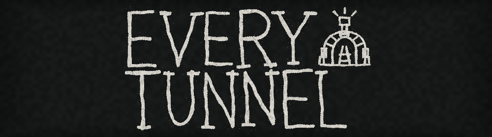

**A singleplayer psychological horror mod for Minecraft 1.20.1 (Fabric).**
*Chapter 1 complete · Chapter 2 demo*

You are the new night-shift security guard of the **Noname Complex**, an abandoned underground
facility. Your shift starts in the service elevator. Play with headphones: **sound is the game**.

| | |
|---|---|
| **Chapter 1** | **Level 1** is empty and teaches you to listen. **Level 2** adds the **Pale man**: tall, blind, and hunting by sound. **Level 3** is a vast, spotless library, and something in it watches. **Level 4** is the VIP lounge: warm, perfectly kept, and very glad you came. **Level 5** is the laboratory, where whatever was kept did not stay put. |
| **Chapter 2** *(demo)* | A prologue, then **Level 1**, a factory where you are the new hire under a supervisor, and **Level 2**, the catacombs below it and the **Stone Maw**. Unlocks when you finish Chapter 1. |

- **Sound-driven horror.** Footsteps, doors, your flashlight's click, even drinking: every action
  makes a noise with its own range, and walls muffle it. Sneak and he may never know you were there.
- **A blind hunter.** The Pale man walks to what he heard, runs at loud noises, and searches where
  he lost you. You hear his breathing, and the silence when he listens.
- **Danger of every kind.** A watcher who never hears but sees you once, creatures in the
  laboratory, a thing in the catacombs.
- **Puzzles and secrets.** Records, film reels, darts, breaker levers, safes cracked by ear, and
  company papers that say more than they should.
- **Survival on a budget.** Stamina, thirst and a flashlight battery.
- **21 achievements**, an in-game guide (main menu, GUIDE), and the whole game in English and
  Spanish (Spain).
- **Looks right with or without shaders.** Tuned for Complementary Reimagined; Bliss and Photon
  work too.

| | |
|---|---|
| **Minecraft** | 1.20.1, with **Fabric Loader** 0.19.5 or newer |
| **LambDynamicLights** | 4.4.0 or newer: it lights your flashlight |
| **Cardinal Components API** | 5.2.3 or newer: it keeps your progress |

The CurseForge app installs both with Every Tunnel. Fabric API, Fabric Language Kotlin, GeckoLib
and the map come inside the mod's file.

1. Create a Fabric 1.20.1 profile in your launcher.
2. Put the Every Tunnel `.jar`, LambDynamicLights and Cardinal Components API in `mods`
   (the CurseForge app does this for you).
3. Start the game and press **NEW GAME**. Chapter 2 is under **SELECT CHAPTER**.

The map appears in your worlds as **Noname Complex**, and **CONTINUE** takes you back to your last
level. Step-by-step guide, shader setup and troubleshooting:
[INSTALL.md](https://github.com/Daio7771/EveryTunnelMod/blob/main/INSTALL.md).

- **Sound Physics Remastered**: echoes and sound muffled behind walls. The sounds are made for it.
- **Sodium + Iris + Indium** with the **Complementary Reimagined** shader pack: set *RP Support* to
  *labPBR*, and leave *colored lighting* off (Every Tunnel turns it off on first start), or the lamps
  and your flashlight light nothing.

Keep the Music volume on: the music tells you things.

- Singleplayer, Fabric only, Minecraft 1.20.1 only.
- Chapter 2 is a demo and unlocks when you finish Chapter 1.
- Brightness always counts as "Moody" in the levels. The dark is part of the game.
- The mod replaces the title screen. **Ctrl+Shift+V** switches to Minecraft's and back.
- Your other worlds stay vanilla.

Report bugs on [GitHub](https://github.com/Daio7771/EveryTunnelMod/issues) with your
`logs/latest.log`. The [source code](https://github.com/Daio7771/EveryTunnelMod) is there too.

Made by **Daio7771**. **All rights reserved.** You may make and monetize videos and streams of the
game, and include it in modpacks that download it from CurseForge or GitHub. Please don't re-upload
it. The sounds are synthesized for the game or come from CC0 recordings, except the character voices.

**About AI.** The character voices (the Director's, and Chapter 2's characters) are ElevenLabs
library voices. The design, story and music are the author's, except Chapter 2's menu theme,
composed in code by Claude from CC0 samples and directed by the author. AI tools also helped with
the code, the asset tools and parts of the text.

Music: "Local Forecast - Elevator" Kevin MacLeod (incompetech.com)
Licensed under Creative Commons: By Attribution 4.0 License
http://creativecommons.org/licenses/by/4.0/

Chapter 2's menu theme is rendered from CC0 samples: "Old Piano FB" (FreePats) and "VSCO 2 CE
Solo Violin" (Versilian Studios, Sam Gossner).
