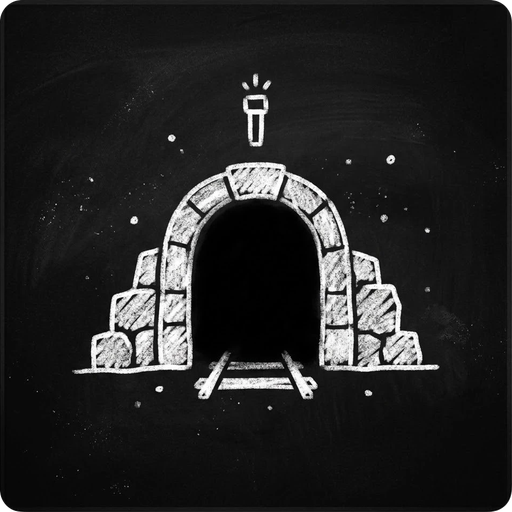

<p align="center">
  
</p>

<h1 align="center">Every Tunnel</h1>

<p align="center">
  <b>A singleplayer psychological horror mod for Minecraft 1.20.1 (Fabric)</b><br>
  Demo: Levels 1 to 3 · version 0.3.1
</p>

---

You are the new night-shift security guard of the **Noname Complex**, an abandoned
underground facility. Your shift starts in the service elevator and goes down through its
parking garage into the offices below.

**Level 1** is empty. It teaches you to listen. **Level 2** adds the **Pale man**: tall,
blind, and hunting by sound. Everything you do makes noise, and every noise tells him where
you were. **Level 3** is the complex's offices round a vast library, spotless and empty, and
something in the library watches. It never hears you. It only needs to see you once.

## Features

- **Sound-driven horror.** Footsteps, jumps, landings, doors, your flashlight's click, even
  drinking: every action makes a noise with its own range. Walls muffle it. Sneak, and he
  may never know you were there; sprint, and he comes running.
- **A blind hunter.** The Pale man stops and listens, walks to what he heard, runs at loud
  noises, and searches where he lost you. You hear him too: his bare feet, his breathing,
  and the silence when he holds his breath to listen.
- **A watcher who never hears.** In Level 3 the danger is being seen: stay out of its sight,
  keep low, keep your light off, and hide in a locker, as long as nothing saw you get in.
- **Puzzles and secrets.** Valves, boxes, books and a hatch to the bunker; company papers left
  on the desks say more than they should.
- **Your body is the warning system.** Your heartbeat speeds up as he gets closer, and the
  music follows what he is doing.
- **Survival on a budget.** Stamina, thirst and a flashlight battery, with a few batteries
  and water bottles left lying around by previous guards.
- **A complete demo.** Its own main menu, an elevator intro, three levels, 8 achievements,
  an ending and credits. Every time you open the world, a new shift starts.
- **An in-game guide** (main menu, GUIDE), in English and Spanish.
- **Looks right with or without shaders.** Tuned for Complementary Reimagined, with material
  maps for every texture. Plays fine on plain Minecraft too.

## Requirements

- **Minecraft 1.20.1**
- **Fabric Loader 0.19.5** or newer
- **[LambDynamicLights](https://modrinth.com/mod/lambdynamiclights)** 4.4.0 or newer for
  1.20.1: it gives your flashlight its light.
- That's it. Fabric API, Fabric Language Kotlin and GeckoLib come inside the mod's file, and
  so does the map.

## Installing

1. Install Fabric Loader for Minecraft 1.20.1.
2. Download the Every Tunnel `.jar` from
   [Releases](https://github.com/Daio7771/EveryTunnelMod/releases) and put it in your `mods`
   folder.
3. Download [LambDynamicLights](https://modrinth.com/mod/lambdynamiclights/versions?g=1.20.1)
   for 1.20.1 and put it in the same folder.
4. Start the game and press **BEGIN**.

Step-by-step instructions, recommended mods, shader setup and troubleshooting:
**[INSTALL.md](INSTALL.md)**.

## Recommended mods

Not required, but they make a big difference:

- **[Sound Physics Remastered](https://modrinth.com/mod/sound-physics-remastered)**: echoes
  in the garage and the library, and sounds muffled behind walls. The game's sounds are
  made for it.
- **[Sodium](https://modrinth.com/mod/sodium) + [Iris](https://modrinth.com/mod/iris) +
  [Indium](https://modrinth.com/mod/indium)** with the
  **[Complementary Reimagined](https://modrinth.com/shader/complementary-reimagined)**
  shader pack.

Play with headphones.

## Good to know

- **Singleplayer**, Fabric only, Minecraft 1.20.1 only.
- **This is a demo** of the first three levels. More of the Noname Complex is planned.
- The mod replaces the title screen with its own menu. **Ctrl+Shift+V** switches to
  Minecraft's title screen and back (other worlds, multiplayer).
- The mod only changes worlds that contain its levels. Your other worlds stay vanilla.

## Credits and license

Made by **Daio7771**: design, code, sound and art. **All rights reserved**
([LICENSE.txt](LICENSE.txt)): you may make and monetize videos and streams of the game and
include it in modpacks that download it from CurseForge or GitHub, but not re-upload it or
reuse its code, art or story. Versions 0.1.0 and 0.2.0 were released under MIT. The sounds
are synthesized for the game or come from CC0 recordings.

Music: "Local Forecast - Elevator" Kevin MacLeod (incompetech.com)
Licensed under Creative Commons: By Attribution 4.0 License
http://creativecommons.org/licenses/by/4.0/

Full credits: [CREDITS.md](CREDITS.md).

Found a bug? [Open an issue](https://github.com/Daio7771/EveryTunnelMod/issues) with your
`logs/latest.log`.

## For modders

Built with Kotlin on Fabric (Loom). You need JDK 17 and JDK 21.

```bash
./gradlew build              # the mod's jar and the unit tests
./gradlew runClient          # the game, at the main menu
./gradlew everytunnerBuild   # the release jar, with the map and the bundled dependencies
```

Everything else (setting up the dev worlds, the architecture, the level format, every system,
the Python tools that generate the sounds, textures and map) is in the documentation:
**[docs/](docs/README.md)**, in [English](docs/en/README.md) and
[Spanish](docs/es/README.md).
