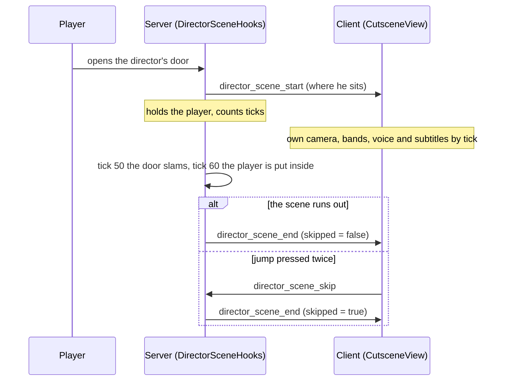

# Cinematic system

*[Versión en español](../es/cinematic-system.md) · [All pages](README.md)*

Level 5 ends with three scripted pieces, one after the other: **the director's scene** (a guided
camera, his voice, subtitles, a skip), **the fall** down the false exit, and **the final
credits**, followed by the congratulations window. This page explains how the director's scene
works, since it is the only one that takes the camera away from the player, and how the other two
are timed. The scene's place in the game is in [Game flow](game-flow.md#the-directors-scene).

## The pieces

| Layer | Files | Job |
|---|---|---|
| Plain Kotlin, unit tested (`core/cutscene/`) | `Cutscene.kt` | Camera poses, a scene's frame, shots, the fly-in and fly-out, the bands: where the camera is at any tick |
| | `DirectorScene.kt` | The director's scene built from his voice lines: framings, subtitles, gestures, gaze, the mask; `SkipPrompt` |
| | `DirectorLines.kt` | His voice lines and their subtitle cues, read from `cutscene/director.json` |
| | `DirectorLoop.kt` | The phrases he repeats afterwards |
| | `FinalCredits.kt` | The final credits' timeline |
| Server (`platform/`) | `DirectorSceneHooks.kt` | Starting, holding the player, the door, skipping, the end; `DirectorLoopHooks` (same file) |
| | `DirectorEntity.kt` | The director (GeckoLib); `DirectorHooks` puts him in his chair with the level |
| | `DirectorBlocks.kt` | `PairedDoorBlock`, his double door, which starts the scene |
| | `FalseExitHooks.kt`, `EndingHooks.kt` | The fall, and the end of the game |
| Client (`client/cutscene/`) | `CutsceneView.kt` | The camera, the HUD off, the player drawn from outside, his lines, the pose it gives the director, skipping |
| | `CutsceneScreen.kt` | Takes the keys and the mouse; the bands, the subtitles, the notice to skip |
| | `DirectorVoice.kt` | His phrases after the scene |
| | `render/DirectorRenderer.kt` | His model and its head turning |
| | `screen/FinalCreditsScreen.kt` | The final credits |
| Data | `assets/every_tunnel/cutscene/director.json`, `sounds/voice/director/*.ogg`, `lang/*.json` (`subtitle.every_tunnel.director.*`) | His lines: part, length, cues, voice files, subtitle text |
| Tools | `tools/sounds/voices.py`, `tools/entity/director.py` | Write the data above, and his model and animations |

The scene and the credits are plain data: the server counts ticks, the client asks the same
objects what to draw. Nothing in `core/cutscene` knows Minecraft, which is why the timing is unit
tested (`CutsceneTest`).

## How a scene runs

1. **Start.** Opening his door (`PairedDoorBlock.onUse`) calls `DirectorSceneHooks.doorOpened`. It
   starts only if the scene has not played since Level 5 was built, none is running, the world
   rules apply, the director's spawn point is within 24 blocks and the client can receive the
   packet. The server then holds the player (see below) and sends where he sits.
2. **The client takes over** (`CutsceneView.start`): a camera that exists only on the client
   becomes the view, the HUD is hidden (`InGameHudMixin` cancels `render` while
   `CutsceneView.active()`), the perspective is forced to first person (and restored at the end)
   and a `CutsceneScreen` takes every key and the mouse.
3. **Both sides count ticks** from the start with the same `Timeline` (`DirectorScene.SCENE`, built
   on both from `director.json`): the client draws, the server acts. At tick 50 the door slams
   shut, at 60 the player is moved just inside it, at the mask's tick the mask goes onto the desk.
4. **The end** is one function, `finish`, whether the scene runs out or is skipped, so the state
   afterwards is always the same: door shut and locked, the mask on the desk, his phrases started,
   the player inside the door, and that spot saved as the restart point (`ContinueGame.restartPoint`).
   Continuing from it finds him as he was left (`DirectorSceneHooks.levelBuilt`).

**Holding the player.** For the scene's length the server puts them back each tick if they have
moved (`requestTeleport`), zeroes their velocity, and refuses all damage to them; the client
screen takes their keys. The player is drawn from outside in the shots (`CutsceneView.drawPlayer`:
the game skips its own player whenever the camera is another entity, as in spectator), still: the
client zeroes their limb animation and velocity every tick.

**What is not saved.** The scene's state lives in memory only. Leaving the world during it drops
it; the next build of Level 5 plays it again. `doorLocked` is a plain flag read by both sides, as the
game is singleplayer (client and integrated server share a process).

## The camera

Everything is given from the scene's own point of view, so the shots are written once and fit
wherever Level 5's office is built.

- **`SceneFrame`**: a point on the floor and a yaw, here where the director sits, facing his door.
  `at(forward, right, up)` turns a place given from him into the world's.
- **`Shot(ticks, from, to, look)`**: the camera glides from one `Local` (forward, right, up) to
  another over `ticks`, eased (smoothstep), looking at a fixed place (`Look.At`) or at the player's
  eyes (`Look.Player`). Between two shots there is a **cut**.
- **`Cutscene(shots, flyIn, flyOut)`**: the black bands slide in over 20 ticks while the camera flies
  out of the player's eyes to the first shot (60 ticks), the shots follow, the camera flies back
  into the player's eyes (40 ticks, to where they stand at the end, which is inside the door) and the
  bands slide out. `pose(tick, ...)` and `bands(tick)` are all the client needs.
- **On the client**, `CutsceneView.place` puts the camera at tick *n* and lets the game blend to
  *n + 1* (its own interpolation between ticks); across a cut it puts it at *n + 1* already, so the
  cut does not blend. The camera is a marker entity that is never added to the world, with its eyes
  1.62 over its feet like a standing player's, so handing the view back moves nothing.
- **The bands** are 2.39:1 inside a 16:9 screen (`CutsceneScreen.BAND`), the subtitles go in the
  bottom one.

## The timeline comes from the voice

The director's lines are real recordings, so **their lengths set the pace** (`DirectorScene.build`):
each line begins after the one before with a pause (16 ticks, 30 between the speech's parts, 40
while he takes his mask off, 20 before the first), and nothing is hand-timed in ticks. Each of the
four framings (a wide shot pushing in; a close-up; over his shoulder at the player and then back
with his wall of monitors behind him; a wide one from the corner) lasts *until the pause after a
named line*, and cuts in the middle of that pause, never while he speaks. Everything else rides on
his lines too:

| What | How it is placed |
|---|---|
| Subtitles | One per cue of each line, from the cue's time (`director.json`) until the next cue, or 12 ticks after the voice, never past the next line's start |
| Gestures | A raised hand, a shrug, a tilt of the head, 8 ticks into chosen lines (`GESTURES`) |
| The mask | Starts coming off when the line before `boss_06` ends; lies on the desk 54 ticks later (`Timeline.maskDown`) |
| Standing and pointing | He stands 20 ticks into `boss_17`, points through `boss_18`, sits again after `boss_19` |
| Where he looks | `lookAway` ranges (the coffee, the subjects, the apology, the mask): his head turns to the player, or a little down, eased over 12 ticks (`Timeline.gazeAt`) |

Replacing a voice file therefore **retimes the whole scene**: run `tools/sounds/voices.py` (it
reads the lengths and finds each cue in the audio) and `tools/sounds/export.py`. `voices.py` writes
`cutscene/director.json` and the cues' texts into `en_us.json`; the Spanish subtitles live in `es_es.json`
and are not touched, so after a rerun check them: `LangFilesTest` fails if a key exists in one language and not in the other.

**Voice and subtitles.** Each line is the sound event `voice.director.<id>`, played flat (no
distance, no direction) under the Voice/Speech slider, so every shot hears the same. Subtitles come
whole, a cue at a time, never ahead of the voice, white after his name in grey
(`subtitle.every_tunnel.speaker.director`), centred, short enough for two lines.

## The director

`DirectorEntity` is a GeckoLib entity that nothing can touch and that is never saved
(`DirectorHooks` puts it back whenever Level 5 is built; `KeptEntities` keeps it if its chunk
unloads). He sits in his chair; standing and every gesture are animations
(`animation.director.idle`, `raise_hand`, `shrug`, `tilt`, `mask_off`, `stand`, `point`), made by
`tools/entity/director.py`.

- **During the scene** his pose comes from the client's timeline: `CutsceneView` sets
  `DirectorEntity.poseSource`, and the entity asks it what he does now (the action, how much he
  looks at the player, whether the mask is off). A skip shows him as the scene ends: breathing, the
  mask off.
- **Outside it** he breathes. With the mask on he looks at the player; after it, as much as the
  server's `look` says, which `DirectorLoopHooks` raises while he says a phrase (synced entity data,
  eased on the client).
- **The mask** is a bone on its own plate (the Cinema film's mask, `film_walker.paint_mask`). The
  server marks `maskOff` for good once it lies on his desk, as a block (`director_mask`, face up),
  and the model hides the bone. `/everytunnel director` puts it back on his face.
- **His head** follows the player's eyes as far as his pose's gaze says (`DirectorModel`).

## After the scene: his phrases

While the player stays in his office (the zone `director_office`) he repeats six phrases
(`voice.director.loop_1` to `loop_6`), from the last to the first, and round again
(`DirectorLoop`): one every 20 to 30 seconds after the one before ends; if the player leaves, he waits
at least 5 seconds after they return. He never attacks. Each time he looks at the player 15% less
(`DirectorLoop.gaze`). `DirectorLoopHooks` sends the phrase's id in `director_phrase`; the client
(`DirectorVoice`) plays it flat and shows its subtitles above the HUD on a dark strip. His
phrases stop when the false exit's floor gives way.

## The fall and the final credits

- **The fall** (`FalseExitHooks`): stepping onto the corridor's last stretch (zone tagged
  `false_exit_pit`) brings the lid down: rumble, shaking, dust, flickering lights; 8 ticks later
  the lid falls away with the player, who is unharmed; the fall's music plays in their head
  (`false_exit_fall`); two thirds of the way down the screen goes black; after the music's last
  hit, three seconds of black and silence.
- **The end** (`EndingHooks.theEnd`): the saved game is erased and `ending` is sent with the time
  played and the deaths.
- **The credits** (`FinalCreditsScreen`, timed by `core.cutscene.FinalCredits`, 94 s): black and
  silence, "THE END", the song comes in 2 s later, "Every Tunnel"; four screens of 18 s (the
  author's drawing fading in over 1.5 s, the title typed a letter every 0.045 s, its lines one by
  one, the credits under both); the tools, a group every 2 s; "Thank you for playing"; "Level 6
  coming soon"; black. Esc fades out at any moment. Then the congratulations window.

The credits' texts are the lang keys `every_tunnel.credits.*`; the drawings are
`tools/gui/credits_art.py`'s.

## Adding another cinematic

Today `CutsceneView` and `CutsceneScreen` read `DirectorScene.SCENE` directly, so there is one
scene. A second one needs, in this order:

1. A scene object in `core/cutscene` that builds a `Timeline` (a `Cutscene` of `Shot`s in a
   `SceneFrame`, plus whatever rides on it), and a test for its timing in `CutsceneTest`.
2. `CutsceneView` and `CutsceneScreen` taking a `Timeline` instead of the director's: the start
   packet would carry which scene and its frame.
3. A hook like `DirectorSceneHooks`: a trigger, holding the player and refusing damage, one
   `finish` for the end and for a skip, the state afterwards, and what happens if the player leaves
   or the level is built again.
4. Voice files, if it has voices: `tools/sounds/voices.py` is written for the director's files (a
   new speaker needs its own list, speaker label and keys), and the sound rule in
   [Audio](audio.md) applies: the director's voice is the one AI exception.
5. This page, the code map and the packets table, in both languages.

## Debugging

- `/everytunnel director` puts you before his door (build Level 5 first with `/everytunnel setlevel 5`),
  his scene ready to play again and his mask back on. Opening the door plays it from the start.
- `/everytunnel congrats` opens the congratulations window with this game's numbers.
- The log says `Level 5: the director's scene begins (N s)`, then `ends` or `skipped`, and
  `Level 5: past the director's scene (checkpoint), his phrases start` when a game continues past it.
- A scene that never starts: the door must be his (`PairedDoorBlock` near the spawn point tagged
  `director`), the scene must not have played this build, and `canSend` must hold (the client has the
  mod).

## Tests

`CutsceneTest` (`core/cutscene`) checks the frame's maths, blending the short way round, the shots
and bands, the skip prompt, the director's pauses and cuts, the subtitles, the mask, standing and
pointing, his gaze, the loop (order, gaps, gaze) and the final credits' timeline. `CameraAimTest`
(`core/camera`) checks the anteroom's security camera.
