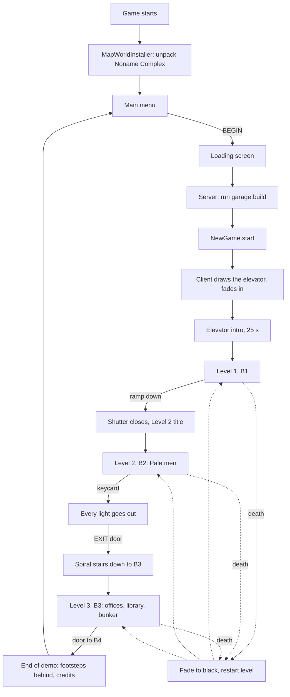

# Game flow

*[Versión en español](../es/game-flow.md) · [All pages](README.md)*

The demo plays from the main menu to the end credits. This page follows one playthrough
and names the code behind each step.

## 1. Start-up

- `client.MapWorldInstaller` runs once as the client starts. If the jar carries the map
  world (`every_tunnel/world/noname_complex.zip`) and `saves/noname_complex` is missing, it
  unpacks it, removes the stored player from `level.dat` and names it "Noname Complex". If
  the world was installed by an older version of the mod, only its datapacks and
  `resources.zip` are replaced.
- `client.ShaderSettings` writes the recommended settings into any Complementary pack in
  `shaderpacks/`, once per pack and settings version (see [Graphics](graphics.md)).
- The Mojang splash screen plays as usual.

## 2. Main menu

`client.screen.MainMenuScreen` replaces vanilla's title screen wherever the game would open
it (`MinecraftClientMixin`): at start-up, after leaving a world, after the credits, and when a
screen closes with no world open (Escape in the options).

- **BEGIN** opens Noname Complex. If the world is missing it says "The map is missing.
  Reinstall the mod."
- **OPTIONS** opens vanilla's options.
- **GUIDE** opens the [player guide](guide/01-how-to-play.md) (`GuideScreen`): one sheet of
  worn white paper, scrolled with the wheel, with paper tabs to jump between the contents and
  each page. It is in the game's language (Spanish for any `es_*`, English otherwise). The
  language itself is changed in OPTIONS.
  Its last tab, **Credits**, rolls the credits (`EndOfDemoScreen.credits`) and comes back.
- **ACHIEVEMENTS** lists the [achievements](#achievements) (`AchievementsScreen`) on the same
  worn paper.
- **EXIT** closes the game.
- Behind it all, a parking hall seen down its aisle from a fixed camera (`MenuScene`), its
  lamps flickering now and then. The logo and options sit on black, which fades out towards
  the right to show the hall. See [Graphics](graphics.md#the-menu-scene).
- **Ctrl+Shift+V** swaps to vanilla's title screen (other worlds, multiplayer, mods) and
  back.
- `MenuMusic` plays `music.menu`, then 15 s of silence, again and again; `MusicTrackerMixin` keeps vanilla music off everywhere.

## 3. Opening the world

Client side (`client.screen.LoadingScreen.kt`, object `LoadingCover`):

- `WorldListEntryMixin` (world list) or `QuickPlayMixin` (quick play) notices that the world
  has levels before vanilla starts reading it.
- From then on one black screen covers everything: vanilla's loading screens
  (`ScreenMixin`) and the resource pack reload splash (`SplashOverlayMixin`). It shows a
  rotating tip (`LoadingTips`, 7 s each) and "Loading...".
- The game is silent: `SoundSystemMixin` scales every volume by `LoadingCover.worldVolume`.

Server side (`platform.LoadingHooks`):

1. When the server starts, every level's `build` function runs once (`garage:build`). The
   function force-loads the map, waits for its chunks, builds both levels and ends with
   `/everytunnel rebuilt`, which puts the loot back (`NewGame.levelsRebuilt`).
2. A joining player is *loading*: frozen, invulnerable, silent, no resource drain, no
   intro. The client is sent state `0`.
3. Once the build has reported back, a Survival or Adventure player gets a **new game**
   (`NewGame.start`). Creative and Spectator players are left where they are.
4. The light is sent again. The build runs while the player joins, so the chunks they
   were sent can carry light from before it (the elevator once had sky light and no lamp).
   After at least 1 s, once the light engine has no updates left (at most 10 s), the light
   of every loaded chunk in the view distance is sent again (`resendLight`).
5. The client is sent state `1` (ready). It waits until the terrain around the player is
   drawn, fades picture and sound in together, and answers `loading_done`.
6. The player is free and the intro starts.

Safety nets: a build that never reports back is given up after 120 s; a client that
never answers is let go after 30 s.

## 4. A new game

`platform.NewGame.start` resets the world and the player:

- **World:** every shutter opens (`LevelEntryHooks.openAll`), all loot is back
  (`LootSpawner.restock`), the lights the keycard put out are back and the card readers
  locked (`KeycardHooks`), and every Pale man returns to his spawn point
  (`PaleManSpawner.startNewGame`; those in unloaded chunks when their chunk loads).
- **Player:** empty inventory, full health and resources, Survival, at the start of the
  first level with an intro, and the intro plays again (`IntroHooks.replay`).

`/everytunnel newgame` does the same at any time.

## 5. The elevator intro

`platform.IntroHooks`, driven by the level's `intro` (see [Levels](levels.md)):

- The player stands in the zone tagged `start` (the service elevator). The doors (zones
  tagged `elevator_door`) are closed with `ElevatorDoorBlock`s.
- The client plays the intro song (`music.elevator`, Kevin MacLeod's "Local Forecast –
  Elevator") through `IntroMusic`. The floor indicators near the doors count down
  3, 2, 1, G, B1 (`FloorIndicatorBlock`).
- After `intro.seconds` (25): the bell (`block.elevator.ding`), the song slows down, wavers
  and fades over 3 s like a tape running down, and the doors slide open in stages
  (`block.elevator.doors`).
- The level's `entry` title shows ("Level 1", `LevelEntryHooks.announce`).

The world remembers who has had the intro (`every_tunnel_intro.dat`), so dying later
brings the player back to the elevator with the doors open.

## 6. Level 1 (B1)

No enemies. Five parking halls that get worse as you go, side rooms with loot, ambience
(drone, drips, relays, rumbles), humming and flickering fluorescent lights. The player
learns the flashlight, stamina, thirst and how loud things are. A ramp at the end leads
down.

## 7. Into Level 2

`platform.LevelEntryHooks`: walking into a level with a higher `order` than the one you
came from:

- Shows its `entry` title ("Level 2") and plays its sound in the player's head.
- Closes every zone of the new level tagged `shutter` once the player is past it: the
  empty blocks fill with `ShutterBlock`s row by row from the top, with a rattle and a slam
  (`block.shutter.close`). There is no way back.

Reopening the world or respawning inside a level does not count as walking in.

## 8. Level 2 (B2)

- Five darker halls. `PaleManSpawner` puts a Pale man at every `pale_man` spawn point the
  first time the player enters: one per hall, two in hall 5, each kept in his hall by the
  spawn point's `zone`. See [Noise and the Pale man](noise-and-pale-man.md).
- **The keycard** lies on the counter of a glass booth in hall 5 (`LootBlock` at a spawn
  point tagged `keycard`). Picking it up (`KeycardHooks.pickedUp`) puts out every light
  still on in B2 in a wave spreading from the player, 0.75 blocks per tick, the nearest
  ones heard powering down; only the lamps of the stair shaft stay on (zone tagged
  `lights_stay`).
- **The exit:** an EXIT door by hall 3 with a `CardReaderBlock`. Without the card it
  buzzes "It needs a keycard"; with it, it beeps, turns green and opens the iron doors
  next to it (zone tagged `keycard_door`), and everyone there earns "Employee of the Month"
  (see [Achievements](#achievements)).
- **The stairs to B3:** behind the door, a round shaft of metal panels with grating stairs
  spiralling down 4 turns (32 blocks, half a block per step) around an open well, railed
  with iron bars and lit by a wall lamp every half turn. At the bottom, a small landing
  and an open door under the "B3" sign: the way into Level 3.

## 9. Level 3 (B3)

The offices of the complex around the central library, in perfect order and empty. Built
so far: the structure, the furniture and the valve puzzle; the observant guard, the books,
the other notes and the loot are still to come, their zones and spawn points already in the
level file (see [Levels](levels.md#level-3-hooks)). The music is planned for last.

- Behind the open door, stairs climb down 8 blocks to the **antechamber**, the electrical
  room. Walking into it shows "Level 3" (the stairs belong to no zone); its spawn point
  tagged `player` is there. On its wall, a cork board with the electrician's note
  (`NoteBoardBlock`): right-clicked, it opens on paper (`NoteScreen`) and tells, in words,
  how many full turns each valve needs.
- North, the **valve corridor**: five valves (A to E) on its east wall, each a `ValveBlock`
  inline in a pipe, then a wall with a closed double emergency door, the **checkpoint**.
- **The valve puzzle** (`ValveHooks`): a new game draws a digit 0 to 9 for each valve and
  puts every valve on 0. A right-click turns a valve once more (from 9 back to 0), with a
  clunk and water in the pipe; the plate on each side shows its letter and its turns. When
  all five show their digits, a water hammer bangs through the pipe, the valves lock open
  and the checkpoint's doors (zone tagged `valve_door`) open, and "Under Pressure" is
  earned. Getting it wrong costs
  nothing. Dying keeps what is solved; only a new game sets it back.
  `/everytunnel valves` shows the digits.
- Past it, through the belt of 17 rooms, the **inner corridor**: a ring round the
  **central library** (64 × 64, 12 high, lit by lights hanging on chains). Every light is
  on; the surfaces are clean.
- Every room is furnished for what it is, tidy and no more than it needs (desks with their
  chairs and phones, filing cabinets, server racks, lockers, the cafeteria's tables...); the
  library has rows of bookshelves four high, two blocks apart, round a clearing with reading
  tables, and the librarian's counter by the south door. Nobody is there.
- **Lockers to hide in:** every room has at least one (the Lockers and Changing rooms are
  full of them; the library has none). Right-clicking a locker from in front of its door
  gets in (`HidingHooks`): the player rides an invisible seat on the locker's floor
  (`LockerSeatEntity`), facing out, the head turning at most 30° to the sides and 15° up or
  down (`core.hiding.LookLimit`), the screen covered by the inside of the door with its
  vent's slits (`client.hud.LockerView`). Inside, the player makes no noise at all. Right-
  clicking again or sneaking gets out in front of the door; both ways the door's sound plays
  (`block.locker.door`, not a noise for enemies). A new game takes everyone out.
- In the library's centre, the **bunker hatch**: iron trapdoors (shut) in a frame of checker
  plate. Under it a ladder goes down a shaft to a lit corridor that runs 32 blocks south to
  the door to B4, where the demo ends.

## 10. The end

`platform.EndingHooks`: at the end of Level 3's bunker corridor, in front of the door to
B4, the player walks into a zone tagged `end`.

1. Five bare footsteps come down behind the player, each a little closer and lower (the
   Pale man's own step sound).
2. The screen fades to black over 2.5 s.
3. The server sends `ending`; the client opens `EndOfDemoScreen`: "End of demo" fades in,
   then the credits roll (the CC BY music credit among them) until "Thank you for playing."
4. Any key after a moment, Esc, or a timeout saves the world and returns to the main menu.

Opening the world again starts a new game, as always.

## Death

`platform.DeathHooks`: while the world rules apply, a player who would die stays alive
instead:

1. `event.death` plays and the screen fades to black (`screen_fade`, 1.5 s). The player
   cannot move and nothing hurts them.
2. In the dark they are moved to the start of the level they were last in (its first spawn
   point tagged `player`), with full health and resources. That level's Pale men go back
   to their spawn points and start over.
3. The screen fades back in.

The inventory is kept: what was picked up stays picked up. A player who never entered a
level dies the vanilla way. `RespawnHooks` also sets the vanilla respawn point to the
current level's start, as a fallback.

## Achievements

Eight achievements (`core.achievement.Achievement`, in list order). The server says when one
is earned (`platform.AchievementHooks`, only in worlds with levels), once per game: earning
it again in the same game (a second death to a Pale man) shows nothing, and a new game lets
them all come again. The client shows the "Achievement Unlocked!" toast, drawn like vanilla's
challenge toast with its fanfare
(`client.hud.AchievementToast`), and remembers it for good in
`config/every_tunnel/achievements.json` (`client.AchievementStore`), across games and worlds.
The vanilla advancements are not touched.

| Achievement | Earned when | Icon |
|---|---|---|
| First Day at Work | walking out of the elevator (the zone tagged `start` of a level with an intro) | the guard's badge |
| Stay Hydrated | drinking a water bottle (`DrinkHooks`) | the water bottle |
| Beware of Tall Men | walking into Level 2 (`AchievementHooks.LEVEL_ENTRIES`) | the Pale man's silhouette |
| Ouch! | killed by a Pale man (`DeathHooks`) | a skull |
| Employee of the Month | the keycard opens the exit's reader (everyone in the world) | the keycard |
| Under Pressure | Level 3's valves are right (everyone in the world) | the valve |
| Master of the Boxes | Level 3's boxes are on Storage's shelf (to come) | (to come) |
| Shhh! | Level 3's books are back on the librarian's counter (to come) | (to come) |

The ACHIEVEMENTS screen in the main menu (`client.screen.AchievementsScreen`) lists them on
the guide's paper (`client.screen.Paper`) with how many are earned; one not earned yet shows a
"?" and "Not yet unlocked". The texts are in the lang file (`achievement.every_tunnel.<id>`, its
`.description`, `toast.every_tunnel.achievement_unlocked`); the badge, skull, silhouette and
"?" icons come from `tools/gui/achievement_icons.py`, the others are the mod's items
(`client.AchievementIcons`; the book is vanilla's until Level 3's books exist). An own sound
in place of the fanfare is planned.
