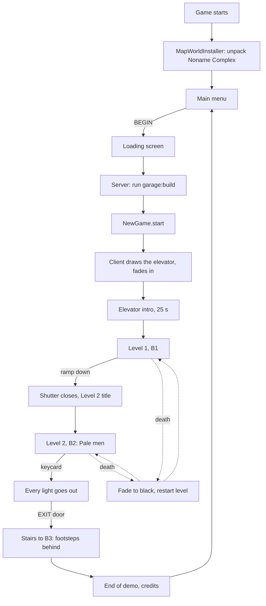

# Game flow

*[Versión en español](../es/game-flow.md) · [All pages](README.md)*

The demo plays from the main menu to the end credits. This page follows one playthrough
and names the code behind each step.

## 1. Start-up

- `client.MapWorldInstaller` runs once as the client starts. If the jar carries the map
  world (`every_tunnel/world/noname_complex.zip`) and `saves/noname_complex` is missing, it
  unpacks it, removes the stored player from `level.dat` and names it "Noname Complex". If
  the world was installed by an older version of the mod, only its datapacks and
  `resources.zip` are replaced.
- `client.ShaderSettings` writes the recommended settings into any Complementary pack in
  `shaderpacks/`, once per pack and settings version (see [Graphics](graphics.md)).
- The Mojang splash screen plays as usual.

## 2. Main menu

`client.screen.MainMenuScreen` replaces vanilla's title screen wherever the game would open
it (`MinecraftClientMixin`): at start-up, after leaving a world, after the credits.

- **BEGIN** opens Noname Complex. If the world is missing it says "The map is missing.
  Reinstall the mod."
- **OPTIONS** opens vanilla's options.
- **GUIDE** opens the [player guide](guide/01-how-to-play.md) (`GuideScreen`): one sheet of
  worn white paper, scrolled with the wheel, with paper tabs to jump between the contents and
  each page. It is in the game's language (Spanish for any `es_*`, English otherwise). The
  language itself is changed in OPTIONS.
- **CREDITS** rolls the credits (`EndOfDemoScreen.credits`) and comes back.
- **EXIT** closes the game.
- After 15 s without moving the mouse, the Pale man's silhouette fades in on the right
  (`MenuFigure`); any movement makes it vanish.
- **Ctrl+Shift+V** swaps to vanilla's title screen (other worlds, multiplayer, mods) and
  back.
- `MenuMusic` loops `music.menu`; `MusicTrackerMixin` keeps vanilla music off everywhere.

## 3. Opening the world

Client side (`client.screen.LoadingScreen.kt`, object `LoadingCover`):

- `WorldListEntryMixin` (world list) or `QuickPlayMixin` (quick play) notices that the world
  has levels before vanilla starts reading it.
- From then on one black screen covers everything: vanilla's loading screens
  (`ScreenMixin`) and the resource pack reload splash (`SplashOverlayMixin`). It shows a
  rotating tip (`LoadingTips`, 7 s each) and "Loading...".
- The game is silent: `SoundSystemMixin` scales every volume by `LoadingCover.worldVolume`.

Server side (`platform.LoadingHooks`):

1. When the server starts, every level's `build` function runs once (`garage:build`). The
   function force-loads the map, waits for its chunks, builds both levels and ends with
   `/everytunnel rebuilt`, which puts the loot back (`NewGame.levelsRebuilt`).
2. A joining player is *loading*: frozen, invulnerable, silent, no resource drain, no
   intro. The client is sent state `0`.
3. Once the build has reported back, a Survival or Adventure player gets a **new game**
   (`NewGame.start`). Creative and Spectator players are left where they are.
4. The client is sent state `1` (ready). It waits until the terrain around the player is
   drawn, fades picture and sound in together, and answers `loading_done`.
5. The player is free and the intro starts.

Safety nets: a build that never reports back is given up after 120 s; a client that
never answers is let go after 30 s.

## 4. A new game

`platform.NewGame.start` resets the world and the player:

- **World:** every shutter opens (`LevelEntryHooks.openAll`), all loot is back
  (`LootSpawner.restock`), the lights the keycard put out are back and the card readers
  locked (`KeycardHooks`), and every Pale man returns to his spawn point
  (`PaleManSpawner.startNewGame`; those in unloaded chunks when their chunk loads).
- **Player:** empty inventory, full health and resources, Survival, at the start of the
  first level with an intro, and the intro plays again (`IntroHooks.replay`).

`/everytunnel newgame` does the same at any time.

## 5. The elevator intro

`platform.IntroHooks`, driven by the level's `intro` (see [Levels](levels.md)):

- The player stands in the zone tagged `start` (the service elevator). The doors (zones
  tagged `elevator_door`) are closed with `ElevatorDoorBlock`s.
- The client plays the intro song (`music.elevator`, Kevin MacLeod's "Local Forecast –
  Elevator") through `IntroMusic`. The floor indicators near the doors count down
  3, 2, 1, G, B1 (`FloorIndicatorBlock`).
- After `intro.seconds` (25): the bell (`block.elevator.ding`), the song slows down, wavers
  and fades over 3 s like a tape running down, and the doors slide open in stages
  (`block.elevator.doors`).
- The level's `entry` title shows ("Level 1", `LevelEntryHooks.announce`).

The world remembers who has had the intro (`every_tunnel_intro.dat`), so dying later
brings the player back to the elevator with the doors open.

## 6. Level 1 (B1)

No enemies. Five parking halls that get worse as you go, side rooms with loot, ambience
(drone, drips, relays, rumbles), humming and flickering fluorescent lights. The player
learns the flashlight, stamina, thirst and how loud things are. A ramp at the end leads
down.

## 7. Into Level 2

`platform.LevelEntryHooks`: walking into a level with a higher `order` than the one you
came from:

- Shows its `entry` title ("Level 2") and plays its sound in the player's head.
- Closes every zone of the new level tagged `shutter` once the player is past it: the
  empty blocks fill with `ShutterBlock`s row by row from the top, with a rattle and a slam
  (`block.shutter.close`). There is no way back.

Reopening the world or respawning inside a level does not count as walking in.

## 8. Level 2 (B2)

- Five darker halls. `PaleManSpawner` puts a Pale man at every `pale_man` spawn point the
  first time the player enters: one per hall, two in hall 5, each kept in his hall by the
  spawn point's `zone`. See [Noise and the Pale man](noise-and-pale-man.md).
- **The keycard** lies on the counter of a glass booth in hall 5 (`LootBlock` at a spawn
  point tagged `keycard`). Picking it up (`KeycardHooks.pickedUp`) puts out every light
  still on in B2 in a wave spreading from the player, 0.75 blocks per tick, the nearest
  ones heard powering down.
- **The exit:** an EXIT door by hall 3 with a `CardReaderBlock`. Without the card it
  buzzes "It needs a keycard"; with it, it beeps, turns green and opens the iron doors
  next to it (zone tagged `keycard_door`).

## 9. The end

`platform.EndingHooks`: a few steps down the stairs to B3 the player walks into a zone
tagged `end`.

1. Five bare footsteps come down the stairs behind the player (the Pale man's own step
   sound).
2. The screen fades to black over 2.5 s.
3. The server sends `ending`; the client opens `EndOfDemoScreen`: "End of demo" fades in,
   then the credits roll (the CC BY music credit among them) until "Thank you for playing."
4. Any key after a moment, Esc, or a timeout saves the world and returns to the main menu.

Opening the world again starts a new game, as always.

## Death

`platform.DeathHooks`: while the world rules apply, a player who would die stays alive
instead:

1. `event.death` plays and the screen fades to black (`screen_fade`, 1.5 s). The player
   cannot move and nothing hurts them.
2. In the dark they are moved to the start of the level they were last in (its first spawn
   point tagged `player`), with full health and resources. That level's Pale men go back
   to their spawn points and start over.
3. The screen fades back in.

The inventory is kept: what was picked up stays picked up. A player who never entered a
level dies the vanilla way. `RespawnHooks` also sets the vanilla respawn point to the
current level's start, as a fallback.
