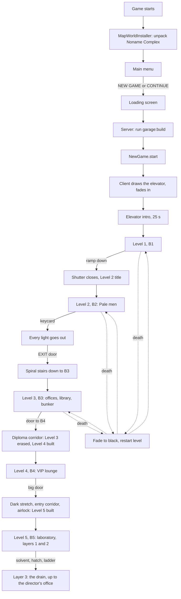

# Game flow

*[Versión en español](../es/game-flow.md) · [All pages](README.md)*

The demo plays from the main menu to the end credits. This page follows one playthrough
and names the code behind each step.

## 1. Start-up

- `client.MapWorldInstaller` runs once as the client starts. If the jar carries the map
  world (`every_tunnel/world/noname_complex.zip`) and `saves/noname_complex` is missing, it
  unpacks it, removes the stored player from `level.dat` and names it "Noname Complex". If
  the world was installed by an older version of the mod, only its datapacks and
  `resources.zip` are replaced.
- `client.ShaderSettings` writes the recommended settings into any Complementary pack in
  `shaderpacks/`, once per pack and settings version (see [Graphics](graphics.md)).
- The Mojang splash screen plays as usual.

## 2. Main menu

`client.screen.MainMenuScreen` replaces vanilla's title screen wherever the game would open
it (`MinecraftClientMixin`): at start-up, after leaving a world, after the credits, and when a
screen closes with no world open (Escape in the options).

- **NEW GAME** opens Noname Complex; with a saved game **CONTINUE** takes its place (`platform.ContinueGame`), and Ctrl+Shift+D erases that game after asking (`EraseSaveScreen`). A saved game has: checkpoints at each level's start, Level 4 kept as it was left (`core.save.LoungeSave`), but for taking the key, and erased by the credits. If the world is missing it says "The map is missing.
  Reinstall the mod."
- **OPTIONS** opens vanilla's options.
- **GUIDE** opens the [player guide](guide/01-how-to-play.md) (`GuideScreen`): one sheet of
  worn white paper, scrolled with the wheel, with paper tabs to jump between the contents and
  each page. It is in the game's language (Spanish for any `es_*`, English otherwise). The
  language itself is changed in OPTIONS.
- **ACHIEVEMENTS** lists the [achievements](#achievements) (`AchievementsScreen`) on the same
  worn paper.
- **EXIT** closes the game.
- Behind it all, a parking hall seen down its aisle from a fixed camera (`MenuScene`), its
  lamps flickering now and then. The logo and options sit on black, which fades out towards
  the right to show the hall. See [Graphics](graphics.md#the-menu-scene).
- **Ctrl+Shift+V** swaps to vanilla's title screen (other worlds, multiplayer, mods) and
  back.
- `MenuMusic` plays `music.menu`, then 15 s of silence, again and again; `MusicTrackerMixin` keeps vanilla music off everywhere.

## 3. Opening the world

Client side (`client.screen.LoadingScreen.kt`, object `LoadingCover`):

- `WorldListEntryMixin` (world list) or `QuickPlayMixin` (quick play) notices that the world
  has levels before vanilla starts reading it.
- From then on one black screen covers everything: vanilla's loading screens
  (`ScreenMixin`) and the resource pack reload splash (`SplashOverlayMixin`). It shows a
  rotating tip (`LoadingTips`, 7 s each) and "Loading...".
- The game is silent: `SoundSystemMixin` scales every volume by `LoadingCover.worldVolume`.

Server side (`platform.LoadingHooks`):

1. When the server starts, every level's `build` function runs once (`garage:build`). The
   function force-loads the map, waits for its chunks, builds both levels and ends with
   `/everytunnel rebuilt`, which puts the loot back (`NewGame.levelsRebuilt`).
2. A joining player is *loading*: frozen, invulnerable, silent, no resource drain, no
   intro. The client is sent state `0`.
3. Once the build has reported back, a Survival or Adventure player gets a **new game**
   (`NewGame.start`). Creative and Spectator players are left where they are.
4. The light is sent again. The build runs while the player joins, so the chunks they
   were sent can carry light from before it (the elevator once had sky light and no lamp).
   After at least 1 s, once the light engine has no updates left (at most 10 s), the light
   of every loaded chunk in the view distance is sent again (`resendLight`).
5. The client is sent state `1` (ready). It waits until the terrain around the player is
   drawn, fades picture and sound in together, and answers `loading_done`.
6. The player is free and the intro starts.

Safety nets: a build that never reports back is given up after 120 s; a client that
never answers is let go after 30 s.

## 4. A new game

`platform.NewGame.start` resets the world and the player:

- **World:** every shutter opens (`LevelEntryHooks.openAll`), all loot is back
  (`LootSpawner.restock`), the lights the keycard put out are back and the card readers
  locked (`KeycardHooks`), and every Pale man returns to his spawn point
  (`PaleManSpawner.startNewGame`; those in unloaded chunks when their chunk loads).
- **Player:** empty inventory, full health and resources, Survival, at the start of the
  first level with an intro, and the intro plays again (`IntroHooks.replay`).

`/everytunnel newgame` does the same at any time.

## 5. The elevator intro

`platform.IntroHooks`, driven by the level's `intro` (see [Levels](levels.md)):

- The player stands in the zone tagged `start` (the service elevator). The doors (zones
  tagged `elevator_door`) are closed with `ElevatorDoorBlock`s.
- The client plays the intro song (`music.elevator`, Kevin MacLeod's "Local Forecast –
  Elevator") through `IntroMusic`. The floor indicators near the doors count down
  3, 2, 1, G, B1 (`FloorIndicatorBlock`).
- After `intro.seconds` (25): the bell (`block.elevator.ding`), the song slows down, wavers
  and fades over 3 s like a tape running down, and the doors slide open in stages
  (`block.elevator.doors`).
- The level's `entry` title shows ("Level 1", `LevelEntryHooks.announce`).

The world remembers who has had the intro (`every_tunnel_intro.dat`), so dying later
brings the player back to the elevator with the doors open.

## 6. Level 1 (B1)

No enemies. Five parking halls that get worse as you go, side rooms with loot, ambience
(drone, drips, relays, rumbles), humming and flickering fluorescent lights. The player
learns the flashlight, stamina, thirst and how loud things are. A ramp at the end leads
down.

## 7. Into Level 2

`platform.LevelEntryHooks`: walking into a level with a higher `order` than the one you
came from:

- Shows its `entry` title ("Level 2") and plays its sound in the player's head.
- Closes every zone of the new level tagged `shutter` once the player is past it: the
  empty blocks fill with `ShutterBlock`s row by row from the top, with a rattle and a slam
  (`block.shutter.close`). There is no way back.

Reopening the world or respawning inside a level does not count as walking in.

## 8. Level 2 (B2)

- Five darker halls. `PaleManSpawner` puts a Pale man at every `pale_man` spawn point the
  first time the player enters: one per hall, two in hall 5, each kept in his hall by the
  spawn point's `zone`. See [Noise and the Pale man](noise-and-pale-man.md).
- **The keycard** lies on the counter of a glass booth in hall 5 (`LootBlock` at a spawn
  point tagged `keycard`). Picking it up (`KeycardHooks.pickedUp`) puts out every light
  still on in B2 in a wave spreading from the player, 0.75 blocks per tick, the nearest
  ones heard powering down; only the lamps of the stair shaft stay on (zone tagged
  `lights_stay`).
- **The exit:** an EXIT door by hall 3 with a `CardReaderBlock`. Without the card it
  buzzes "It needs a keycard"; with it, it beeps, turns green and opens the iron doors
  next to it (zone tagged `keycard_door`), and everyone there earns "Employee of the Month"
  (see [Achievements](#achievements)).
- **The stairs to B3:** behind the door, a round shaft of metal panels with grating stairs
  spiralling down 4 turns (32 blocks, half a block per step) around an open well, railed
  with iron bars and lit by a wall lamp every half turn. At the bottom, a small landing
  and an open door under the "B3" sign: the way into Level 3.

## 9. Level 3 (B3)

The offices of the complex around the central library, in perfect order and empty. Built
so far: the structure, the furniture, the valve puzzle, the lockers, the box and book
puzzles that open the bunker, the Observer, the company's documents, the loot, the room
nameplates and the bunker tunnel with its collapse (see [Levels](levels.md#level-3-hooks)).
There is no music of its own (one is ready for Level 4).

The **ambience** is the near-silence of an empty office building (`ambient.offices.room_tone`)
with, rarely (every 1.5 to 4 minutes), a phone ringing somewhere far off and stopping
mid-ring (`ambient.offices.phone`); the library has a slow clock ticking from nowhere in place
of the room tone (`ambient.library.clock`, the library zone's own ambience), and the bunker is
silent.

- Behind the open door, stairs climb down 8 blocks to the **antechamber**, the electrical
  room, in a tall hall with a flat ceiling (the top landing's) lit by three rows of lights;
  high on the wall over the way into the antechamber, big dark letters read "OFFICES &
  LIBRARY" (`ENTRANCE_SIGN`), seen all the way down. Walking into it shows "Level 3" (the stairs belong to no zone); its spawn point
  tagged `player` is there. On its wall, a cork board with the electrician's note
  (`NoteBoardBlock`): right-clicked, it opens on paper (`NoteScreen`) and tells, in words,
  how many full turns each valve needs.
- North, the **valve corridor**: five valves (A to E) on its east wall, each a `ValveBlock`
  inline in a pipe, then a wall with a closed double emergency door, the **checkpoint**.
- **The valve puzzle** (`ValveHooks`): a new game draws a digit 0 to 9 for each valve and
  puts every valve on 0. A right-click turns a valve once more (from 9 back to 0), with a
  clunk and water in the pipe; the plate on each side shows its letter and its turns. When
  all five show their digits, a water hammer bangs through the pipe, the valves lock open
  and the checkpoint's doors (zone tagged `valve_door`) open, and "Under Pressure" is
  earned. Getting it wrong costs
  nothing. Dying keeps what is solved; only a new game sets it back.
  `/everytunnel valves` shows the digits.
- Past it, through the belt of 17 rooms, the **inner corridor**: a ring round the
  **central library** (64 × 64, 12 high, lit by lights hanging on chains). Every light is
  on; the surfaces are clean. Beside each room's door, a dark nameplate with its name in
  white (`WallTextBlock`, in the game's font and language: `sign.every_tunnel.room.<id>`).
- Every room is furnished for what it is, tidy and no more than it needs (desks with their
  chairs and phones, filing cabinets, server racks, lockers, the kitchen's tables...); the
  library has rows of bookshelves four high, two blocks apart, round a clearing, and in it
  the librarian's desk in a U round the hatch, open to the south, a brass lamp
  with a green shade on it (`desk_lamp`). Nobody is there.
- **Loot:** no bottles in Level 3. The kitchen's water dispenser gives water: right-clicked,
  the player drinks there, as often as they like, a bottle's worth each time (at most once
  every 1.5 s; a noise like drinking a bottle), `WaterDispenserHooks`, the dispenser at the
  spawn point tagged `water_source` (`WATER_SOURCES`; the other dispensers are only
  furniture). Three batteries lie on the floor of the Electrical room by the ring (`LOOT`,
  spawn points tagged `battery`, put there by `LootSpawner` like the garages' loot).
- **The company's documents** (the lore): five loose typed sheets (`NotePaperBlock`), each
  on the desk or counter nearest the doors of its room (`NOTE_PAPERS`): a memo on the
  reading room's supervision (HR), the archive's procedure for boxes and books (Archive), a
  notice on the lockers (Lockers), a staff complaint about the machine brought down
  (Management) and the invoice for a reactor (Finance). Read like the electrician's note
  (`NoteScreen`). Formal, no humour; the first three hint at the Observer and the puzzles.
- **The box puzzle** (`BoxHooks`): a new game puts ten purple archive boxes (`PurpleBoxBlock`,
  drawn full bright) at ten of the level's 25 spots tagged `box_spot`, drawn at random: one in
  every room but Storage, on a desk, counter or cabinet or on the floor against a wall, and
  nine round the ring. Right-click picks one up into the hand: one at a time; while carried it
  stays in the hand (changing slot moves it along), it cannot be thrown away (it comes
  straight back) and the player cannot sprint; hiding in a locker with it is fine. In Storage,
  its other shelves only along the walls (the middle open, the door in plain sight from the
  box shelf), an empty metal shelf, 2 wide and 3 high with five boards (`BoxShelfBlock`, spawn point tagged
  `box_shelf`; the boxes on it drawn by `BoxShelfRenderer`): right-clicking a place on it puts
  the box there, "3 / 10" shows above the hotbar, and the Observer is alerted (he comes running;
  far off, something is heard noticing, `event.observer.alert`). With all ten up, "Master of the Boxes"
  is earned and the books appear. Carrying follows `CarryHooks` (for the books too); picking it up with the mouse in the inventory screen and moving it about is fine, it still counts as carried (before, it looked lost and the box came back to its place while the one in the inventory stayed: eleven boxes). Dying
  puts a carried box back where it was found; the shelf keeps its boxes. `/everytunnel boxes` tells where they are, `boxes fill`
  fills all but the last.
- **The Observer** (`ObserverEntity`, decisions in `entities.ObserverBrain`, spawned by
  `ObserverHooks` at the spawn point tagged `observant_guard`): a tall guard in black with a
  blank grey head (`tools/entity/observer.py`). He sees; he does not hear footsteps. He
  patrols the library (the zone tagged `observer_home`), walking stiffly between the shelves
  and stopping to look round, his head sweeping from side to side. He sees only into the library: a player out
  in the ring or a room is safe from him, unless a box sent him out (then he sees anywhere until
  he is back on patrol) or he is already after them (a chase or a search goes on outside). He
  sees a player in a 90° cone round where his head faces, up to 24 blocks (12 sneaking, 32 with the flashlight
  on), with nothing solid in between, and anyone within 2 blocks whatever way he faces;
  never a player hidden in a locker. Seeing one, he first walks towards them; once they have
  stayed in his sight for 1.5 s, or are within 6 blocks, he runs, a little faster than a
  sprint, and a caught player dies. Out of his sight for 1.5 s, he goes to where he saw them
  last (running if he was), looks round and walks home: a player just spotted has a moment to
  sneak out of his range, duck behind a shelf or get into a locker unseen. A box on Storage's shelf brings him running there, faster
  still, and "He's coming." shows in big dark red letters with "Hide." under it; he looks round and runs home
  (only after a box; after a search he walks).
  Storage's locker stands right beside the shelf (he comes in by the door). A player he sees get into a locker is pulled out and
  dies. He makes no sound of his own, not even footsteps; walking your way he
  brings a slow clock and a drone (`music.observer.approach`), running at you the clock gone
  mad (`music.observer.chase`). A new game or a death sends him back to his spawn point; every rebuild of the map
  kills him, like the Pale men, and his spawn point spawns him again when a player walks in. The rebuild also
  discards him itself (`/kill` on a living thing plays its death for a second first, and his spawn point
  is forgotten only when he is gone) and puts one back for each level a player is already in, so a world
  opened inside Level 3 (CONTINUE) has him; `core.spawn.PostLedger` keeps a dying or late-loading leftover
  from wiping the record of the one that replaced it. Starting numbers, to tune by
  playing (`ObserverSettings`; the log says how fast each run really was, "[observer] ran ...").
- **Lockers to hide in:** every room has at least one (the Lockers and Changing rooms are
  full of them; the library has none). Right-clicking a locker from in front of its door
  gets in (`HidingHooks`): the player rides an invisible seat on the locker's floor
  (`LockerSeatEntity`), facing out, the head turning at most 30° to the sides and 15° up or
  down (`core.hiding.LookLimit`), the screen covered by the inside of the door with its
  vent's slits (`client.hud.LockerView`). Inside, the player makes no noise at all. Right-
  clicking again or sneaking gets out in front of the door; both ways the door's sound plays
  (`block.locker.door`, not a noise for enemies). Getting in, "Sneak (Left Shift) or
  right-click to step out" shows over the hotbar in place of vanilla's dismount line. A new
  game takes everyone out.
- **The book puzzle** (`BookHooks`): with the boxes done, five office books (`OfficeBookBlock`,
  blue-grey, drawn full bright) appear, silently, in the library, his ground: at five of its 13
  spots picked at random (spawn points tagged `book_spot`): on book carts (`book_cart`) and on
  the floor of the aisles between the shelves, and one on the card catalogue by the south door
  (`LIBRARY_LAYOUT["books"]`). They are carried like the boxes and alert no
  one. Right-clicking the librarian's desk round the hatch (or a book already on it) hands
  one in: it lies at the next of five places spread along the desk (tagged `book_return`), and
  "2 / 5" shows. The fifth opens the hatch by itself (the zone tagged `book_hatch`: its steel
  leaves swing up with `block.hatch.open`) and "Shhh!" is earned. Dying puts a carried book
  back where it was found; only a new game takes the books away and shuts the hatch.
  `/everytunnel books` tells where they are, `books fill` finishes the boxes and puts the
  books out with all but one already on the desk.
  While the books are out (`BookPhaseHooks`, rules in `systems.ObserverNearness`), the
  library's clock ticks in the player's head whenever the Observer is within 24 blocks, tick
  and tock, every 0.75 s at the edge down to every 0.25 s within 4 blocks, louder as he nears
  (`event.observer.tick` / `tock`); and when he first comes within 16 blocks, "He's near."
  shows like the box warning, with "Hide." under it (again only once he has been farther than 24; not while
  he is already after the player).
- In the library's centre, the **bunker hatch**: two leaves of dark steel checker plate
  (`bunker_trapdoor`, a trapdoor nobody opens by hand) with a yellow and black band along their
  hinges, hinged on the west and east sides, in a frame of checker plate,
  shut until the books are back. Under it a ladder goes down a shaft to the **bunker tunnel**:
  about 90 blocks of lit concrete, 3 wide, in four legs at right angles (`BUNKER["path"]`),
  pipes along the ceiling on one side and a cable tray on the other, through two open blast
  doors (a hazard-striped steel frame, `hazard_steel`, and the leaf folded back against the
  wall, `blast_door`), to the door to B4. The Observer never follows
  anyone down (the shaft and tunnel are tagged `observer_never`).
- **The collapse** (`CollapseHooks`, timing in `systems.CollapseSchedule`): about 13 blocks
  before the door, the tunnel's ceiling comes down behind the player: a groan, cracks and the
  crash of the fall (`event.collapse`), the camera shaking (`CameraShake`), the stretch behind
  filling with rubble over a second and a half (the tunnel's concrete and cobbled deepslate),
  dust falling and the lights round about flickering. No way back; once per game. A death in
  Level 3 (the player starts again at the antechamber), a new game and the map's rebuild clear
  the rubble.

## 10. From Level 3 to Level 4

`platform.LoungeHooks`. Level 4 stands in the space of Level 3, so it is built in play:

- Walking up to the door to B4 opens it. Walking into the diploma corridor behind it (4 wide,
  20 long, built with Level 3 under its floor) shuts it for good.
- `garage:level4_begin` force-loads the area; `/everytunnel loungeready` says the chunks are
  there. Then one `garage:level4_step_<n>` runs every 2 ticks: Level 3 goes and Level 4 goes up,
  in small steps so the game does not stall.
- After the last step the door to Reception opens.

The corridor already belongs to Level 4, so "Level 4" shows as the door to B4 shuts, and going back
into the corridor from Reception does not count as Level 3 again.

The map's rebuild, whenever the world opens, puts Level 3 back and clears Level 4. Level 4 is its
rooms, furniture, nine notes, loot and rules (a `safe` level, see
[Player systems](player.md#safe-levels)), its four puzzles (below) and its closing.

Each puzzle gives a corner of the golden master card, kept by `ProgressService`. The answers of the
Bar, the Cinema and the darts are drawn each game, and the log says them (`Level 4 this game`, `Level 4's
darts this game`). Failing costs nothing, and after 3 failures the next right thing glows (`core.puzzle.OrderPuzzle`,
`platform.LoungePuzzleHooks`):

- **Bar:** four records, carried one at a time from their racks to the record player, in the order
  of the menu's lines, drawn each game (`{R0:menu}` in its note). A wrong one sends them all back.
- **Cinema:** four reels by running time, in the projection booth. The one the log names (`{FILM}`,
  drawn each game) in the projector waits until someone steps out of the booth into the auditorium. Then the film
  runs on the screen, once, with only the projector to hear (`client.effects.FilmPlayer`), and when
  it ends the piece lies by the projector.
- **Spa:** the piece lies at the bottom of the pool, 6 deep. Being a safe level, nobody drowns.
- **Game room:** a dartboard 3 blocks across, a plate beside it with three numbers drawn each game, and a tray with
  3 darts (`platform.DartHooks`, `core.puzzle.darts.DartboardGeometry`). Right-click throws. Only
  the number counts, not its ring; anything else sends the darts back to the tray. The third hit
  opens a brass hatch under the board with the piece inside, and adds a line to the score sheet on
  the wall (`ch1_l4_note_score_sheet_won`). The line on the floor is only a guide.

Two more things, neither of which gives a piece:

- **Maintenance room** (`platform.BreakerHooks`, `core.puzzle.BreakerCode`), by Reception's east door, in
  bare concrete: five levers, a code drawn each game (`Level 4's breakers this game` in the log). Press the
  button and a counter says how many are right, not which. Five powers the Calm room's reader, so it is
  required.
- **Safes** in the Suites (`platform.SafeHooks`, `core.puzzle.SafeDial`, `client.screen.SafeScreen`), optional,
  a diary in each. Three numbers on a dial of 40, cracked by ear: a tick per number, a low click on the right
  one, and changing direction there fixes it. Each right number shakes the dial a moment. Changing direction elsewhere starts
  over; after 3 failures the dial keeps trembling on the right numbers.

### The closing

`platform.LoungeClosingHooks`, blocks in `LoungeClosingBlocks.kt`:

1. **The master card:** the four corners, each in its place in the inventory's 2 x 2 crafting grid,
   make the card (`data/every_tunnel/recipes/master_card.json`). Pieces, card and key left on the floor
   never vanish.
2. **The Calm room:** a door at the top of the steps, with a reader that opens it for someone carrying
   the card, once the Maintenance room has given it power (without power: "No power", and a note beside it).
   Without the card it does nothing.
3. **The blackout:** taking the Master Key from the room's table puts out every lamp at once and lights
   the red emergency lamps on the way back. A wet floor sign now stands in the middle of the Hall, and, once the player has come round the pool (zone tag `cinema_wakes`), the Cinema
   lights up by itself: an eye and INTRUDER DETECTED on its screen in a loop (`tools/film/eye.py`), the projector heard from
   the Bar. The
   level stays safe, and the Security room's monitors stay on (`blackout` is there for the music of the
   audio phase).
4. **The big door:** a dull knock without the key. With it the key is used and the door opens from the
   centre out, over 3 s.

- **Wall messages** (`WallMessageBlock`, `client.render.WallMessageRenderer`, `core.wall`, placed by `tools/map/wall_messages.py`): black paint in an uneven font of our own, on a pale patch over a dark wall, in Levels 3 and 4. Each is fixed, appears on approach, or changes once it has been seen and looked away from. Their text is under `wall.every_tunnel.*` in the lang file.

## 11. From Level 4 to Level 5

Halfway along the dark stretch past the big door, a zone tagged `big_door_shut` slams the door behind
the player. Walking into the stretch (a zone tagged `lab_build`) has already started Level 5's build,
in play (`platform.LabHooks`), in a space of its own west of Level 4:

- `garage:level5_begin` force-loads the area; `/everytunnel labready` says the chunks are there. Then
  one `garage:level5_step_<n>` runs every 2 ticks (46 steps, about 5 s). The steps put back the level's
  air as well, so a build over an older one leaves nothing of it.
- Meanwhile the player walks on, in the dark. The stretch, longer now and the lounge's to its end, is left as it
  was (`STRETCH` in `tools/map/lounge/furnish.py`): dead sconces and paintings on its walls, side tables (a glass
  left on one), a runner down its middle, a chair knocked over. Its last 11 cells turn into a library (Level 3's
  green carpet in patches, `EXIT_LIBRARY`; shelves, the card catalogue, a cart, books dropped on the floor). It has a
  steel frame in its side by its far end, and on its far wall, painted, DON'T LOOK. WALK AWAY. (`dont_look`).
  Through the frame is Level 5: a straight corridor of about 100 blocks between the shelves of Level 3's library
  (its own blocks), built with Level 4. **The Cloud's game:**
  - No light there but the Cloud's: walking in, the battery drops to nothing and the flashlight flickers out (a
    zone tagged `dead_battery`, `platform.ResourceHooks`); no battery helps there, and walking out it is full again.
    Nobody sprints there (`no_sprint`: the server and the client's sprint check both hold back).
  - Ten cells in begins the game, played as Halt plays it (zone `cloud_game`, `platform.CloudGameHooks`,
    `entities.CloudGame`): one Cloud for the whole corridor (`DistortionCloudEntity.inGame`), down its middle line
    (spawn points `cloud_game_start` and `cloud_game_end`). It appears behind the player and creeps after them
    (`cloud.game_creep_start` to `game_creep_end` blocks a second, slower than a walk): stopping, it reaches them.
    After a leg forward (`game_forward_min_seconds` to `game_forward_max_seconds`, at random) it jumps in front of
    them (`game_ahead_blocks`), and they must turn round and walk back; after a leg back (`game_back_min_seconds` to
    `game_back_max_seconds`) it jumps behind them again (`game_behind_blocks`), in their face as they walk back, and
    they turn round once more. The legs get shorter towards the end (`game_hurry`), the creeping faster; close to
    the end it no longer jumps in front. Touching it kills, and so does looking its way (for `game_grace_seconds`,
    1.5, there): one must turn one's back on it. Walking out of the zone, at either end, ends the game: it goes.
  - On the client (`DistortionEffect`): it gives off light (`LambDynamicLightsCompat`, level 11) and, within 20
    blocks, the picture is multiplied by violet: its light is violet and the dark stays dark. Each jump flashes
    violet over the whole screen three times with the turn round sign in the middle (`textures/gui/turn_icon.png`),
    and is heard where it lands (`entity.distortion_cloud.appear`). While it is about, a monotone static is heard
    from nowhere (`ambient.cloud_game.static`), its pitch rising from 0.8 to 1.4 as the player gets further along.
  - A death there (`back_to_key`) does not restart Level 5: `DeathHooks` takes the player back to Level 4 by the
    Master Key's table (spawn point `key_table`), and `LoungeClosingHooks.takeBack` undoes the closing: the
    lamps as they were before the blackout, no wet floor sign, the Cinema asleep, the big door shut, the music
    as before, the key off the player and on its table again (`LootSpawner.putBack`); the game is over, its Cloud
    gone (`CloudGameHooks.died`).
  - The corridor and its frame are tagged `no_checkpoint`: Level 5's checkpoint is made at the airlock
    (`ContinueGame`), so quitting in the corridor, CONTINUE goes back to Level 4.
- **The airlock** at its end, steel on a checker plate floor (`LabHooks`, zones tagged `lab_airlock`,
  `lab_airlock_rear`, `lab_welcome`): walking in, the door behind slides shut with a hiss
  (`block.airlock.close`), never on someone in the doorway, and opens again for someone who steps back out
  before it shuts. Once the level stands, after a moment in the dark, the door ahead, in the Lobby's wall,
  slides open over about 3 s (`block.airlock.open`), the white, lit Lobby is there and the title "Level 5"
  shows (the level's `entry` is `manual`: `LabHooks` shows it then). Each door is two leaves of
  `AirlockDoorBlock` moving a quarter of a block a step (`core.door.SlidingDoor`, `platform.SlidingDoors`).

Level 5 is three layers. The two upper ones are a clean laboratory of white tiles with a band of pale green ones,
grey vinyl, white ceiling panels, every fluorescent light on, furnished (`tools/map/lab/furnish.py`) cold and
used until recently: stainless steel, white melamine, surgical green plastic. Layer 1: the Lobby, a
ring of corridors with the Workshop, the Waiting room and the Lockers, and a steel door (shut) to the
stairs down (one flight, its ceiling coming down with it, five blocks clear over each step). Layer 2, 10 blocks lower: the subjects' corridor with rooms S-1 to S-4, the Lab hall, a
loop north through the Office, a loop south past Storage to the chemical room, the shortcut and the
drain hatch behind a grate. Layer 3, 7 blocks lower again and east of it all, is the drain, dirty and
industrial, and up its stairs the director's office (the boss's scene is still to come). Its zones are listed in
[Levels](levels.md#level-5). What works so far:

- **Layer 1, the tutorial.** The Lobby: a reception desk, seats, plants; seen from it, far down the corridor
  to the ring, a dark figure stands looking back, and once looked at it turns and goes round the corner, once
  a game (`LabFigureHooks`, `LabFigureEntity`). The Workshop: benches with pegboards, shelves of jars, tool
  chests; **the wrench and the detector** lie on its island bench (see
  [Player systems](player.md#level-5s-tools)). The Waiting room: rows of seats, and on its north wall the
  safety briefing, a big cork board under a printed plate, SAFETY BRIEFING (`BriefingBoardBlock`,
  `BriefingSignBlock`): a column for each of the Hunters, the Cloud, the Junior and the equipment, a pencil
  drawing of it pinned over its technical sheet (what each does and how to deal with it: the level's
  tutorial); a right click on a drawing or a sheet reads that sheet. The Lockers: lockers to hide in, as in Level 3. From the Lobby on, the lab's air handling runs
  (`ambient.lab.air`), a fridge's compressor starts or stops somewhere and a duct pops or ticks now and then
  (`ZONE_AMBIENCE`); the way in stays silent. The look (`tools/map/lab/level.py`, `furnish.py`): a ceiling of white
  panels with lights set into it, lit all over and silent (`lab_ceiling_light`: no fluorescent hum on layer 1),
  an air vent beside every other one (`lab_ceiling_vent`); columns in the Lobby and the Workshop, finished like the
  walls (`COLUMNS`); four niches in the ring's walls, lower than it, with benches, a water dispenser and fire
  extinguishers under their signs; the Workshop and the Waiting room behind pairs of white doors with a window
  (`lab_door`, opened by hand), a card reader with a green light by each door and by the stairs' (only to look
  at), a white plastic plate with each room's name (`wall_text` in its `lab` style, `PLATES`); a green line on
  the floor from the Lobby to the stairs' door (`FLOOR_LINE`); safety signs (extinguisher, emergency exit,
  biohazard, radiation); and the people who worked there: a monitor and a coffee on the Lobby's desk, a
  microscope, beakers and a box of gloves on the Workshop's island bench, a lab coat on a hook, a jacket left over
  a chair.
- **The fuse box.** The stairs' lever, on the ring's east side, is dead ("No power.", `block.breaker.dead`)
  until the fuse box beside it is full: five holders (`FuseHolderBlock`) marked 5A, 10A, 15A, 20A and 30A,
  the 15A in already; the fuses are glass tubes with a band of their colour. The other four fuses lie one in each room, in plain sight: 10A on the Lobby's desk,
  30A on a tool chest in the Workshop, 5A on the Waiting room's cabinet, 20A on the Lockers' cabinet. Aimed
  at a holder with the fuse of its amperage, a right click puts it in (`block.fuse.insert`); any other snaps
  back (`block.fuse.reject`). The fifth one in, a relay and a hum (`block.fuse.power`), the lamps light, and
  the lever works. Three Hunters wander by the box, harmless (they push, shriek, never hurt): the first use
  of the wrench.
- **Three locked doors** slide open like the airlock's, for good (`platform.LabDoorHooks`): the stairs' by the
  lever by the fuse box, the shortcut's by a lever in the chemical room (Level 4's Maintenance levers; where
  that one stands is provisional), and the south route's on walking out of the Office, wherever the player is
  then: a lock is heard letting go far off (`event.lab.unlock`) and "The south route is open." shows.
- **The Lab hall's checkpoint:** walking in makes it the checkpoint, silently (`ContinueGame`, a zone and a
  spawn point tagged `restart_point`). A death there or later restarts in the Lab hall with what the player
  carries; CONTINUE puts them there with what they had on arriving. The drain's Junction is one too, the same
  way (each restart point is the spawn point tagged `restart_point` inside its zone; an earlier one never takes
  a later one's place).
- **Layer 2.** The subjects' corridor: the test chambers S-1 to S-4 are sealed, each seen through a wide
  window in a steel frame (`WINDOWS`), white and empty but for its subject, sedated and strapped to a vertical
  stretcher (wrists, ankles, chest, forehead), a drip stand and a tray of instruments beside it, a person turning
  room by room into a Pale man (`SubjectEntity`, `SubjectHooks`; `tools/entity/subject.py`), an experiment
  file on the corridor's wall by each window (subjects by number only: six-month contracts, meals provided,
  each worse than the last). Walking into the Lab hall: a stab of low
  strings out of tune (`event.lab.sting`), and a moment later the first Distortion Cloud, a few steps ahead,
  once a game (`LabHallHooks`). Clouds come at random in the Lab hall and both routes (zones tagged `cloud`),
  never in the Office, Storage, the chemical room or the subjects' corridor. The first Junior floats in plain
  sight down the north corridor; three Hunters guard Storage. Layer 2 sounds like layer 1 (the air handling, a
  compressor, a duct), with a phone ringing far off now and then (Level 3's `ambient.offices.phone`).
- **The computers** (`LabTerminalBlock`, `TerminalHooks`, the client's `TerminalScreen`): a right click types out
  the screen, green on black. The Office's middle one: the lab head's work log (the budget gone, staying on
  alone, the drain sealed), with the chemical puzzle's answer. Storage's: its inventory, two patient gowns more
  than rooms. The rest: "SESSION LOCKED" in red, asking for a password, the account RTA on screen.
- **Loot:** a snack and water on the Lockers' cabinet, a battery in the Waiting room and one in the Office;
  Storage holds two snacks, two waters and two batteries, guarded by its Hunters. Nothing in the subjects'
  corridor, the Lab hall or the chemical room but the reagents.
- **The chemical puzzle** (`ChemicalHooks`, `core.puzzle.ChemicalMix`): four reagent flasks, R-1 to R-4, on a
  cabinet past the grate, by the mixer; one in each of its two tanks (`MixerTankBlock`, `block.mixer.fill`), then its red
  button (`MixerBlock`). One pair, drawn each game, is the solvent: the mixer runs (`block.mixer.run`), the
  drain's grate dissolves in green fumes (`block.grate.dissolve`) and the hatch behind it, in the floor, opens onto
  the ladder down to the drain. Any other
  pair: the alarm, a siren (`event.lab.alarm`) and red lights turning (`AlarmLightBlock`) for 10 s, three
  Hunters and a Junior appear in the room; then the two flasks are back on their cabinet.
- **Its enemies** are placed by `tools/map/lab/furnish.py`; to try them anywhere,
  `/everytunnel spawn hunters|junior|cloud`. `platform.DistortionHooks` puts them in when the level is built
  and back when the player dies there; none is saved. As the level is built while the player is still in Level 4, they
  (and the subjects, the figure, the dead guard) go in through `KeptEntities`: one lost with its chunk when it unloads
  comes back as it was put in once its chunk ticks again; one killed or sent away does not. Those put in by the command
  come once: a death clears them.
  - **The Hunters** (`HunterEntity`, decisions in `entities.HunterBrain`), in groups of three at a spawn
    point tagged `hunters` (side by side, or the nearest place where there is no room: a catwalk over water, a wall;
    each one where its whole body fits and the point is in sight, never behind a wall, its place in the log): black little humanoids in lab coats, blank white eyes. They wander near it; one
    that sees the player (16 blocks, a 140-degree cone, or 3 blocks whatever way it faces, never through a
    wall) shrieks (`entity.hunter.shriek`) and the whole group charges. Half a heart a hit, once a second each;
    one blow of the wrench kills one, even a hurried one. Out of sight for 4 s they search, then walk back. They do not hear, not
    even the wrench.
  - **The Distortion Cloud** (`DistortionCloudEntity`): black smoke with glitches and one angry purple eye,
    whispering (`entity.distortion_cloud.whisper`). It appears already whole (`entity.distortion_cloud.appear`)
    8 to 14 blocks in front of the player, where they can see it, every 2 to 4 minutes spent in zones tagged
    `cloud` (with none about); in the drain's (tagged `cloud_often` too), every 1 to 2 minutes, counted apart. Having it anywhere in front (within 90 degrees either side, however far up or
    down one looks; walls hide it) for 1 s in a row kills (`entity.distortion_cloud.kill`), as does walking
    into it; the screen distorts as the look goes on (`client.effects.DistortionEffect`). Nobody looking its
    way for 6 s, it goes (`entity.distortion_cloud.leave`) and the detector falls quiet. Turn round and go back.
  - **The Distortion Junior** (`DistortionJuniorEntity`, at a spawn point tagged `distortion_junior`): a small
    Cloud floating at face height, where it was put. It never kills: within 8 blocks of its eye, with nothing
    in between, the camera trembles and drifts away from it, and every Hunter about knows where the player is.
    Staring at its eye 4 s without looking away (its eye cracks, a glassy hum rises) ends it
    (`entity.distortion_junior.die`).

- **Layer 3, the drain** (the same `tools/map/lab/` modules; its look in `STYLES`, its sounds in
  `ZONE_AMBIENCE`). A ladder of rusty steel goes down about six blocks from the hatch; once the player stands on
  the floor at its foot (the zone tagged `drain_bottom`), the hatch slams shut over them (vanilla's iron trapdoor,
  deep: `DrainHooks`): there is no way back up. A death before the Junction comes back up in the Lab hall, so the hatch
  opens again then, if the solvent had opened it. Tunnels five wide of stained concrete, a channel of water down
  their middle, rusty pipes along the walls and under the ceiling, puddles; caged yellow lamps
  (`CageLampBlock`) hang far apart, some flickering, some dead, with dark between them. Water runs, drips fall,
  pipes creak far off. At the foot of the ladder, on the far wall of the first tunnel, a chalk arrow at eye height
  points left, the way to the Hideout (`ChalkArrowBlock`). Two loops:
  - **The Junction,** where the tunnels cross: a tall room, a pool of deep water under railed catwalks of
    grating (`CatwalkRailBlock`), a sluice gate in its north wall. It is the drain's checkpoint, and a Junior
    floats over the water in plain sight. Clouds come in it and in the tunnels.
  - Off the first loop, **the Hideout:** dark, a mattress of rags, empty tins, a crate with a last snack on it,
    and the guard before you, Night Guard No. 13, dead, sitting against the wall in the player's uniform worn out
    (`DeadGuardEntity`, `DeadGuardHooks`; `tools/entity/dead_guard.py`), his dead flashlight and his note by him
    (a warning to the next one). And **the Pump room:** the pumps running, loud (`ambient.drain.pumps`), two
    batteries on tool chests, a snack and water on a workbench.
  - The north tunnel on from the Junction is cut by **a collapse** of rubble: the way on goes through **the
    Cistern,** a tank of deep water crossed by narrow catwalks without rails, three Hunters where they cross, and
    out of its east side, round to the tunnel past the collapse.
  - **The deep water** of both pools (zones tagged `deep_water`, `DeepWaterHooks`) kills: falling in, the player is
    pulled to the bottom, cannot swim up, sinks among bubbles as the screen darkens, and drowns two seconds later
    ("Deep Water"). The tunnels' channels, a block deep, are only wet.
  - At its end, **spiral stairs** of grating climb ten blocks in a round shaft (a turn and a half round an open
    well, iron bars along it) that cleans up as it rises: the drain's stained concrete at the foot, under a caged
    lamp that flickers half way, steel above, the office's look at the top, lit by a panel over the well. Out at
    the top, **the anteroom** of the director's secretary, spotless and lit as if still open: her desk facing
    the way through, its computer (SESSION LOCKED) and phone, her chair; three leather chairs for visitors, a
    glass table, plants, a painting, a clock. In the ceiling's corner **a security camera** turns its head to
    follow the player while it sees them, its red light blinking, a small servo whirring as it turns
    (`SecurityCameraBlock`, the client's `SecurityCameraRenderer`, `core.camera.CameraAim`, `block.camera.servo`).
    A brass plate reads DIRECTOR by **his double door** of dark walnut, both leaves opening at once
    (`PairedDoorBlock`), onto **the director's office:** walnut-panelled walls with a brass rail at waist
    height over a dark wainscot, a ceiling seven blocks up in coffers between walnut beams, a square light in
    each (`PanelLightBlock`, `COFFERS`); black leather, steel and smoked glass; a burgundy runner from the door to
    his desk at the far end, his chair behind it, a lamp, a little block of diorite, a few papers, coffee. Behind
    him, over a credenza, a wall of fifteen CCTV screens showing only snow under their cameras' labels (`MonitorBankBlock`);
    four framed diplomas over the sofa and three trophies on a credenza by the south wall, each with its brass
    plaque (`WallTextBlockEntity`'s `diploma` and `plaque` styles). On its south side a door (opened by
    hand) out to a corridor of Level 1's garage, straight, lit,
    ending at Level 1's locked EXIT door under its sign. Under the corridor's end lies a pit 40 blocks deep,
    closed by its floor until the player steps onto it ([The end](#12-the-end)).

The map's rebuild when the world opens does not touch Level 5: the way in goes with Level 4, and
nobody can reach what stands until the next build. A game continued in Level 5 builds it behind the
loading screen, the player waiting in the diploma corridor (`ContinueGame`); the Lobby's wall round the airlock's
door is built with both levels, so it stands whole even when Level 4 does not.

### The director's scene

Opening the director's double door (`PairedDoorBlock`) starts his scene, once each time Level 5 is built
(`platform.DirectorSceneHooks`). The player is held, unharmed, while a camera of its own flies in from
their eyes, black bands slide in, and the director, sitting in his chair behind his desk in his mask,
speaks his twenty lines (ElevenLabs voices, subtitled whole in the bottom band). The door slams shut
as the camera passes it and stays locked, and the player is put just inside it, facing him. The camera
cuts between four framings: a wide shot pushing in, a close-up, over his shoulder at the player and
then back at him with his wall of monitors behind, and a wide one from the corner. He gestures, takes
the mask off and lays it on his desk, stands to point down the corridor, and sits again. Pressing
jump twice skips it, to the same end state. At the end the spot inside the door becomes the restart
point (CONTINUE finds him as the scene left him), and while the player stays in his office he
repeats six phrases, one every 20 to 30 seconds. The way on is the corridor out of his office, which
leads to the end below. How it works: [Cinematic system](cinematic-system.md).

## 12. The end

The game ends down Level 5's false exit, past the director (`platform.FalseExitHooks`):

1. Stepping onto the corridor's last stretch, the lid over the pit, brings the floor down as
   Level 3's tunnel came down: `event.collapse`, the camera shaking (`collapse_shake`), dust, the
   lights round it flickering.
2. A moment later the lid falls away under the player (its blocks falling with them) and the lights
   go out; nothing hurts them. The fall's music plays in their head (`music.fall`, `false_exit_fall`).
3. Two seconds down the screen goes black (`screen_fade`); after the music's last hit, three seconds
   of black and silence, then the server erases the saved game and sends `ending` (`EndingHooks.theEnd`).
4. The client shows the final credits (`FinalCreditsScreen`), timed to their 94 s song
   (`core.cutscene.FinalCredits`): "THE END" a moment before the song comes in, gently, then "Every
   Tunnel"; four screens of 18 s, each with one
   of the author's drawings (`tools/gui/credits_art.py`) on one side, in turn, and on the other its
   title typed out and its lines one by one, its credits under both; the tools, a group every 2 s;
   "Thank you for playing"; "Level 6 coming soon" in the drawings' purple; black. The texts are the
   lang keys `every_tunnel.credits.*`.
5. At the end, or with Esc at any moment (the song and the screen fade out), the world is saved and
   the main menu comes back, and over it the **congratulations window** (`CongratulationsScreen`):
   a white panel with the Observer sat with a coffee, animated: the steam rises and he sips (`tools/gui/congrats_art.py`), a thank-you
   (`screen.every_tunnel.congrats.*`) and the time played and deaths of the whole game, summed over its
   sessions (`PlayerProgress.playTicks` and `deaths`, kept by `RunStatsHooks` and `DeathHooks`, sent in
   `ending`). It earns "Nothing in There" (the first time ever) and shows every time the game is finished.
   Enter, Space, Esc or its button close it.

The saved game is erased: only NEW GAME remains. A zone tagged `end` would still end the game
the old way (a fade, then the same credits); no level has one now.

## Death

`platform.DeathHooks`: while the world rules apply, a player who would die stays alive
instead:

1. `event.death` plays and the screen fades to black (`screen_fade`, 1.5 s). The player
   cannot move and nothing hurts them.
2. **The death screen,** in every level but Levels 1 and 4 (which have no enemies: there only thirst
   is named): on the black, "Killed by", what killed them in big letters and a tip under it, in dark red,
   come up with a low blow (`event.death.reveal`), and under them "Try again". The black stays until the
   player presses it (or Enter, Space, Esc: `death_retry`); the game does not pause.
   What it names (`core.death.DeathCause`, sent as `death_cause`, shown by `client.screen.DeathScreen`):
   the Pale Man, the Observer, the Hunters, the Distortion Cloud, thirst, the fall, deep water (drowning); anything else says
   only "You died". The texts are `death.every_tunnel.*` in the lang file.
3. In the dark they are moved to the start of the level they were last in (its first spawn
   point tagged `player`), or to the restart point they reached in it (Level 5's Lab hall), with full
   health and resources. That level's Pale men go back
   to their spawn points and start over; so do Level 5's Hunters and Juniors, the dead ones too, and a
   Distortion Cloud about is gone (`DistortionHooks.restart`).
4. The screen fades back in.

The inventory is kept: what was picked up stays picked up. A player who never entered a
level dies the vanilla way. `RespawnHooks` also sets the vanilla respawn point to the
current level's start, as a fallback.

## Achievements

Eleven achievements (`core.achievement.Achievement`, in list order). The server says when one
is earned (`platform.AchievementHooks`, only in worlds with levels), once per game at most. The client shows the "Achievement Unlocked!" toast only the first time ever,
as they stay unlocked until Ctrl+Shift+D on the ACHIEVEMENTS screen resets them, drawn like vanilla's
challenge toast with its fanfare
(`client.hud.AchievementToast`), and remembers it for good in
`config/every_tunnel/achievements.json` (`client.AchievementStore`), across games and worlds.
The vanilla advancements are not touched.

| Achievement | Earned when | Icon |
|---|---|---|
| First Day at Work | walking out of the elevator (the zone tagged `start` of a level with an intro) | the guard's badge |
| Stay Hydrated | drinking a water bottle (`DrinkHooks`) | the water bottle |
| Beware of Tall Men | walking into Level 2 (`AchievementHooks.LEVEL_ENTRIES`) | the Pale man's silhouette |
| Ouch! | killed by a Pale man (`DeathHooks`) | a skull |
| Employee of the Month | the keycard opens the exit's reader (everyone in the world) | the keycard |
| Under Pressure | Level 3's valves are right (everyone in the world) | the valve |
| Master of the Boxes | Level 3's ten boxes are on Storage's shelf (everyone in the world) | the purple box |
| Shhh! | Level 3's five books are back on the librarian's desk (everyone in the world) | the office book |
| Big Brain | the first piece of Level 4's master card is picked up | a puzzle piece |
| Privacy Policy | a safe in Level 4's Suites is opened | a padlock |
| Nothing in There | the game is finished: earned by the client when the congratulations window opens (`CongratulationsScreen`) | the Director's mask |

The ACHIEVEMENTS screen in the main menu (`client.screen.AchievementsScreen`) lists them on
the guide's paper (`client.screen.Paper`) with how many are earned; one not earned yet shows a
"?" and "Not yet unlocked". The texts are in the lang file (`achievement.every_tunnel.<id>`, its
`.description`, `toast.every_tunnel.achievement_unlocked`); the badge, skull, silhouette and
"?", puzzle piece, padlock and mask icons come from `tools/gui/achievement_icons.py`, the others are the mod's items
(`client.AchievementIcons`). An own sound
in place of the fanfare is planned.
