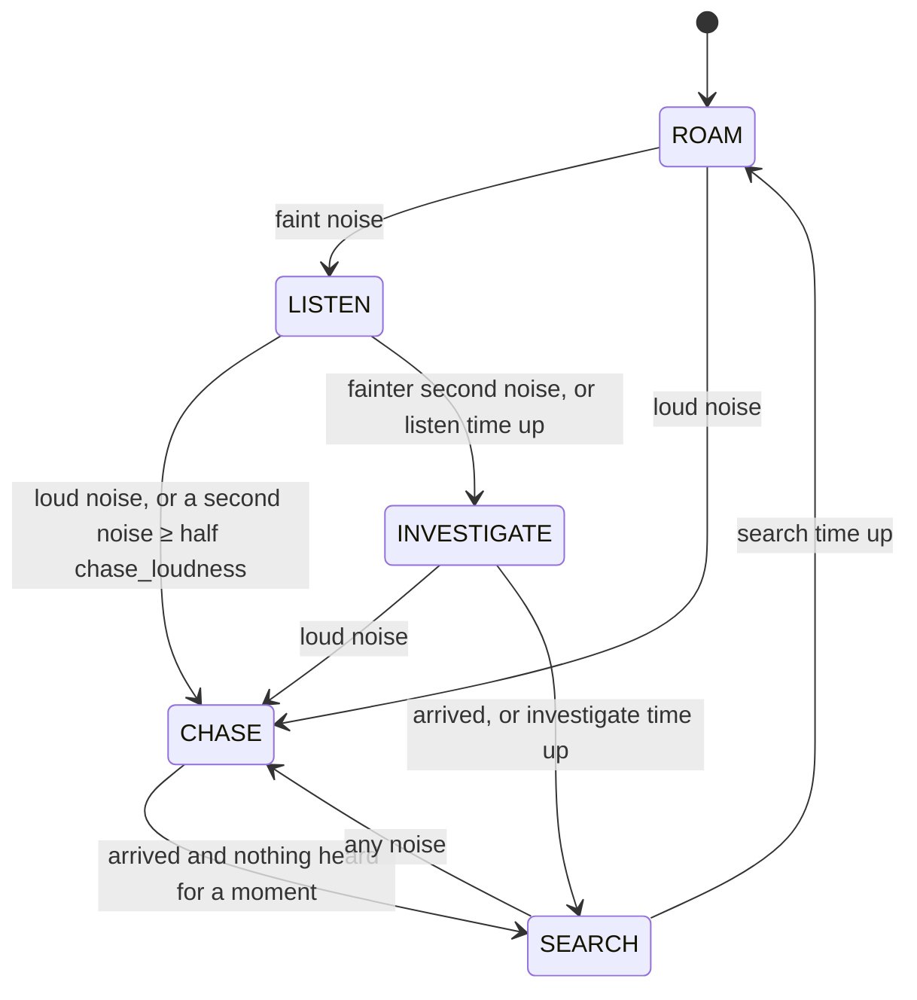

# Noise and the Pale man

*[Versión en español](../es/noise-and-pale-man.md) · [All pages](README.md)*

The core loop of Level 2: everything the player does makes a noise; the Pale man is blind
and only knows where noises came from.

## The noise system

`systems.NoiseSystem` (plain Kotlin, unit tested) keeps every noise of the last
**5 seconds** (100 ticks) as a `NoiseEvent`:

| Field | Meaning |
|---|---|
| `source` | What made it (`NoiseSource`: sneak, walk, sprint, jump, land, interact, equipment, breathing, drink) |
| `dimension`, `x`, `y`, `z` | Where |
| `radius` | How far it carries, in blocks |
| `tick` | When, in server ticks |
| `playerId` | Who made it, or null for noises of the world |

Listeners can either ask at any time what is audible from a position
(`audibleAt(dimension, x, y, z, now, hearing, maxAgeTicks)`) or register a
`NoiseSystem.Listener` to react the moment a noise is emitted. A noise of radius 0 is
dropped.

### Where noises come from

`platform.NoiseHooks` feeds the system every server tick, for Survival and Adventure
players in worlds with levels (Creative and Spectator are silent):

| Noise | Radius (default) | How it is detected |
|---|---|---|
| Footstep, sneaking | 2 | One per block walked on the ground (`StepCounter`) |
| Footstep, walking | 6 | Same |
| Footstep, sprinting | 14 | Same. A move of more than 2 blocks in one tick is a teleport, not a step |
| Jump | 8 | The vanilla jump statistic (`JumpCounter`); there is no jump event |
| Landing | 10 × fall/2, clamped to 5–20 | Falls under 0.6 blocks (a slab) are silent |
| Doors, trapdoors, gates, levers, buttons, chests, note blocks | 8 | Vanilla game events ("vibrations") caught by `ServerWorldMixin` |
| Flashlight click, battery change | 4 | Reported by `FlashlightHooks` |
| Panting while exhausted | 5 | Once per second |
| Drinking | 4 | Once per drink |

All radii are in the `noise` section of the config ([Player systems](player.md#the-config-file)).
`/everytunnel noise watch` shows each of your noises in the action bar.

## The brain

`entities.PaleManBrain` is the Pale man's decisions as plain Kotlin: no Minecraft types,
fully unit tested (`PaleManBrainTest`). Each tick it gets `Senses` (time, his position,
what he heard, the nearest player and whether his pathfinding is idle) and returns a
`Decision` (state, target, speed, who to hit, whose noise alerted him).

### Loudness

```
reach    = radius × hearing × wall_muffle ^ walls
loudness = 1 − distance / reach      (0 if distance ≥ reach)
```

1 at the source, 0 at the edge of what he can hear. With the defaults
(`wall_muffle` 0.6), one wall cuts a sprint's 14 blocks to 8.4, two walls to 5. Walls are
counted by `PaleManEntity.wallsBetween`: opaque full blocks along the line from the noise
to his ears, up to 4.

### States



| State | Speed | What he does |
|---|---|---|
| `ROAM` | `roam_speed` 0.6 | Wanders inside his territory |
| `LISTEN` | 0 | Stands still for `listen_seconds` (2), head turned to the noise, holding his breath |
| `INVESTIGATE` | `investigate_speed` 0.8 | Walks to the last noise; new noises move the target. Gives up after `investigate_seconds` (20) |
| `CHASE` | `chase_speed` 1.6 | Runs to the last noise; each new noise moves the target and resets the timer |
| `SEARCH` | 0 | Stands alert for `search_seconds` (4), holding his breath |

"Loud" means loudness ≥ `chase_loudness` (0.5): sprinting within about 7 blocks with no
wall between. A second noise while he listens needs only half of it to start a chase.

**Hitting:** he hits a player within `attack_range` (2) while chasing or searching, and
anyone within `touch_range` (1) at any time. A hit deals `attack_damage` (20, one hit kills)
and has a `attack_cooldown_seconds` (1) cooldown.

Each noise is used once, the tick after it was made, so none made later in the same tick
is missed.

## The entity

`platform.PaleManEntity` (`every_tunnel:pale_man`, a GeckoLib `HostileEntity`, hitbox
0.6 × 1.9 blocks) is the Minecraft side:

- **Unkillable by the player**: only `/kill` and the void remove him. He never despawns.
- **Territory:** if his spawn point names a `zone`, he wanders only inside it and ignores
  every noise and player outside it. Looked up live, so a `/reload` applies at once.
- **Each tick:** hears the noises of the last 2 ticks inside his territory, works out their
  loudness with walls, finds the nearest player (within -2..+3 blocks of his height), runs
  the brain and applies the decision: path to the target, stop and look, or hit.
- **Pathfinding:** vanilla mob navigation. His hitbox is 1.9 blocks tall, so like the
  player he needs two free blocks of height (the upright model is 2.75; see *His model*).
  Paths that fall short are logged by `PlaytestLog` with the blocks in the way.
- **New game:** he notices that a new game started (a counter in `PaleManSpawner`) and goes
  home to his spawn point.
- **State sync:** his brain state is tracked entity data (`brainState`), which clients use
  for animations and music.

### Spawning

`platform.PaleManSpawner`: the first time a player enters a level, every spawn point tagged
`pale_man` gets one. The world remembers it (`every_tunnel_pale_men.dat`), so leaving and
coming back or reopening the world never adds a second one, even while he is in an
unloaded chunk. If he is killed or removed, his spawn point is forgotten and spawns him
again on the next entry. The spawn egg (Every Tunnel creative tab) is for testing.

### His model

`tools/entity/pale_man.py` writes the geometry, animations (idle, listen, walk, run,
attack), texture and a glow mask for his milky eyes. `client.render.PaleManRenderer` draws
him; the animation follows his mode (listen, chase = run, roam = walk or idle).

**The stoop:** where a block stands in the space of his upright model (above the hitbox,
here or one block ahead), the client bends him over 8 ticks: the back leans to at least
75°, the arms keep hanging, the head lifts, the knees bend. He is then about 1.9 blocks
tall, and he straightens again in the open. The test runs on the client in
`PaleManEntity.tick` (`stoopAt`); `client.render.PaleManModel` bends the bones on top of
whatever animation plays. The pose is `STOOP_*` in `pale_man.py` (drawn in its preview)
and the same numbers in `PaleManModel`.

## What the player hears

| Sound | Where | Code |
|---|---|---|
| His bare footsteps | In time with his animation; walking heard up to 16 blocks, running up to 24 | `PaleManEntity.footsteps` |
| His breathing | One breath after another, within about 8 blocks; held while listening or searching | `PaleManEntity.breathe` |
| "He heard you" stinger | When your noise starts a chase, at most once every 30 s | `PaleManEntity.sting` |
| Your heartbeat | Within 24 blocks: 60 bpm at the edge to 140 next to him, never under 120 while he chases | `client.effects.HeartbeatEffect` |
| Tinnitus | After his hit. `DeathHooks` keeps a dying player alive, so it also plays on the fatal hit (an open question: keep it or not) | `PaleManEntity.hit` |
| Music | By what the nearest Pale men do (below) | `client.effects.TensionMusic` |

### Tension music

`TensionMusic` picks one layer from the Pale men around the player. The strongest wins:

| Layer | Sound event | When |
|---|---|---|
| none | | No Pale man within 48 blocks |
| Pulse | `music.tension.pulse` | One within 48 blocks, wandering |
| Rising | `music.tension.rising` | One walking to a noise |
| Strings | `music.tension.strings` | One within 12 blocks, not walking to a noise |
| Chase | `music.chase` | One chasing, within 64 blocks |

Stronger layers start at once; a weaker one takes over only after it has been right for a
while, and distances have a margin, so the music does not flap. Layers crossfade. The
chase fades out slowly with no "he lost you" cue, so the player is never sure.

## Tuning

All his numbers are in the `pale_man` section of the config. The `[playtest]` log records
when he hears you, why each chase ends and where paths fall short (see
[Debugging](debugging.md)). `/everytunnel paleman` shows the Pale men near you, their state
and target.
