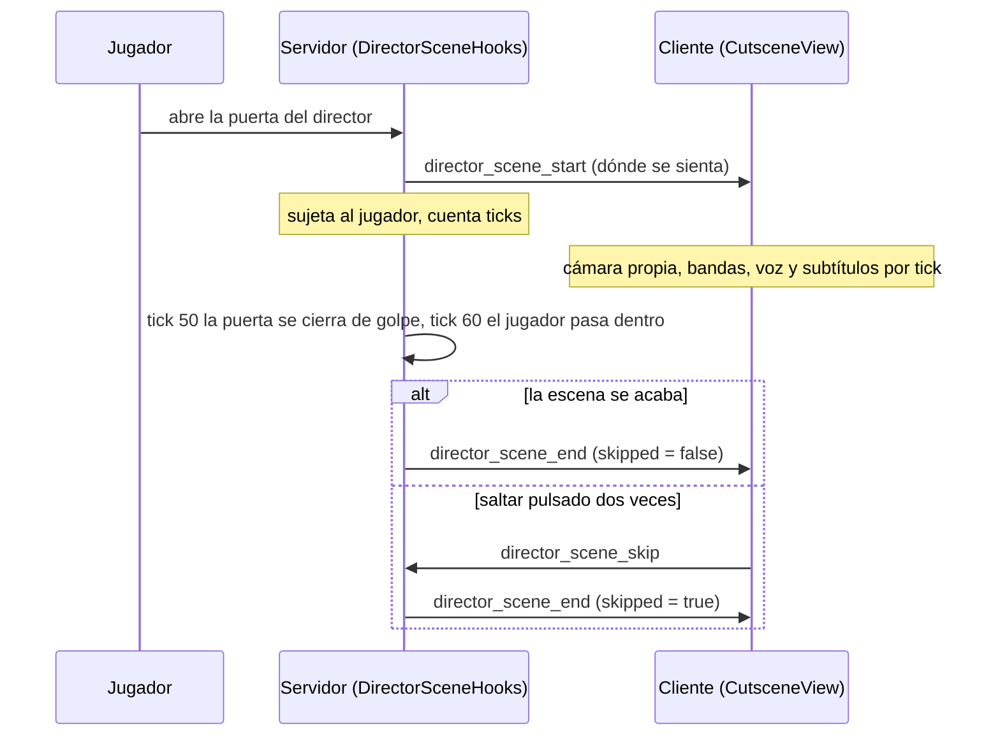

# Sistema de cinemáticas

*[English version](../en/cinematic-system.md) · [Todas las páginas](README.md)*

El nivel 5 acaba con tres piezas guionizadas, una detrás de otra: **la escena del director** (una
cámara guiada, su voz, subtítulos, un salto), **la caída** por la falsa salida y **los créditos
finales**, seguidos de la ventana de felicitación. Esta página explica cómo funciona la escena del
director, que es la única que le quita la cámara al jugador, y cómo se miden las otras dos. El lugar
de la escena en el juego está en [Flujo del juego](game-flow.md#la-escena-del-director).

## Las piezas

| Capa | Archivos | Qué hacen |
|---|---|---|
| Kotlin puro, con tests (`core/cutscene/`) | `Cutscene.kt` | Poses de cámara, el marco de una escena, planos, el vuelo de entrada y de salida, las bandas: dónde está la cámara en cualquier tick |
| | `DirectorScene.kt` | La escena del director construida con sus líneas de voz: encuadres, subtítulos, gestos, mirada, la máscara; `SkipPrompt` |
| | `DirectorLines.kt` | Sus líneas de voz y los subtítulos de cada una, leídos de `cutscene/director.json` |
| | `DirectorLoop.kt` | Las frases que repite después |
| | `FinalCredits.kt` | La línea de tiempo de los créditos finales |
| Servidor (`platform/`) | `DirectorSceneHooks.kt` | Empezar, sujetar al jugador, la puerta, saltar, el final; `DirectorLoopHooks` (mismo archivo) |
| | `DirectorEntity.kt` | El director (GeckoLib); `DirectorHooks` lo pone en su silla con el nivel |
| | `DirectorBlocks.kt` | `PairedDoorBlock`, su puerta doble, que empieza la escena |
| | `FalseExitHooks.kt`, `EndingHooks.kt` | La caída y el final del juego |
| Cliente (`client/cutscene/`) | `CutsceneView.kt` | La cámara, el HUD apagado, el jugador dibujado desde fuera, sus líneas, la pose que da al director, saltar |
| | `CutsceneScreen.kt` | Se queda con las teclas y el ratón; las bandas, los subtítulos, el aviso para saltar |
| | `DirectorVoice.kt` | Sus frases tras la escena |
| | `render/DirectorRenderer.kt` | Su modelo y el giro de su cabeza |
| | `screen/FinalCreditsScreen.kt` | Los créditos finales |
| Datos | `assets/every_tunnel/cutscene/director.json`, `sounds/voice/director/*.ogg`, `lang/*.json` (`subtitle.every_tunnel.director.*`) | Sus líneas: parte, duración, subtítulos, archivos de voz, texto de los subtítulos |
| Herramientas | `tools/sounds/voices.py`, `tools/entity/director.py` | Escriben los datos de arriba, y su modelo y sus animaciones |

La escena y los créditos son datos puros: el servidor cuenta ticks y el cliente pregunta a los mismos
objetos qué dibujar. Nada de `core/cutscene` conoce Minecraft, y por eso su temporización tiene tests
(`CutsceneTest`).

## Cómo corre una escena

1. **Empezar.** Abrir su puerta (`PairedDoorBlock.onUse`) llama a `DirectorSceneHooks.doorOpened`.
   Solo empieza si la escena no se ha jugado desde que se construyó el nivel 5, no hay otra en
   marcha, las reglas del mundo se aplican, el punto de aparición del director está a menos de 24
   bloques y el cliente puede recibir el paquete. Entonces el servidor sujeta al jugador (ver abajo)
   y envía dónde se sienta.
2. **El cliente toma el mando** (`CutsceneView.start`): una cámara que solo existe en el cliente pasa
   a ser la vista, se oculta el HUD (`InGameHudMixin` cancela `render` mientras
   `CutsceneView.active()`), la perspectiva se fuerza a primera persona (y se restaura al acabar) y
   una `CutsceneScreen` se queda con todas las teclas y el ratón.
3. **Los dos lados cuentan ticks** desde el principio con el mismo `Timeline` (`DirectorScene.SCENE`,
   construido en ambos con `director.json`): el cliente dibuja, el servidor actúa. En el tick 50 la
   puerta se cierra de golpe, en el 60 el jugador pasa justo dentro, en el tick de la máscara esta
   queda sobre la mesa.
4. **El final** es una sola función, `finish`, tanto si la escena se acaba como si se salta, así que
   el estado posterior es siempre el mismo: la puerta cerrada y bloqueada, la máscara sobre la mesa,
   sus frases en marcha, el jugador dentro de la puerta y ese punto guardado como punto de reinicio
   (`ContinueGame.restartPoint`). Al continuar desde ahí lo encuentra como se quedó
   (`DirectorSceneHooks.levelBuilt`).

**Sujetar al jugador.** Mientras dura la escena, el servidor lo devuelve a su sitio en cada tick si
se ha movido (`requestTeleport`), anula su velocidad y le niega todo daño; la pantalla del cliente le
quita las teclas. En los planos el jugador se dibuja desde fuera (`CutsceneView.drawPlayer`: el juego
omite a su propio jugador siempre que la cámara es otra entidad, como en espectador), quieto: el
cliente anula en cada tick la animación de sus piernas y su velocidad.

**Lo que no se guarda.** El estado de la escena vive solo en memoria. Salir del mundo durante ella la
descarta; la siguiente construcción del nivel 5 la vuelve a jugar. `doorLocked` es un simple indicador
que leen los dos lados, porque el juego es de un jugador (cliente y servidor integrado comparten
proceso).

## La cámara

Todo se da desde el punto de vista de la propia escena, así que los planos se escriben una vez y valen
donde se construya el despacho del nivel 5.

- **`SceneFrame`**: un punto del suelo y una orientación, aquí donde se sienta el director, mirando a
  su puerta. `at(forward, right, up)` convierte un lugar dado desde él en uno del mundo.
- **`Shot(ticks, from, to, look)`**: la cámara se desliza de un `Local` (delante, derecha, arriba) a
  otro durante `ticks`, suavizada (smoothstep), mirando a un lugar fijo (`Look.At`) o a los ojos del
  jugador (`Look.Player`). Entre dos planos hay un **corte**.
- **`Cutscene(shots, flyIn, flyOut)`**: las bandas negras entran en 20 ticks mientras la cámara sale de
  los ojos del jugador hasta el primer plano (60 ticks), siguen los planos, la cámara vuelve a los
  ojos del jugador (40 ticks, al sitio donde está al final, que es dentro de la puerta) y las bandas
  salen. `pose(tick, ...)` y `bands(tick)` es todo lo que necesita el cliente.
- **En el cliente**, `CutsceneView.place` pone la cámara en el tick *n* y deja que el juego la mezcle
  hasta el *n + 1* (su propia interpolación entre ticks); en un corte la pone ya en *n + 1*, para que
  el corte no se mezcle. La cámara es una entidad marcador que nunca se añade al mundo, con los ojos
  a 1,62 sobre los pies como un jugador de pie, así que devolver la vista no mueve nada.
- **Las bandas** son 2,39:1 dentro de una pantalla 16:9 (`CutsceneScreen.BAND`); los subtítulos van en
  la de abajo.

## La línea de tiempo sale de la voz

Las líneas del director son grabaciones reales, así que **su duración marca el ritmo**
(`DirectorScene.build`): cada línea empieza tras la anterior con una pausa (16 ticks, 30 entre las
partes del discurso, 40 mientras se quita la máscara, 20 antes de la primera), y nada se mide a mano
en ticks. Cada uno de los cuatro encuadres (un plano general que se acerca; un primer plano; por
encima de su hombro al jugador y luego de vuelta, con su muro de monitores detrás; un general desde
la esquina) dura *hasta la pausa tras una línea concreta*, y corta en mitad de esa pausa, nunca
mientras habla. Todo lo demás también va sobre sus líneas:

| Qué | Cómo se coloca |
|---|---|
| Subtítulos | Uno por cada parte de cada línea, desde su instante (`director.json`) hasta el siguiente, o 12 ticks tras la voz, nunca más allá del inicio de la línea siguiente |
| Gestos | Una mano alzada, un encogimiento de hombros, la cabeza ladeada, 8 ticks dentro de ciertas líneas (`GESTURES`) |
| La máscara | Empieza a quitarse cuando acaba la línea anterior a `boss_06`; queda sobre la mesa 54 ticks después (`Timeline.maskDown`) |
| Levantarse y señalar | Se levanta 20 ticks dentro de `boss_17`, señala durante `boss_18` y se sienta otra vez tras `boss_19` |
| Adónde mira | Rangos `lookAway` (el café, los sujetos, la disculpa, la máscara): su cabeza gira hacia el jugador, o un poco hacia abajo, suavizado en 12 ticks (`Timeline.gazeAt`) |

Cambiar un archivo de voz **reajusta toda la escena**: ejecuta `tools/sounds/voices.py` (lee las
duraciones y busca cada subtítulo en el audio) y `tools/sounds/export.py`. `voices.py` escribe
`cutscene/director.json` y el texto de los subtítulos en `en_us.json`; los subtítulos en español están en
`es_es.json` y no los toca, así que tras una nueva ejecución hay que revisarlos: `LangFilesTest` falla si
una clave existe en un idioma y no en el otro.

**Voz y subtítulos.** Cada línea es el evento de sonido `voice.director.<id>`, que suena plano (sin
distancia ni dirección) bajo el control de Voz/Habla, para que todos los planos la oigan igual. Los
subtítulos salen enteros, uno a uno, nunca por delante de la voz, en blanco tras su nombre en gris
(`subtitle.every_tunnel.speaker.director`), centrados y lo bastante cortos para dos líneas.

## El director

`DirectorEntity` es una entidad de GeckoLib que nada puede tocar y que nunca se guarda (`DirectorHooks`
la vuelve a poner cada vez que se construye el nivel 5; `KeptEntities` la conserva si su chunk se
descarga). Está sentado en su silla; levantarse y cada gesto son animaciones
(`animation.director.idle`, `raise_hand`, `shrug`, `tilt`, `mask_off`, `stand`, `point`), hechas por
`tools/entity/director.py`.

- **Durante la escena** su pose sale de la línea de tiempo del cliente: `CutsceneView` pone
  `DirectorEntity.poseSource` y la entidad le pregunta qué hace ahora (la acción, cuánto mira al
  jugador, si la máscara está quitada). Un salto lo muestra como acaba la escena: respirando, sin
  máscara.
- **Fuera de ella** respira. Con la máscara puesta mira al jugador; después, tanto como diga el `look`
  del servidor, que `DirectorLoopHooks` sube mientras dice una frase (dato de entidad sincronizado,
  suavizado en el cliente).
- **La máscara** es un hueso en su propia placa (la máscara de la película del Cinema,
  `film_walker.paint_mask`). El servidor marca `maskOff` para siempre cuando queda sobre su mesa, como
  bloque (`director_mask`, boca arriba), y el modelo oculta el hueso. `/everytunnel director` se la
  vuelve a poner en la cara.
- **Su cabeza** sigue los ojos del jugador tanto como diga la mirada de su pose (`DirectorModel`).

## Tras la escena: sus frases

Mientras el jugador sigue en su despacho (la zona `director_office`) repite seis frases
(`voice.director.loop_1` a `loop_6`), de la última a la primera, y vuelta a empezar (`DirectorLoop`):
una cada 20 a 30 segundos después de que acabe la anterior; si el jugador sale, espera al menos 5
segundos tras su regreso. Nunca ataca. Cada vez mira un 15 % menos al jugador (`DirectorLoop.gaze`).
`DirectorLoopHooks` envía el id de la frase en `director_phrase`; el cliente (`DirectorVoice`) la
reproduce plana y muestra sus subtítulos sobre el HUD, en una franja oscura. Sus frases se paran
cuando cede el suelo de la falsa salida.

## La caída y los créditos finales

- **La caída** (`FalseExitHooks`): pisar el último tramo del pasillo (zona etiquetada
  `false_exit_pit`) hace caer la tapa: estruendo, temblor, polvo, luces parpadeando; 8 ticks después
  la tapa cae con el jugador, que sale ileso; la música de la caída suena en su cabeza
  (`false_exit_fall`); a dos tercios del descenso la pantalla se pone negra; tras el último golpe de
  la música, tres segundos de negro y silencio.
- **El final** (`EndingHooks.theEnd`): se borra la partida guardada y se envía `ending` con el tiempo
  jugado y las muertes.
- **Los créditos** (`FinalCreditsScreen`, medidos por `core.cutscene.FinalCredits`, 94 s): negro y
  silencio, "THE END", la canción entra 2 s después, "Every Tunnel"; cuatro pantallas de 18 s (el
  dibujo del autor apareciendo en 1,5 s, el título tecleado una letra cada 0,045 s, sus líneas una a
  una, los créditos bajo ambos); las herramientas, un grupo cada 2 s; "Thank you for playing";
  "Level 6 coming soon"; negro. Esc lo desvanece en cualquier momento. Después, la ventana de
  felicitación.

Los textos de los créditos son las claves `every_tunnel.credits.*`; los dibujos, los de
`tools/gui/credits_art.py`.

## Añadir otra cinemática

Hoy `CutsceneView` y `CutsceneScreen` leen `DirectorScene.SCENE` directamente, así que hay una sola
escena. Una segunda necesita, por este orden:

1. Un objeto de escena en `core/cutscene` que construya un `Timeline` (una `Cutscene` de `Shot`s en
   un `SceneFrame`, más lo que vaya sobre ella), y un test de su temporización en `CutsceneTest`.
2. Que `CutsceneView` y `CutsceneScreen` reciban un `Timeline` en vez del del director: el paquete de
   inicio llevaría qué escena y su marco.
3. Un hook como `DirectorSceneHooks`: un disparador, sujetar al jugador y negarle el daño, un único
   `finish` para el final y para un salto, el estado posterior, y qué pasa si el jugador sale o se
   vuelve a construir el nivel.
4. Archivos de voz, si tiene voces: `tools/sounds/voices.py` está escrito para los del director (un
   hablante nuevo necesita su lista, su etiqueta y sus claves), y se aplica la regla de sonido de
   [Audio](audio.md): la voz del director es la única excepción con IA.
5. Esta página, el mapa del código y la tabla de paquetes, en los dos idiomas.

## Depuración

- `/everytunnel director` te pone ante su puerta (antes construye el nivel 5 con
  `/everytunnel setlevel 5`), con su escena lista para repetirse y su máscara de nuevo puesta. Abrir la
  puerta la juega desde el principio.
- `/everytunnel congrats` abre la ventana de felicitación con los números de esta partida.
- El log dice `Level 5: the director's scene begins (N s)`, luego `ends` o `skipped`, y
  `Level 5: past the director's scene (checkpoint), his phrases start` cuando una partida continúa
  pasada la escena.
- Una escena que no empieza: la puerta debe ser la suya (`PairedDoorBlock` cerca del punto de aparición
  etiquetado `director`), la escena no debe haberse jugado ya en esta construcción, y debe cumplirse
  `canSend` (el cliente tiene el mod).

## Tests

`CutsceneTest` (`core/cutscene`) comprueba las matemáticas del marco, la mezcla por el lado corto, los
planos y las bandas, el aviso de salto, las pausas y los cortes del director, los subtítulos, la
máscara, levantarse y señalar, su mirada, el bucle (orden, pausas, mirada) y la línea de tiempo de los
créditos finales. `CameraAimTest` (`core/camera`) comprueba la cámara de seguridad de la antesala.
