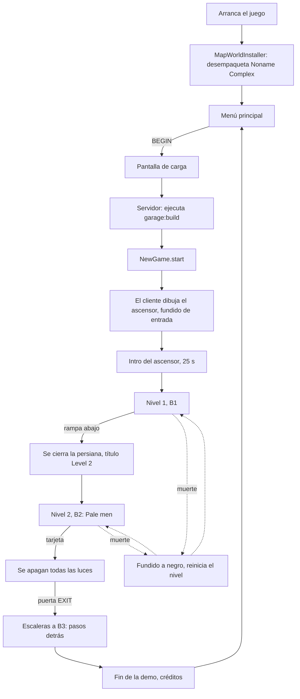

# Flujo del juego

*[English version](../en/game-flow.md) · [Todas las páginas](README.md)*

La demo se juega del menú principal a los créditos finales. Esta página sigue una partida y
nombra el código que hay detrás de cada paso.

## 1. Arranque

- `client.MapWorldInstaller` se ejecuta una vez al arrancar el cliente. Si el jar trae el
  mundo del mapa (`every_tunnel/world/noname_complex.zip`) y falta `saves/noname_complex`,
  lo desempaqueta, quita el jugador guardado en `level.dat` y lo llama "Noname Complex". Si
  el mundo lo instaló una versión anterior del mod, solo se sustituyen sus datapacks y
  `resources.zip`.
- `client.ShaderSettings` escribe los ajustes recomendados en cualquier pack Complementary
  de `shaderpacks/`, una vez por pack y versión de los ajustes (ver [Gráficos](graphics.md)).
- La pantalla de Mojang sale como siempre.

## 2. Menú principal

`client.screen.MainMenuScreen` sustituye la pantalla de título de vanilla allí donde el
juego la abriría (`MinecraftClientMixin`): al arrancar, al salir de un mundo, tras los
créditos.

- **BEGIN** abre Noname Complex. Si el mundo falta, dice "The map is missing. Reinstall the
  mod."
- **OPTIONS** abre las opciones de vanilla.
- **GUIDE** abre la [guía del jugador](guide/01-how-to-play.md) (`GuideScreen`): una hoja de
  papel blanco gastado que se desplaza con la rueda, con pestañas de papel para saltar entre
  el índice y cada página. Sale en el idioma del juego (español para cualquier `es_*`, inglés
  en los demás). El idioma en sí se cambia en OPTIONS.
- **CREDITS** pasa los créditos (`EndOfDemoScreen.credits`) y vuelve.
- **EXIT** cierra el juego.
- Tras 15 s sin mover el ratón, la silueta del Pale man aparece poco a poco a la derecha
  (`MenuFigure`); cualquier movimiento la hace desaparecer.
- **Ctrl+Shift+V** cambia a la pantalla de título de vanilla (otros mundos, multijugador,
  mods) y vuelve.
- `MenuMusic` toca `music.menu`, luego 15 s de silencio, una y otra vez; `MusicTrackerMixin`
  mantiene la música de vanilla apagada en todas partes.

## 3. Abrir el mundo

Lado del cliente (`client.screen.LoadingScreen.kt`, objeto `LoadingCover`):

- `WorldListEntryMixin` (lista de mundos) o `QuickPlayMixin` (quick play) detectan que el
  mundo tiene niveles antes de que vanilla empiece a leerlo.
- A partir de ahí una pantalla negra lo cubre todo: las pantallas de carga de vanilla
  (`ScreenMixin`) y el splash de recarga del resource pack (`SplashOverlayMixin`). Muestra
  un consejo que va cambiando (`LoadingTips`, 7 s cada uno) y "Loading...".
- El juego está en silencio: `SoundSystemMixin` multiplica cada volumen por
  `LoadingCover.worldVolume`.

Lado del servidor (`platform.LoadingHooks`):

1. Al arrancar el servidor, la función `build` de cada nivel se ejecuta una vez
   (`garage:build`). La función fuerza la carga del mapa, espera a sus chunks, construye
   los dos niveles y termina con `/everytunnel rebuilt`, que vuelve a poner el botín
   (`NewGame.levelsRebuilt`).
2. Un jugador que entra está *cargando*: congelado, invulnerable, silencioso, sin gasto de
   recursos, sin intro. Al cliente se le envía el estado `0`.
3. Cuando la construcción ha avisado, un jugador en Supervivencia o Aventura recibe una
   **partida nueva** (`NewGame.start`). Los jugadores en Creativo y Espectador se quedan
   donde están.
4. Se vuelve a enviar la luz. La construcción corre mientras el jugador entra, así que los
   chunks que recibió pueden traer la luz de antes (el ascensor llegó a tener luz del cielo
   y ninguna lámpara). Tras 1 s como mínimo, cuando el motor de luz ya no tiene
   actualizaciones pendientes (10 s como máximo), se vuelve a enviar la luz de cada chunk
   cargado dentro de la distancia de visión (`resendLight`).
5. Al cliente se le envía el estado `1` (listo). Espera a que el terreno alrededor del
   jugador esté dibujado, hace el fundido de imagen y sonido a la vez y responde
   `loading_done`.
6. El jugador queda libre y empieza la intro.

Redes de seguridad: si la construcción no avisa nunca, se abandona a los 120 s; si el
cliente no responde nunca, se le suelta a los 30 s.

## 4. Una partida nueva

`platform.NewGame.start` reinicia el mundo y el jugador:

- **Mundo:** se abren todas las persianas (`LevelEntryHooks.openAll`), vuelve todo el botín
  (`LootSpawner.restock`), vuelven las luces que apagó la tarjeta y se bloquean los lectores
  (`KeycardHooks`), y cada Pale man vuelve a su punto de aparición
  (`PaleManSpawner.startNewGame`; los de chunks sin cargar, cuando se carga su chunk).
- **Jugador:** inventario vacío, vida y recursos llenos, Supervivencia, en el inicio del
  primer nivel con intro, y la intro se repite (`IntroHooks.replay`).

`/everytunnel newgame` hace lo mismo en cualquier momento.

## 5. La intro del ascensor

`platform.IntroHooks`, según el `intro` del nivel (ver [Niveles](levels.md)):

- El jugador está en la zona con la etiqueta `start` (el ascensor de servicio). Las puertas
  (zonas con la etiqueta `elevator_door`) están cerradas con `ElevatorDoorBlock`s.
- El cliente reproduce la canción de la intro (`music.elevator`, "Local Forecast –
  Elevator" de Kevin MacLeod) con `IntroMusic`. Los indicadores de planta junto a las
  puertas cuentan 3, 2, 1, G, B1 (`FloorIndicatorBlock`).
- Tras `intro.seconds` (25): la campana (`block.elevator.ding`), la canción se ralentiza,
  ondula y se apaga en 3 s como una cinta que se para, y las puertas se abren por etapas
  (`block.elevator.doors`).
- Sale el título de `entry` del nivel ("Level 1", `LevelEntryHooks.announce`).

El mundo recuerda quién ha tenido la intro (`every_tunnel_intro.dat`), así que morir
después devuelve al jugador al ascensor con las puertas abiertas.

## 6. Nivel 1 (B1)

Sin enemigos. Cinco plantas de aparcamiento que empeoran según avanzas, cuartos laterales
con botín, ambiente (zumbido grave, goteos, relés, retumbos), fluorescentes que zumban y
parpadean. El jugador aprende la linterna, la stamina, la sed y cuánto ruido hace cada
cosa. Una rampa al final baja.

## 7. Entrar en el Nivel 2

`platform.LevelEntryHooks`: al entrar en un nivel con un `order` mayor que el de
procedencia:

- Muestra su título de `entry` ("Level 2") y reproduce su sonido en la cabeza del jugador.
- Cierra cada zona del nuevo nivel con la etiqueta `shutter` cuando el jugador la ha
  pasado: los bloques vacíos se llenan de `ShutterBlock`s fila a fila desde arriba, con
  traqueteo y golpe final (`block.shutter.close`). No hay vuelta atrás.

Reabrir el mundo o reaparecer dentro de un nivel no cuenta como entrar.

## 8. Nivel 2 (B2)

- Cinco plantas más oscuras. `PaleManSpawner` pone un Pale man en cada punto `pale_man` la
  primera vez que el jugador entra: uno por planta, dos en la planta 5, cada uno retenido en
  su planta por la `zone` de su punto de aparición. Ver
  [El ruido y el Pale man](noise-and-pale-man.md).
- **La tarjeta** está en el mostrador de una cabina de cristal en la planta 5 (`LootBlock`
  en un punto con la etiqueta `keycard`). Recogerla (`KeycardHooks.pickedUp`) apaga todas
  las luces que quedan encendidas en B2 en una ola que se extiende desde el jugador, a 0,75
  bloques por tick, y se oye cómo se apagan las más cercanas.
- **La salida:** una puerta EXIT junto a la planta 3 con un `CardReaderBlock`. Sin la
  tarjeta zumba "It needs a keycard"; con ella pita, se pone verde y abre las puertas de
  hierro de al lado (zona con la etiqueta `keycard_door`).

## 9. El final

`platform.EndingHooks`: unos escalones más abajo en las escaleras a B3, el jugador entra en
una zona con la etiqueta `end`.

1. Cinco pasos descalzos bajan las escaleras detrás del jugador (el sonido de paso del
   propio Pale man).
2. La pantalla funde a negro en 2,5 s.
3. El servidor envía `ending`; el cliente abre `EndOfDemoScreen`: aparece "End of demo" y
   luego suben los créditos (entre ellos el crédito CC BY de la música) hasta "Thank you
   for playing."
4. Cualquier tecla tras un momento, Esc o un tiempo límite guardan el mundo y vuelven al
   menú principal.

Abrir el mundo otra vez empieza una partida nueva, como siempre.

## Muerte

`platform.DeathHooks`: mientras se aplican las reglas del mundo, un jugador que iba a morir
sigue vivo:

1. Suena `event.death` y la pantalla funde a negro (`screen_fade`, 1,5 s). El jugador no
   puede moverse y nada le hace daño.
2. A oscuras se le lleva al inicio del último nivel en el que estuvo (su primer punto con la
   etiqueta `player`), con la vida y los recursos llenos. Los Pale men de ese nivel vuelven a
   sus puntos de aparición y empiezan de cero.
3. La pantalla vuelve con un fundido.

El inventario se conserva: lo recogido sigue recogido. Un jugador que nunca entró en un
nivel muere como en vanilla. `RespawnHooks` además fija el punto de reaparición de vanilla
en el inicio del nivel actual, como respaldo.
