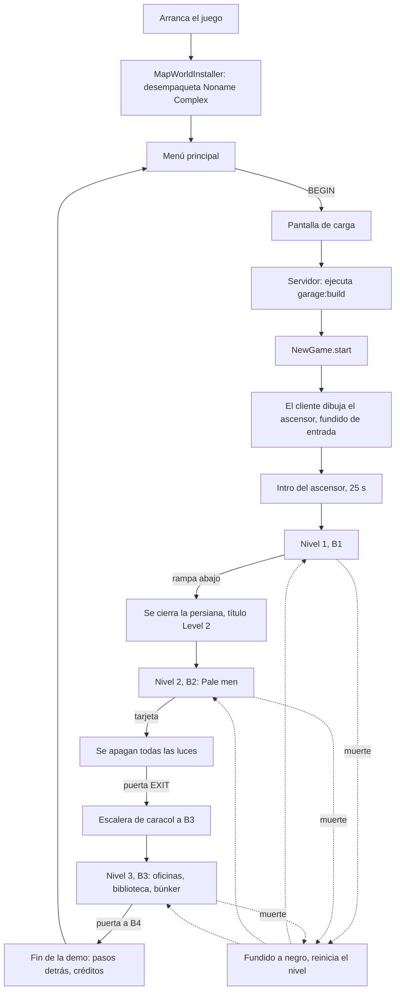

# Flujo del juego

*[English version](../en/game-flow.md) · [Todas las páginas](README.md)*

La demo se juega del menú principal a los créditos finales. Esta página sigue una partida y
nombra el código que hay detrás de cada paso.

## 1. Arranque

- `client.MapWorldInstaller` se ejecuta una vez al arrancar el cliente. Si el jar trae el
  mundo del mapa (`every_tunnel/world/noname_complex.zip`) y falta `saves/noname_complex`,
  lo desempaqueta, quita el jugador guardado en `level.dat` y lo llama "Noname Complex". Si
  el mundo lo instaló una versión anterior del mod, solo se sustituyen sus datapacks y
  `resources.zip`.
- `client.ShaderSettings` escribe los ajustes recomendados en cualquier pack Complementary
  de `shaderpacks/`, una vez por pack y versión de los ajustes (ver [Gráficos](graphics.md)).
- La pantalla de Mojang sale como siempre.

## 2. Menú principal

`client.screen.MainMenuScreen` sustituye la pantalla de título de vanilla allí donde el
juego la abriría (`MinecraftClientMixin`): al arrancar, al salir de un mundo, tras los
créditos y al cerrarse una pantalla sin mundo abierto (Escape en las opciones).

- **BEGIN** abre Noname Complex. Si el mundo falta, dice "The map is missing. Reinstall the
  mod."
- **OPTIONS** abre las opciones de vanilla.
- **GUIDE** abre la [guía del jugador](guide/01-how-to-play.md) (`GuideScreen`): una hoja de
  papel blanco gastado que se desplaza con la rueda, con pestañas de papel para saltar entre
  el índice y cada página. Sale en el idioma del juego (español para cualquier `es_*`, inglés
  en los demás). El idioma en sí se cambia en OPTIONS.
  Su última pestaña, **Créditos**, pasa los créditos (`EndOfDemoScreen.credits`) y vuelve.
- **ACHIEVEMENTS** muestra los [logros](#logros) (`AchievementsScreen`) en el mismo papel
  gastado.
- **EXIT** cierra el juego.
- Detrás de todo, una planta del aparcamiento vista a lo largo de su pasillo desde una cámara
  fija (`MenuScene`), con lámparas que parpadean de vez en cuando. El logo y las opciones van
  sobre negro, que se difumina hacia la derecha para dejar ver la planta. Ver
  [Gráficos](graphics.md#la-escena-del-menú).
- **Ctrl+Shift+V** cambia a la pantalla de título de vanilla (otros mundos, multijugador,
  mods) y vuelve.
- `MenuMusic` toca `music.menu`, luego 15 s de silencio, una y otra vez; `MusicTrackerMixin`
  mantiene la música de vanilla apagada en todas partes.

## 3. Abrir el mundo

Lado del cliente (`client.screen.LoadingScreen.kt`, objeto `LoadingCover`):

- `WorldListEntryMixin` (lista de mundos) o `QuickPlayMixin` (quick play) detectan que el
  mundo tiene niveles antes de que vanilla empiece a leerlo.
- A partir de ahí una pantalla negra lo cubre todo: las pantallas de carga de vanilla
  (`ScreenMixin`) y el splash de recarga del resource pack (`SplashOverlayMixin`). Muestra
  un consejo que va cambiando (`LoadingTips`, 7 s cada uno) y "Loading...".
- El juego está en silencio: `SoundSystemMixin` multiplica cada volumen por
  `LoadingCover.worldVolume`.

Lado del servidor (`platform.LoadingHooks`):

1. Al arrancar el servidor, la función `build` de cada nivel se ejecuta una vez
   (`garage:build`). La función fuerza la carga del mapa, espera a sus chunks, construye
   los dos niveles y termina con `/everytunnel rebuilt`, que vuelve a poner el botín
   (`NewGame.levelsRebuilt`).
2. Un jugador que entra está *cargando*: congelado, invulnerable, silencioso, sin gasto de
   recursos, sin intro. Al cliente se le envía el estado `0`.
3. Cuando la construcción ha avisado, un jugador en Supervivencia o Aventura recibe una
   **partida nueva** (`NewGame.start`). Los jugadores en Creativo y Espectador se quedan
   donde están.
4. Se vuelve a enviar la luz. La construcción corre mientras el jugador entra, así que los
   chunks que recibió pueden traer la luz de antes (el ascensor llegó a tener luz del cielo
   y ninguna lámpara). Tras 1 s como mínimo, cuando el motor de luz ya no tiene
   actualizaciones pendientes (10 s como máximo), se vuelve a enviar la luz de cada chunk
   cargado dentro de la distancia de visión (`resendLight`).
5. Al cliente se le envía el estado `1` (listo). Espera a que el terreno alrededor del
   jugador esté dibujado, hace el fundido de imagen y sonido a la vez y responde
   `loading_done`.
6. El jugador queda libre y empieza la intro.

Redes de seguridad: si la construcción no avisa nunca, se abandona a los 120 s; si el
cliente no responde nunca, se le suelta a los 30 s.

## 4. Una partida nueva

`platform.NewGame.start` reinicia el mundo y el jugador:

- **Mundo:** se abren todas las persianas (`LevelEntryHooks.openAll`), vuelve todo el botín
  (`LootSpawner.restock`), vuelven las luces que apagó la tarjeta y se bloquean los lectores
  (`KeycardHooks`), y cada Pale man vuelve a su punto de aparición
  (`PaleManSpawner.startNewGame`; los de chunks sin cargar, cuando se carga su chunk).
- **Jugador:** inventario vacío, vida y recursos llenos, Supervivencia, en el inicio del
  primer nivel con intro, y la intro se repite (`IntroHooks.replay`).

`/everytunnel newgame` hace lo mismo en cualquier momento.

## 5. La intro del ascensor

`platform.IntroHooks`, según el `intro` del nivel (ver [Niveles](levels.md)):

- El jugador está en la zona con la etiqueta `start` (el ascensor de servicio). Las puertas
  (zonas con la etiqueta `elevator_door`) están cerradas con `ElevatorDoorBlock`s.
- El cliente reproduce la canción de la intro (`music.elevator`, "Local Forecast –
  Elevator" de Kevin MacLeod) con `IntroMusic`. Los indicadores de planta junto a las
  puertas cuentan 3, 2, 1, G, B1 (`FloorIndicatorBlock`).
- Tras `intro.seconds` (25): la campana (`block.elevator.ding`), la canción se ralentiza,
  ondula y se apaga en 3 s como una cinta que se para, y las puertas se abren por etapas
  (`block.elevator.doors`).
- Sale el título de `entry` del nivel ("Level 1", `LevelEntryHooks.announce`).

El mundo recuerda quién ha tenido la intro (`every_tunnel_intro.dat`), así que morir
después devuelve al jugador al ascensor con las puertas abiertas.

## 6. Nivel 1 (B1)

Sin enemigos. Cinco plantas de aparcamiento que empeoran según avanzas, cuartos laterales
con botín, ambiente (zumbido grave, goteos, relés, retumbos), fluorescentes que zumban y
parpadean. El jugador aprende la linterna, la stamina, la sed y cuánto ruido hace cada
cosa. Una rampa al final baja.

## 7. Entrar en el Nivel 2

`platform.LevelEntryHooks`: al entrar en un nivel con un `order` mayor que el de
procedencia:

- Muestra su título de `entry` ("Level 2") y reproduce su sonido en la cabeza del jugador.
- Cierra cada zona del nuevo nivel con la etiqueta `shutter` cuando el jugador la ha
  pasado: los bloques vacíos se llenan de `ShutterBlock`s fila a fila desde arriba, con
  traqueteo y golpe final (`block.shutter.close`). No hay vuelta atrás.

Reabrir el mundo o reaparecer dentro de un nivel no cuenta como entrar.

## 8. Nivel 2 (B2)

- Cinco plantas más oscuras. `PaleManSpawner` pone un Pale man en cada punto `pale_man` la
  primera vez que el jugador entra: uno por planta, dos en la planta 5, cada uno retenido en
  su planta por la `zone` de su punto de aparición. Ver
  [El ruido y el Pale man](noise-and-pale-man.md).
- **La tarjeta** está en el mostrador de una cabina de cristal en la planta 5 (`LootBlock`
  en un punto con la etiqueta `keycard`). Recogerla (`KeycardHooks.pickedUp`) apaga todas
  las luces que quedan encendidas en B2 en una ola que se extiende desde el jugador, a 0,75
  bloques por tick, y se oye cómo se apagan las más cercanas; solo siguen encendidas las
  lámparas del pozo de escaleras (zona con la etiqueta `lights_stay`).
- **La salida:** una puerta EXIT junto a la planta 3 con un `CardReaderBlock`. Sin la
  tarjeta zumba "It needs a keycard"; con ella pita, se pone verde y abre las puertas de
  hierro de al lado (zona con la etiqueta `keycard_door`), y todos los que están en el mundo
  consiguen "Employee of the Month" (ver [Logros](#logros)).
- **Las escaleras a B3:** tras la puerta, un pozo redondo de paneles metálicos con una
  escalera de rejilla que baja en espiral 4 vueltas (32 bloques, medio bloque por escalón)
  alrededor de un hueco abierto, con barandilla de barrotes de hierro y una lámpara de pared
  cada media vuelta. Abajo, un rellano pequeño y una puerta abierta bajo la señal "B3": la
  entrada al nivel 3.

## 9. Nivel 3 (B3)

Las oficinas del complejo alrededor de la biblioteca central, en perfecto estado y vacías.
Hecho hasta ahora: la estructura, los muebles, el puzle de las válvulas, las taquillas y los
puzles de las cajas y los libros que abren el búnker, y el Observer; faltan las demás notas, el loot y el derrumbe, con sus zonas y puntos de spawn ya en el
archivo del nivel (ver [Niveles](levels.md#ganchos-del-nivel-3)). La música queda para el
final.

El **ambiente** es el casi silencio de un edificio de oficinas vacío
(`ambient.offices.room_tone`) con, de tarde en tarde (cada 1,5 a 4 minutos), un teléfono que
suena muy lejos y se corta a medio timbrazo (`ambient.offices.phone`); la biblioteca tiene en
lugar del tono de sala un reloj lento que hace tic-tac sin que se vea ninguno
(`ambient.library.clock`, el ambiente propio de la zona de la biblioteca), y el búnker está en
silencio.

- Tras la puerta abierta, unas escaleras bajan 8 bloques hasta la **antesala**, el cuarto
  eléctrico. Al entrar aparece "Level 3" (las escaleras no pertenecen a ninguna zona); ahí
  está su punto de spawn con la etiqueta `player`. En su pared, un tablón de corcho con la
  nota del electricista (`NoteBoardBlock`): con clic derecho se abre en papel (`NoteScreen`)
  y dice, en letra, cuántas vueltas completas necesita cada válvula.
- Al norte, el **pasillo de las válvulas**: cinco válvulas (A a E) en su pared este, cada
  una un `ValveBlock` en línea en una tubería, y luego un muro con una puerta doble de
  emergencia cerrada, el **checkpoint**.
- **El puzle de las válvulas** (`ValveHooks`): una partida nueva sortea una cifra del 0 al 9
  para cada válvula y las pone todas en 0. Un clic derecho gira una válvula una vez más (de
  9 vuelve a 0), con un golpe y agua en la tubería; la chapa de cada lado muestra su letra y
  sus vueltas. Cuando las cinco marcan su cifra, un golpe de ariete recorre la tubería, las
  válvulas quedan abiertas y fijas y se abren las puertas del checkpoint (zona con la
  etiqueta `valve_door`), y se consigue "Under Pressure". Equivocarse no cuesta nada. Al morir se conserva lo resuelto; solo
  una partida nueva lo deshace. `/everytunnel valves` muestra las cifras.
- Pasado este, a través del cinturón de 17 habitaciones, el **pasillo interior**: un anillo
  alrededor de la **biblioteca central** (64 × 64, 12 de alto, con lámparas colgadas de
  cadenas). Todas las luces están encendidas y las superficies, limpias.
- Cada sala tiene los muebles de lo que es, ordenados y sin sobrar nada (mesas con sus sillas
  y teléfonos, archivadores, racks de servidores, taquillas, las mesas de la cafetería...);
  la biblioteca tiene filas de estanterías de cuatro de alto, a dos bloques unas de otras,
  alrededor de un claro con mesas de lectura, y el mostrador del bibliotecario junto a la
  puerta sur. No hay nadie.
- **El puzle de las cajas** (`BoxHooks`): una partida nueva pone diez cajas de archivo moradas
  (`PurpleBoxBlock`, a brillo completo) en diez de los 25 sitios del nivel con la etiqueta
  `box_spot`, al azar: uno en cada sala menos Storage, sobre una mesa, mostrador o archivador
  o en el suelo contra una pared, y nueve por el anillo. Un clic derecho coge una y la lleva en
  la mano: de una en una; mientras se lleva sigue en la mano (cambiar de hueco la mueve con
  él), no se puede tirar (vuelve sola) y no se puede correr; se puede entrar con ella en una
  taquilla. En Storage, una estantería metálica vacía de 2 de ancho y 3 de alto con cinco
  baldas (`BoxShelfBlock`, punto de spawn con la etiqueta `box_shelf`; las cajas encima las
  dibuja `BoxShelfRenderer`): un clic derecho en un hueco deja ahí la caja, sale "3 / 10"
  encima de la barra y se avisa al Observer (viene corriendo; a lo lejos se oye que algo se ha
  dado cuenta, `event.observer.alert`). Con las diez puestas se consigue "Master of the
  Boxes" y aparecen los libros. Llevarlas sigue `CarryHooks` (los libros también). Al morir,
  una caja en la mano vuelve a donde estaba; la estantería conserva las suyas. `/everytunnel boxes` dice dónde están y
  `boxes fill` llena todo menos el último hueco.
- **El Observer** (`ObserverEntity`, decisiones en `entities.ObserverBrain`, generado por
  `ObserverHooks` en el punto de spawn con la etiqueta `observant_guard`): un vigilante alto
  vestido de negro con una cabeza gris lisa (`tools/entity/observer.py`). Ve; no oye pasos.
  Patrulla la biblioteca (la zona con la etiqueta `observer_home`): anda tieso entre las
  estanterías y se para a mirar alrededor, la cabeza girando de lado a lado. Solo ve dentro de la biblioteca: un jugador
  en el anillo o en una sala está a salvo de él, salvo si una caja lo hizo salir (entonces ve en
  cualquier sitio hasta que vuelve a patrullar) o si ya va a por él (una persecución o una
  búsqueda siguen fuera). Ve a un jugador
  en un cono de 90° hacia donde mira su cabeza, hasta 24 bloques (12 agachado, 32 con la
  linterna encendida), sin nada sólido en medio, y a cualquiera a menos de 2 bloques mire
  hacia donde mire; nunca a uno escondido en una taquilla. Si ve a uno, primero va andando
  hacia él; si sigue a la vista 1,5 s, o está a 6 bloques o menos, corre, algo más rápido que
  un sprint, y el jugador atrapado muere. Si lo pierde de vista 1,5 s, va a donde lo vio por
  última vez (corriendo si ya corría), mira alrededor y vuelve andando: un jugador recién
  visto tiene un momento para agacharse fuera de su alcance, meterse detrás de una estantería
  o esconderse en una taquilla sin que lo vea. Una caja en la estantería de
  Storage le hace ir corriendo allí, más rápido aún, y sale "He's coming. Hide." en grande y en
  rojo oscuro; mira alrededor y vuelve. La taquilla de Storage está justo al lado de la
  estantería (él entra por la puerta). A un jugador al
  que ve meterse en una taquilla lo saca y muere. No hace ningún ruido propio, ni pasos; cuando viene
  andando hacia ti suenan un reloj lento y un zumbido
  (`music.observer.approach`), y cuando corre a por ti, el reloj desbocado
  (`music.observer.chase`). Una partida nueva o una muerte lo devuelven
  a su punto de spawn. Números de partida, a ajustar jugando (`ObserverSettings`; el log dice a
  qué velocidad corrió de verdad en cada carrera, "[observer] ran ...").
- **Taquillas para esconderse:** cada sala tiene al menos una (las salas Lockers y Changing
  room están llenas; la biblioteca no tiene). Un clic derecho en una taquilla desde delante
  de su puerta mete al jugador dentro (`HidingHooks`): va montado en un asiento invisible en
  el suelo de la taquilla (`LockerSeatEntity`), mirando hacia fuera, la cabeza gira como
  mucho 30° a los lados y 15° arriba o abajo (`core.hiding.LookLimit`), y la pantalla queda
  tapada por el interior de la puerta con las rendijas de su rejilla
  (`client.hud.LockerView`). Dentro, el jugador no hace ningún ruido. Otro clic derecho o
  agacharse le saca delante de la puerta; en los dos sentidos suena la puerta
  (`block.locker.door`, que no es ruido para los enemigos). Una partida nueva saca a todos.
- **El puzle de los libros** (`BookHooks`): con las cajas puestas aparece, en silencio, un
  libro de oficina (`OfficeBookBlock`, azul grisáceo, a brillo completo) sobre el archivador de
  cada una de las cinco salas con libro (puntos con la etiqueta `book_spot`). Se llevan como
  las cajas y no avisan a nadie. Un clic derecho en el mostrador del bibliotecario junto a la
  puerta sur (o en un libro ya puesto) entrega uno: queda tumbado en el siguiente de cinco
  sitios a lo largo del mostrador (con la etiqueta `book_return`) y sale "2 / 5". El quinto
  abre la trampilla solo (la zona con la etiqueta `book_hatch`: sus trampillas de hierro se
  levantan con `block.hatch.open`) y se consigue "Shhh!". Al morir, un libro en la mano vuelve
  a su archivador; solo una partida nueva quita los libros y cierra la trampilla.
  `/everytunnel books` dice dónde están y `books fill` los saca con todos menos uno ya en el
  mostrador.
- En el centro de la biblioteca, la **trampilla del búnker**: trampillas de hierro en un marco
  de chapa estriada, cerradas hasta que vuelven los libros. Debajo, una escalera de mano baja por un pozo hasta un
  pasillo iluminado que recorre 32 bloques hacia el sur hasta la puerta a B4, donde termina
  la demo.

## 10. El final

`platform.EndingHooks`: al final del pasillo del búnker del nivel 3, delante de la puerta a
B4, el jugador entra en una zona con la etiqueta `end`.

1. Cinco pasos descalzos se acercan por detrás del jugador, cada uno algo más cerca y más
   bajo (el sonido de paso del propio Pale man).
2. La pantalla funde a negro en 2,5 s.
3. El servidor envía `ending`; el cliente abre `EndOfDemoScreen`: aparece "End of demo" y
   luego suben los créditos (entre ellos el crédito CC BY de la música) hasta "Thank you
   for playing."
4. Cualquier tecla tras un momento, Esc o un tiempo límite guardan el mundo y vuelven al
   menú principal.

Abrir el mundo otra vez empieza una partida nueva, como siempre.

## Muerte

`platform.DeathHooks`: mientras se aplican las reglas del mundo, un jugador que iba a morir
sigue vivo:

1. Suena `event.death` y la pantalla funde a negro (`screen_fade`, 1,5 s). El jugador no
   puede moverse y nada le hace daño.
2. A oscuras se le lleva al inicio del último nivel en el que estuvo (su primer punto con la
   etiqueta `player`), con la vida y los recursos llenos. Los Pale men de ese nivel vuelven a
   sus puntos de aparición y empiezan de cero.
3. La pantalla vuelve con un fundido.

El inventario se conserva: lo recogido sigue recogido. Un jugador que nunca entró en un
nivel muere como en vanilla. `RespawnHooks` además fija el punto de reaparición de vanilla
en el inicio del nivel actual, como respaldo.

## Logros

Ocho logros (`core.achievement.Achievement`, en el orden de la lista). El servidor dice cuándo
se consigue uno (`platform.AchievementHooks`, solo en mundos con niveles), una vez por partida:
volver a conseguirlo en la misma partida (morir otra vez por un Pale man) no muestra nada, y una
partida nueva deja que salgan todos otra vez. El cliente muestra el aviso "Achievement
Unlocked!", dibujado como el de desafío de vanilla con su fanfarria
(`client.hud.AchievementToast`), y lo recuerda para siempre en
`config/every_tunnel/achievements.json` (`client.AchievementStore`), entre partidas y mundos.
Los logros de vanilla no se tocan.

| Logro | Se consigue al | Icono |
|---|---|---|
| First Day at Work | salir del ascensor (la zona con la etiqueta `start` de un nivel con intro) | la placa del vigilante |
| Stay Hydrated | beber una botella de agua (`DrinkHooks`) | la botella de agua |
| Beware of Tall Men | entrar en el nivel 2 (`AchievementHooks.LEVEL_ENTRIES`) | la silueta del Pale man |
| Ouch! | morir a manos de un Pale man (`DeathHooks`) | una calavera |
| Employee of the Month | abrir el lector de la salida con la tarjeta (todos los del mundo) | la tarjeta |
| Under Pressure | dejar bien las válvulas del nivel 3 (todos los del mundo) | la válvula |
| Master of the Boxes | poner las diez cajas del nivel 3 en la estantería de Storage (todos los del mundo) | la caja morada |
| Shhh! | devolver los cinco libros del nivel 3 al mostrador del bibliotecario (todos los del mundo) | el libro de oficina |

La pantalla ACHIEVEMENTS del menú principal (`client.screen.AchievementsScreen`) los muestra en
el papel de la guía (`client.screen.Paper`) con cuántos se tienen; uno que aún no se tiene
muestra un "?" y "Not yet unlocked". Los textos están en el archivo de idioma
(`achievement.every_tunnel.<id>`, su `.description`, `toast.every_tunnel.achievement_unlocked`);
los iconos de la placa, la calavera, la silueta y el "?" salen de
`tools/gui/achievement_icons.py`, los demás son objetos del mod (`client.AchievementIcons`). Está previsto un sonido propio en lugar de la fanfarria.
