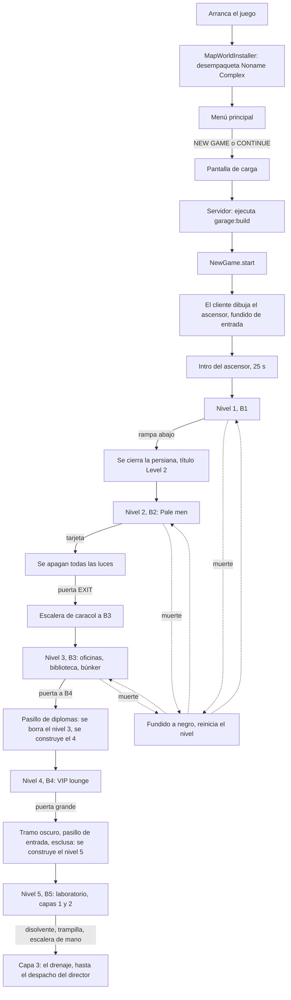

# Flujo del juego

*[English version](../en/game-flow.md) · [Todas las páginas](README.md)*

La demo se juega del menú principal a los créditos finales. Esta página sigue una partida y
nombra el código que hay detrás de cada paso.

## 1. Arranque

- `client.MapWorldInstaller` se ejecuta una vez al arrancar el cliente. Si el jar trae el
  mundo del mapa (`every_tunnel/world/noname_complex.zip`) y falta `saves/noname_complex`,
  lo desempaqueta, quita el jugador guardado en `level.dat` y lo llama "Noname Complex". Si
  el mundo lo instaló una versión anterior del mod, solo se sustituyen sus datapacks y
  `resources.zip`.
- `client.ShaderSettings` escribe los ajustes recomendados en cualquier pack Complementary
  de `shaderpacks/`, una vez por pack y versión de los ajustes (ver [Gráficos](graphics.md)).
- La pantalla de Mojang sale como siempre.

## 2. Menú principal

`client.screen.MainMenuScreen` sustituye la pantalla de título de vanilla allí donde el
juego la abriría (`MinecraftClientMixin`): al arrancar, al salir de un mundo, tras los
créditos y al cerrarse una pantalla sin mundo abierto (Escape en las opciones).

- **NEW GAME** abre Noname Complex; con una partida guardada lo sustituye **CONTINUE** (`platform.ContinueGame`), y Ctrl+Shift+D borra esa partida tras preguntar (`EraseSaveScreen`). Una partida guardada tiene: puntos de control al inicio de cada nivel, el nivel 4 como se dejó (`core.save.LoungeSave`), salvo coger la llave, y se borra con los créditos. Si el mundo falta, dice "The map is missing. Reinstall the
  mod."
- **OPTIONS** abre las opciones de vanilla.
- **GUIDE** abre la [guía del jugador](guide/01-how-to-play.md) (`GuideScreen`): una hoja de
  papel blanco gastado que se desplaza con la rueda, con pestañas de papel para saltar entre
  el índice y cada página. Sale en el idioma del juego (español para cualquier `es_*`, inglés
  en los demás). El idioma en sí se cambia en OPTIONS.
- **ACHIEVEMENTS** muestra los [logros](#logros) (`AchievementsScreen`) en el mismo papel
  gastado.
- **EXIT** cierra el juego.
- Detrás de todo, una planta del aparcamiento vista a lo largo de su pasillo desde una cámara
  fija (`MenuScene`), con lámparas que parpadean de vez en cuando. El logo y las opciones van
  sobre negro, que se difumina hacia la derecha para dejar ver la planta. Ver
  [Gráficos](graphics.md#la-escena-del-menú).
- **Ctrl+Shift+V** cambia a la pantalla de título de vanilla (otros mundos, multijugador,
  mods) y vuelve.
- `MenuMusic` toca `music.menu`, luego 15 s de silencio, una y otra vez; `MusicTrackerMixin`
  mantiene la música de vanilla apagada en todas partes.

## 3. Abrir el mundo

Lado del cliente (`client.screen.LoadingScreen.kt`, objeto `LoadingCover`):

- `WorldListEntryMixin` (lista de mundos) o `QuickPlayMixin` (quick play) detectan que el
  mundo tiene niveles antes de que vanilla empiece a leerlo.
- A partir de ahí una pantalla negra lo cubre todo: las pantallas de carga de vanilla
  (`ScreenMixin`) y el splash de recarga del resource pack (`SplashOverlayMixin`). Muestra
  un consejo que va cambiando (`LoadingTips`, 7 s cada uno) y "Loading...".
- El juego está en silencio: `SoundSystemMixin` multiplica cada volumen por
  `LoadingCover.worldVolume`.

Lado del servidor (`platform.LoadingHooks`):

1. Al arrancar el servidor, la función `build` de cada nivel se ejecuta una vez
   (`garage:build`). La función fuerza la carga del mapa, espera a sus chunks, construye
   los dos niveles y termina con `/everytunnel rebuilt`, que vuelve a poner el botín
   (`NewGame.levelsRebuilt`).
2. Un jugador que entra está *cargando*: congelado, invulnerable, silencioso, sin gasto de
   recursos, sin intro. Al cliente se le envía el estado `0`.
3. Cuando la construcción ha avisado, un jugador en Supervivencia o Aventura recibe una
   **partida nueva** (`NewGame.start`). Los jugadores en Creativo y Espectador se quedan
   donde están.
4. Se vuelve a enviar la luz. La construcción corre mientras el jugador entra, así que los
   chunks que recibió pueden traer la luz de antes (el ascensor llegó a tener luz del cielo
   y ninguna lámpara). Tras 1 s como mínimo, cuando el motor de luz ya no tiene
   actualizaciones pendientes (10 s como máximo), se vuelve a enviar la luz de cada chunk
   cargado dentro de la distancia de visión (`resendLight`).
5. Al cliente se le envía el estado `1` (listo). Espera a que el terreno alrededor del
   jugador esté dibujado, hace el fundido de imagen y sonido a la vez y responde
   `loading_done`.
6. El jugador queda libre y empieza la intro.

Redes de seguridad: si la construcción no avisa nunca, se abandona a los 120 s; si el
cliente no responde nunca, se le suelta a los 30 s.

## 4. Una partida nueva

`platform.NewGame.start` reinicia el mundo y el jugador:

- **Mundo:** se abren todas las persianas (`LevelEntryHooks.openAll`), vuelve todo el botín
  (`LootSpawner.restock`), vuelven las luces que apagó la tarjeta y se bloquean los lectores
  (`KeycardHooks`), y cada Pale man vuelve a su punto de aparición
  (`PaleManSpawner.startNewGame`; los de chunks sin cargar, cuando se carga su chunk).
- **Jugador:** inventario vacío, vida y recursos llenos, Supervivencia, en el inicio del
  primer nivel con intro, y la intro se repite (`IntroHooks.replay`).

`/everytunnel newgame` hace lo mismo en cualquier momento.

## 5. La intro del ascensor

`platform.IntroHooks`, según el `intro` del nivel (ver [Niveles](levels.md)):

- El jugador está en la zona con la etiqueta `start` (el ascensor de servicio). Las puertas
  (zonas con la etiqueta `elevator_door`) están cerradas con `ElevatorDoorBlock`s.
- El cliente reproduce la canción de la intro (`music.elevator`, "Local Forecast –
  Elevator" de Kevin MacLeod) con `IntroMusic`. Los indicadores de planta junto a las
  puertas cuentan 3, 2, 1, G, B1 (`FloorIndicatorBlock`).
- Tras `intro.seconds` (25): la campana (`block.elevator.ding`), la canción se ralentiza,
  ondula y se apaga en 3 s como una cinta que se para, y las puertas se abren por etapas
  (`block.elevator.doors`).
- Sale el título de `entry` del nivel ("Level 1", `LevelEntryHooks.announce`).

El mundo recuerda quién ha tenido la intro (`every_tunnel_intro.dat`), así que morir
después devuelve al jugador al ascensor con las puertas abiertas.

## 6. Nivel 1 (B1)

Sin enemigos. Cinco plantas de aparcamiento que empeoran según avanzas, cuartos laterales
con botín, ambiente (zumbido grave, goteos, relés, retumbos), fluorescentes que zumban y
parpadean. El jugador aprende la linterna, la stamina, la sed y cuánto ruido hace cada
cosa. Una rampa al final baja.

## 7. Entrar en el Nivel 2

`platform.LevelEntryHooks`: al entrar en un nivel con un `order` mayor que el de
procedencia:

- Muestra su título de `entry` ("Level 2") y reproduce su sonido en la cabeza del jugador.
- Cierra cada zona del nuevo nivel con la etiqueta `shutter` cuando el jugador la ha
  pasado: los bloques vacíos se llenan de `ShutterBlock`s fila a fila desde arriba, con
  traqueteo y golpe final (`block.shutter.close`). No hay vuelta atrás.

Reabrir el mundo o reaparecer dentro de un nivel no cuenta como entrar.

## 8. Nivel 2 (B2)

- Cinco plantas más oscuras. `PaleManSpawner` pone un Pale man en cada punto `pale_man` la
  primera vez que el jugador entra: uno por planta, dos en la planta 5, cada uno retenido en
  su planta por la `zone` de su punto de aparición. Ver
  [El ruido y el Pale man](noise-and-pale-man.md).
- **La tarjeta** está en el mostrador de una cabina de cristal en la planta 5 (`LootBlock`
  en un punto con la etiqueta `keycard`). Recogerla (`KeycardHooks.pickedUp`) apaga todas
  las luces que quedan encendidas en B2 en una ola que se extiende desde el jugador, a 0,75
  bloques por tick, y se oye cómo se apagan las más cercanas; solo siguen encendidas las
  lámparas del pozo de escaleras (zona con la etiqueta `lights_stay`).
- **La salida:** una puerta EXIT junto a la planta 3 con un `CardReaderBlock`. Sin la
  tarjeta zumba "It needs a keycard"; con ella pita, se pone verde y abre las puertas de
  hierro de al lado (zona con la etiqueta `keycard_door`), y todos los que están en el mundo
  consiguen "Employee of the Month" (ver [Logros](#logros)).
- **Las escaleras a B3:** tras la puerta, un pozo redondo de paneles metálicos con una
  escalera de rejilla que baja en espiral 4 vueltas (32 bloques, medio bloque por escalón)
  alrededor de un hueco abierto, con barandilla de barrotes de hierro y una lámpara de pared
  cada media vuelta. Abajo, un rellano pequeño y una puerta abierta bajo la señal "B3": la
  entrada al nivel 3.

## 9. Nivel 3 (B3)

Las oficinas del complejo alrededor de la biblioteca central, en perfecto estado y vacías.
Hecho hasta ahora: la estructura, los muebles, el puzle de las válvulas, las taquillas y los
puzles de las cajas y los libros que abren el búnker, el Observer, los documentos de la empresa, el loot, las
placas de las salas y el túnel del búnker con su derrumbe (ver [Niveles](levels.md#ganchos-del-nivel-3)).
No tiene música propia (hay una preparada para el nivel 4).

El **ambiente** es el casi silencio de un edificio de oficinas vacío
(`ambient.offices.room_tone`) con, de tarde en tarde (cada 1,5 a 4 minutos), un teléfono que
suena muy lejos y se corta a medio timbrazo (`ambient.offices.phone`); la biblioteca tiene en
lugar del tono de sala un reloj lento que hace tic-tac sin que se vea ninguno
(`ambient.library.clock`, el ambiente propio de la zona de la biblioteca), y el búnker está en
silencio.

- Tras la puerta abierta, unas escaleras bajan 8 bloques hasta la **antesala**, el cuarto
  eléctrico, en una nave alta de techo plano (el del rellano de arriba) con tres filas de
  luces; en lo alto de la pared sobre la entrada a la antesala, letras grandes oscuras:
  "OFFICES & LIBRARY" (`ENTRANCE_SIGN`), que se ven durante toda la bajada. Al entrar aparece "Level 3" (las escaleras no pertenecen a ninguna zona); ahí
  está su punto de spawn con la etiqueta `player`. En su pared, un tablón de corcho con la
  nota del electricista (`NoteBoardBlock`): con clic derecho se abre en papel (`NoteScreen`)
  y dice, en letra, cuántas vueltas completas necesita cada válvula.
- Al norte, el **pasillo de las válvulas**: cinco válvulas (A a E) en su pared este, cada
  una un `ValveBlock` en línea en una tubería, y luego un muro con una puerta doble de
  emergencia cerrada, el **checkpoint**.
- **El puzle de las válvulas** (`ValveHooks`): una partida nueva sortea una cifra del 0 al 9
  para cada válvula y las pone todas en 0. Un clic derecho gira una válvula una vez más (de
  9 vuelve a 0), con un golpe y agua en la tubería; la chapa de cada lado muestra su letra y
  sus vueltas. Cuando las cinco marcan su cifra, un golpe de ariete recorre la tubería, las
  válvulas quedan abiertas y fijas y se abren las puertas del checkpoint (zona con la
  etiqueta `valve_door`), y se consigue "Under Pressure". Equivocarse no cuesta nada. Al morir se conserva lo resuelto; solo
  una partida nueva lo deshace. `/everytunnel valves` muestra las cifras.
- Pasado este, a través del cinturón de 17 habitaciones, el **pasillo interior**: un anillo
  alrededor de la **biblioteca central** (64 × 64, 12 de alto, con lámparas colgadas de
  cadenas). Todas las luces están encendidas y las superficies, limpias. Junto a la puerta
  de cada sala, una placa oscura con su nombre en blanco (`WallTextBlock`, con la fuente y el
  idioma del juego: `sign.every_tunnel.room.<id>`).
- Cada sala tiene los muebles de lo que es, ordenados y sin sobrar nada (mesas con sus sillas
  y teléfonos, archivadores, racks de servidores, taquillas, las mesas de la cocina...);
  la biblioteca tiene filas de estanterías de cuatro de alto, a dos bloques unas de otras,
  alrededor de un claro, y en él la mesa del bibliotecario en U alrededor de la
  trampilla, abierta al sur, con una lámpara de latón y pantalla verde (`desk_lamp`). No hay nadie.
- **Loot:** en el nivel 3 no hay botellas. El dispensador de agua de la cocina da agua: con
  clic derecho el jugador bebe ahí, cuantas veces quiera, lo que da una botella cada vez (como
  mucho una vez cada 1,5 s; hace el ruido de beber), `WaterDispenserHooks`, el dispensador en
  el punto de spawn con la etiqueta `water_source` (`WATER_SOURCES`; los demás dispensadores
  son solo muebles). Tres baterías en el suelo de la sala Electrical del anillo (`LOOT`, puntos
  de spawn con la etiqueta `battery`, que coloca `LootSpawner` como el loot de los garajes).
- **Los documentos de la empresa** (el lore): cinco folios mecanografiados sueltos
  (`NotePaperBlock`), cada uno en la mesa o el mostrador más cercano a las puertas de su sala
  (`NOTE_PAPERS`): un memorando sobre la supervisión de la sala de lectura (HR), el
  procedimiento del archivo para cajas y libros (Archive), un aviso sobre las taquillas
  (Lockers), una queja del personal por la máquina que bajaron (Management) y la factura de un
  reactor (Finance). Se leen como la nota del electricista (`NoteScreen`). Formales, sin humor;
  los tres primeros dan pistas sobre el Observer y los puzles.
- **El puzle de las cajas** (`BoxHooks`): una partida nueva pone diez cajas de archivo moradas
  (`PurpleBoxBlock`, a brillo completo) en diez de los 25 sitios del nivel con la etiqueta
  `box_spot`, al azar: uno en cada sala menos Storage, sobre una mesa, mostrador o archivador
  o en el suelo contra una pared, y nueve por el anillo. Un clic derecho coge una y la lleva en
  la mano: de una en una; mientras se lleva sigue en la mano (cambiar de hueco la mueve con
  él), no se puede tirar (vuelve sola) y no se puede correr; se puede entrar con ella en una
  taquilla. En Storage, con las demás estanterías solo junto a las paredes (el centro libre:
  desde la estantería de las cajas se ve la puerta), una estantería metálica vacía de 2 de ancho y 3 de alto con cinco
  baldas (`BoxShelfBlock`, punto de spawn con la etiqueta `box_shelf`; las cajas encima las
  dibuja `BoxShelfRenderer`): un clic derecho en un hueco deja ahí la caja, sale "3 / 10"
  encima de la barra y se avisa al Observer (viene corriendo; a lo lejos se oye que algo se ha
  dado cuenta, `event.observer.alert`). Con las diez puestas se consigue "Master of the
  Boxes" y aparecen los libros. Llevarlas sigue `CarryHooks` (los libros también). Al morir,
  una caja en la mano vuelve a donde estaba; la estantería conserva las suyas. `/everytunnel boxes` dice dónde están y
  `boxes fill` llena todo menos el último hueco.
- **El Observer** (`ObserverEntity`, decisiones en `entities.ObserverBrain`, generado por
  `ObserverHooks` en el punto de spawn con la etiqueta `observant_guard`): un vigilante alto
  vestido de negro con una cabeza gris lisa (`tools/entity/observer.py`). Ve; no oye pasos.
  Patrulla la biblioteca (la zona con la etiqueta `observer_home`): anda tieso entre las
  estanterías y se para a mirar alrededor, la cabeza girando de lado a lado. Solo ve dentro de la biblioteca: un jugador
  en el anillo o en una sala está a salvo de él, salvo si una caja lo hizo salir (entonces ve en
  cualquier sitio hasta que vuelve a patrullar) o si ya va a por él (una persecución o una
  búsqueda siguen fuera). Ve a un jugador
  en un cono de 90° hacia donde mira su cabeza, hasta 24 bloques (12 agachado, 32 con la
  linterna encendida), sin nada sólido en medio, y a cualquiera a menos de 2 bloques mire
  hacia donde mire; nunca a uno escondido en una taquilla. Si ve a uno, primero va andando
  hacia él; si sigue a la vista 1,5 s, o está a 6 bloques o menos, corre, algo más rápido que
  un sprint, y el jugador atrapado muere. Si lo pierde de vista 1,5 s, va a donde lo vio por
  última vez (corriendo si ya corría), mira alrededor y vuelve andando: un jugador recién
  visto tiene un momento para agacharse fuera de su alcance, meterse detrás de una estantería
  o esconderse en una taquilla sin que lo vea. Una caja en la estantería de
  Storage le hace ir corriendo allí, más rápido aún, y sale "He's coming. Hide." en grande y en
  rojo oscuro; mira alrededor y vuelve corriendo (solo tras una caja; tras una búsqueda vuelve
  andando). La taquilla de Storage está justo al lado de la
  estantería (él entra por la puerta). A un jugador al
  que ve meterse en una taquilla lo saca y muere. No hace ningún ruido propio, ni pasos; cuando viene
  andando hacia ti suenan un reloj lento y un zumbido
  (`music.observer.approach`), y cuando corre a por ti, el reloj desbocado
  (`music.observer.chase`). Una partida nueva o una muerte lo devuelven
  a su punto de spawn; cada reconstrucción del mapa lo mata, como a los Pale men, y su punto
  de spawn lo vuelve a generar cuando entra un jugador. Números de partida, a ajustar jugando (`ObserverSettings`; el log dice a
  qué velocidad corrió de verdad en cada carrera, "[observer] ran ...").
- **Taquillas para esconderse:** cada sala tiene al menos una (las salas Lockers y Changing
  room están llenas; la biblioteca no tiene). Un clic derecho en una taquilla desde delante
  de su puerta mete al jugador dentro (`HidingHooks`): va montado en un asiento invisible en
  el suelo de la taquilla (`LockerSeatEntity`), mirando hacia fuera, la cabeza gira como
  mucho 30° a los lados y 15° arriba o abajo (`core.hiding.LookLimit`), y la pantalla queda
  tapada por el interior de la puerta con las rendijas de su rejilla
  (`client.hud.LockerView`). Dentro, el jugador no hace ningún ruido. Otro clic derecho o
  agacharse le saca delante de la puerta; en los dos sentidos suena la puerta
  (`block.locker.door`, que no es ruido para los enemigos). Al entrar, sobre la barra sale
  "Sneak (Left Shift) or right-click to step out" en lugar de la línea de vanilla para
  bajarse. Una partida nueva saca a todos.
- **El puzle de los libros** (`BookHooks`): con las cajas puestas aparecen, en silencio,
  cinco libros de oficina (`OfficeBookBlock`, azul grisáceo, a brillo completo) en la biblioteca,
  su terreno: en cinco de sus 13 sitios elegidos al azar (puntos con la etiqueta `book_spot`):
  sobre carritos de libros (`book_cart`) y en el suelo de los pasillos entre las estanterías, y
  uno sobre el fichero junto a la puerta sur (`LIBRARY_LAYOUT["books"]`). Se llevan como
  las cajas y no avisan a nadie. Un clic derecho en la mesa del bibliotecario alrededor de la
  trampilla (o en un libro ya puesto) entrega uno: queda tumbado en el siguiente de cinco
  sitios repartidos por la mesa (con la etiqueta `book_return`) y sale "2 / 5". El quinto
  abre la trampilla solo (la zona con la etiqueta `book_hatch`: sus hojas de acero se
  levantan con `block.hatch.open`) y se consigue "Shhh!". Al morir, un libro en la mano vuelve
  a donde estaba; solo una partida nueva quita los libros y cierra la trampilla.
  `/everytunnel books` dice dónde están y `books fill` completa las cajas y saca los
  libros con todos menos uno ya en la mesa.
  Mientras los libros están fuera (`BookPhaseHooks`, reglas en `systems.ObserverNearness`), el
  reloj de la biblioteca suena en la cabeza del jugador cuando el Observer está a 24 bloques o
  menos, tic y tac, cada 0,75 s en el borde y hasta cada 0,25 s a 4 bloques o menos, más fuerte
  cuanto más cerca (`event.observer.tick` / `tock`); y la primera vez que se acerca a 16
  bloques sale "He's near. Hide." como el aviso de las cajas (otra vez solo después de haberse
  alejado a más de 24; no si ya va a por el jugador).
- En el centro de la biblioteca, la **trampilla del búnker**: dos hojas de chapa estriada de acero oscuro
  (`bunker_trapdoor`, una trampilla que nadie abre a mano) con una banda amarilla y negra junto a
  las bisagras, una con bisagra al oeste y otra al este, en un marco
  de chapa estriada, cerradas hasta que vuelven los libros. Debajo, una escalera de mano baja por un pozo hasta un
  **túnel del búnker**: unos 90 bloques de hormigón iluminado, de 3 de ancho, en cuatro tramos
  en ángulo recto (`BUNKER["path"]`), con tuberías por el techo a un lado y una bandeja de
  cables al otro, que pasa por dos puertas blindadas abiertas (un marco de acero con franjas,
  `hazard_steel`, y la hoja plegada contra la pared, `blast_door`) hasta la puerta a B4. El
  Observer nunca baja detrás de nadie (el pozo y el túnel tienen la
  etiqueta `observer_never`).
- **El derrumbe** (`CollapseHooks`, tiempos en `systems.CollapseSchedule`): unos 13 bloques
  antes de la puerta, el techo del túnel cae detrás del jugador: un crujido, grietas y el
  estruendo de la caída (`event.collapse`), la cámara tiembla (`CameraShake`), el tramo de
  detrás se llena de escombros en segundo y medio (el hormigón del túnel y pizarra profunda),
  cae polvo y las luces de alrededor parpadean. No hay vuelta atrás; una vez por partida. Una
  muerte en el nivel 3 (el jugador vuelve a empezar en la antesala), una partida nueva y la
  reconstrucción del mapa quitan los escombros.

## 10. Del nivel 3 al nivel 4

`platform.LoungeHooks`. El nivel 4 ocupa el espacio del nivel 3, así que se construye en plena
partida:

- Al acercarse a la puerta a B4, se abre. Al entrar en el pasillo de diplomas que hay detrás (4
  de ancho, 20 de largo, construido con el nivel 3, debajo de su suelo) se cierra para siempre.
- `garage:level4_begin` fuerza la carga de la zona; `/everytunnel loungeready` avisa de que los
  chunks están. Luego se ejecuta un `garage:level4_step_<n>` cada 2 ticks: se va el nivel 3 y se
  levanta el 4, en tandas pequeñas para que el juego no se atasque.
- Tras la última tanda se abre la puerta de Reception.

El pasillo ya pertenece al nivel 4, así que "Level 4" aparece cuando se cierra la puerta a B4, y
volver al pasillo desde Reception no cuenta como regresar al nivel 3.

La reconstrucción del mapa, cada vez que se abre el mundo, devuelve el nivel 3 y limpia el 4. De
momento el nivel 4 son sus salas, muebles, nueve notas, botín y reglas (un nivel `safe`, ver
[Sistemas del jugador](player.md#niveles-seguros)), sus cuatro puzles (abajo) y su cierre.

Cada puzle da una esquina de la tarjeta maestra dorada, que guarda `ProgressService`. Las respuestas
del Bar, el Cinema y los dardos se sortean en cada partida, y el log las dice (`Level 4 this game`,
`Level 4's darts this game`). Fallar no cuesta nada, y tras 3 fallos brilla lo siguiente correcto (`core.puzzle.OrderPuzzle`,
`platform.LoungePuzzleHooks`):

- **Bar:** cuatro discos, llevados de uno en uno desde sus estantes al tocadiscos, en el orden de
  las líneas de la carta, sorteado en cada partida (`{R0:menu}` en su nota). Uno equivocado los devuelve todos.
- **Cinema:** cuatro carretes por duración, en la cabina. El que nombra el registro (`{FILM}`, sorteado en cada partida) se
  pone en el proyector y espera a que alguien salga de la cabina a la sala. Entonces la película corre
  en la pantalla, una sola vez, y solo se oye el proyector (`client.effects.FilmPlayer`), y al acabar
  la pieza queda junto al proyector.
- **Spa:** la pieza está en el fondo de la piscina, a 6 de hondo. Al ser un nivel seguro, nadie se
  ahoga.
- **Game room:** un tablero de dardos de 3 bloques de ancho, una placa al lado con tres números sorteados en cada partida y una
  bandeja con 3 dardos (`platform.DartHooks`, `core.puzzle.darts.DartboardGeometry`). Clic derecho
  lanza. Solo cuenta el número, no su anillo; cualquier otra cosa devuelve los dardos a la bandeja. El
  tercer acierto abre una portezuela de latón bajo el tablero con la pieza dentro y añade una línea a
  la hoja de puntuaciones de la pared (`ch1_l4_note_score_sheet_won`). La línea del suelo es solo una
  guía.

Dos cosas más, que no dan pieza:

- **Sala de mantenimiento** (`platform.BreakerHooks`, `core.puzzle.BreakerCode`), tras la puerta este de
  Reception, de hormigón: cinco palancas y un código sorteado en cada partida (`Level 4's breakers this game`
  en el log). Al pulsar el botón, un contador dice cuántas están bien, no cuáles. Con cinco, el lector de la
  Calm room tiene corriente, así que es obligatoria.
- **Cajas fuertes** en las Suites (`platform.SafeHooks`, `core.puzzle.SafeDial`, `client.screen.SafeScreen`),
  opcionales, con un diario en cada una. Tres números en un dial de 40, a oído: un tic por número, un clic grave
  en el correcto, y cambiar de sentido ahí lo fija. Cada número correcto sacude el dial un momento. Cambiar de sentido en otro sitio
  vuelve a empezar; tras 3 fallos el dial sigue temblando en los números correctos.

### El cierre

`platform.LoungeClosingHooks`, con sus bloques en `LoungeClosingBlocks.kt`:

1. **La tarjeta maestra:** las cuatro esquinas, cada una en su sitio en la cuadrícula de crafteo de 2 x 2
   del inventario, forman la tarjeta (`data/every_tunnel/recipes/master_card.json`). Las piezas, la
   tarjeta y la llave que se dejan en el suelo no desaparecen nunca.
2. **La Calm room:** una puerta arriba de los escalones, con un lector que la abre a quien lleve la
   tarjeta, una vez que la sala de mantenimiento le da corriente (sin ella: "No power", y una nota al lado).
   Sin la tarjeta, no hace nada.
3. **El apagón:** coger la Master Key de la mesa de la sala apaga todas las lámparas a la vez y enciende
   las luces rojas de emergencia del camino de vuelta. Aparece un cartel de suelo mojado en medio del
   Hall, y, cuando el jugador ha rodeado la piscina (etiqueta de zona `cinema_wakes`), el Cinema se
   enciende solo: un ojo e INTRUDER DETECTED en bucle en su pantalla (`tools/film/eye.py`),
   con el proyector oyéndose desde el Bar. El nivel sigue siendo seguro y los monitores de la Security room siguen encendidos (`blackout`
   queda para la música de la fase de audio).
4. **La puerta grande:** un golpe sordo sin la llave. Con ella, la llave se gasta y la puerta se abre del
   centro hacia fuera en 3 s.

- **Mensajes en la pared** (`WallMessageBlock`, `client.render.WallMessageRenderer`, `core.wall`, colocados por `tools/map/wall_messages.py`): pintura negra con una fuente irregular propia, sobre un parche claro en las paredes oscuras, en los niveles 3 y 4. Cada uno es fijo, aparece al acercarse o cambia cuando se ha visto y se deja de mirar. Sus textos están en `wall.every_tunnel.*` en el archivo de idioma.

## 11. Del nivel 4 al nivel 5

A mitad del tramo oscuro tras la puerta grande, una zona con la etiqueta `big_door_shut` cierra la puerta
de golpe a espaldas del jugador. Al entrar en el tramo (una zona con la etiqueta `lab_build`) ya ha empezado
la construcción del nivel 5, en juego (`platform.LabHooks`), en un espacio propio al oeste del nivel 4:

- `garage:level5_begin` fuerza la carga de la zona; `/everytunnel labready` avisa de que los chunks
  están. Luego se ejecuta un `garage:level5_step_<n>` cada 2 ticks (46 pasos, unos 5 s). Los pasos ponen
  también el aire del nivel, así que construirlo encima de uno anterior no deja nada de aquel.
- Mientras, el jugador sigue andando a oscuras. El tramo, ahora más largo y del lounge hasta el final, sigue como
  lo dejaron (`STRETCH` en `tools/map/lounge/furnish.py`): apliques apagados y cuadros en las paredes, mesitas (con
  un vaso olvidado en una), una alfombra de pasillo por el centro, una silla volcada. Sus últimas 11 celdas se
  vuelven biblioteca (la moqueta verde del nivel 3 a parches, `EXIT_LIBRARY`; estanterías, el fichero, un carrito,
  libros caídos por el suelo). Tiene un marco de acero en un lado junto a su fondo y, pintado en la pared del
  fondo, DON'T LOOK. WALK AWAY. (`dont_look`). Al cruzar el marco se entra en el nivel 5: un pasillo recto de unos 100 bloques entre las
  estanterías de la biblioteca del nivel 3 (sus propios bloques), construido con el nivel 4. **El juego de la Cloud:**
  - Ahí no hay más luz que la de la Cloud: al entrar, la batería cae a cero y la linterna parpadea y se apaga (una
    zona con la etiqueta `dead_battery`, `platform.ResourceHooks`); ninguna pila sirve ahí, y al salir vuelve a
    estar llena. Ahí nadie esprinta (`no_sprint`: lo frenan el servidor y la comprobación de sprint del cliente).
  - A diez celdas de la entrada empieza el juego, como lo juega Halt (zona `cloud_game`, `platform.CloudGameHooks`,
    `entities.CloudGame`): una sola Cloud para todo el pasillo (`DistortionCloudEntity.inGame`), por su línea central
    (puntos de aparición `cloud_game_start` y `cloud_game_end`). Aparece detrás del jugador y se le acerca despacio
    (`cloud.game_creep_start` a `game_creep_end` bloques por segundo, menos que andando): si se para, le alcanza.
    Tras un tramo hacia delante (`game_forward_min_seconds` a `game_forward_max_seconds`, al azar) salta delante de
    él (`game_ahead_blocks`), y hay que darse la vuelta y volver andando; tras un tramo hacia atrás
    (`game_back_min_seconds` a `game_back_max_seconds`) salta otra vez detrás (`game_behind_blocks`), en su cara
    mientras vuelve, y hay que darse la vuelta otra vez. Los tramos se acortan hacia el final (`game_hurry`) y se
    acerca más deprisa; cerca del final ya no salta delante. Tocarla mata, y mirar hacia ella también (durante
    `game_grace_seconds`, 1.5, ahí): hay que darle la espalda. Salir de la zona, por cualquiera de los dos lados,
    acaba el juego: se va.
  - En el cliente (`DistortionEffect`): da luz (`LambDynamicLightsCompat`, nivel 11) y, a 20 bloques o menos, la
    imagen se multiplica por violeta: su luz es violeta y lo oscuro sigue oscuro. Cada salto llena la pantalla de
    destellos violeta tres veces con el símbolo de girar en el centro (`textures/gui/turn_icon.png`), y se oye donde
    cae (`entity.distortion_cloud.appear`). Mientras está cerca suena una estática monótona, sin venir de ningún
    sitio (`ambient.cloud_game.static`), que sube de tono de 0.8 a 1.4 según avanza el jugador.
  - Morir ahí (`back_to_key`) no reinicia el nivel 5: `DeathHooks` lleva al jugador al nivel 4 junto a la mesa de
    la Master Key (punto de aparición `key_table`), y `LoungeClosingHooks.takeBack` deshace el cierre: las lámparas
    como estaban antes del apagón, sin cartel de suelo mojado, el Cinema dormido, la puerta grande cerrada, la
    música como antes, la llave fuera del inventario y otra vez en su mesa (`LootSpawner.putBack`); el juego se
    acaba y su Cloud desaparece (`CloudGameHooks.died`).
  - El pasillo y su marco tienen la etiqueta `no_checkpoint`: el punto de control del nivel 5 se guarda en la
    esclusa (`ContinueGame`), así que si se sale del juego en el pasillo, CONTINUE vuelve al nivel 4.
- **La esclusa**, al final, de acero con suelo de chapa estriada (`LabHooks`, zonas con las etiquetas
  `lab_airlock`, `lab_airlock_rear`, `lab_welcome`): al entrar, la puerta de atrás se cierra deslizándose con
  un siseo (`block.airlock.close`), nunca encima de alguien que esté en el hueco, y se vuelve a abrir si el
  jugador sale antes de que se cierre. Cuando el nivel está en pie, tras un momento a oscuras, la puerta de
  delante, en la pared del Lobby, se abre deslizándose en unos 3 s (`block.airlock.open`), aparece el Lobby,
  blanco e iluminado, y sale el título "Level 5" (la `entry` del nivel es `manual`: la muestra `LabHooks` en ese
  momento). Cada puerta son dos hojas de `AirlockDoorBlock` que se mueven un cuarto de bloque por paso
  (`core.door.SlidingDoor`, `platform.SlidingDoors`).

El nivel 5 son tres capas. Las dos de arriba, amuebladas, son un laboratorio limpio de azulejo
blanco con una franja de azulejo verde pálido, vinilo gris, paneles blancos en el techo y todos los
fluorescentes encendidos. Capa 1: el Lobby, un anillo de pasillos con el Workshop, la sala de espera y las
taquillas, y una puerta de acero (cerrada) a las escaleras (un tramo, con el techo bajando con él, cinco bloques
libres sobre cada peldaño). Capa 2, 10 bloques más abajo: el pasillo de los
sujetos con las salas S-1 a S-4, el Lab hall, un bucle al norte por la Office, un bucle al sur por Storage
hasta la sala de químicos, el atajo y la trampilla al drenaje tras una rejilla. La capa 3, otros 7 bloques más
abajo y al este de todo, es el drenaje, sucio e industrial, y subiendo su escalera el despacho del director (la
escena del jefe está por llegar). Sus zonas están en [Niveles](levels.md#nivel-5). Lo que ya funciona:

- **La capa 1, el tutorial.** Amueblada (`tools/map/lab/furnish.py`), fría y usada hasta hace poco: acero
  inoxidable, melamina blanca, plástico verde quirófano. El Lobby: mostrador de recepción, asientos, plantas;
  desde él, al fondo del pasillo hacia el anillo, una figura oscura mira hacia atrás y, cuando se la mira, se
  gira y desaparece tras la esquina, una vez por partida (`LabFigureHooks`, `LabFigureEntity`). El Workshop:
  bancos con paneles de herramientas, estanterías de frascos, cajas de herramientas; **la llave inglesa y el
  detector** están en su banco central (ver [Sistemas del jugador](player.md#herramientas-del-nivel-5)). La sala
  de espera: filas de asientos y, en su pared norte, la pizarra de seguridad, un gran corcho bajo una placa
  impresa, SAFETY BRIEFING (`BriefingBoardBlock`, `BriefingSignBlock`): una columna para los Hunters, la Cloud,
  el Junior y el equipo, con un dibujo a lápiz clavado sobre su ficha técnica (qué hace cada cosa y cómo
  tratarla, el tutorial del nivel); con clic derecho en un dibujo o una ficha se lee esa ficha. Las taquillas:
  taquillas para esconderse, como en el nivel 3. Desde el Lobby suena la ventilación del laboratorio
  (`ambient.lab.air`), el compresor de una nevera arranca o para en algún sitio y de vez en cuando un conducto
  cede o cruje (`ZONE_AMBIENCE`); la entrada sigue en silencio. El aspecto (`tools/map/lab/level.py`,
  `furnish.py`): un techo de placas blancas con luces empotradas, que alumbran por igual y no hacen ruido
  (`lab_ceiling_light`: sin zumbido de fluorescentes en la capa 1), una rejilla de ventilación junto a una de cada
  dos (`lab_ceiling_vent`); columnas en el Lobby y el Workshop, con el acabado de las paredes (`COLUMNS`); cuatro
  nichos en las paredes del anillo, más bajos que él, con bancos, un dispensador de agua y extintores bajo su
  cartel; el Workshop y la sala de espera tras puertas dobles blancas con ventanilla (`lab_door`, se abren a mano),
  un lector de tarjeta con la luz verde junto a cada puerta y a la de las escaleras (solo decorativo), una placa de
  plástico blanco con el nombre de cada sala (`wall_text` en su estilo `lab`, `PLATES`); una línea verde en el suelo
  del Lobby a la puerta de las escaleras (`FLOOR_LINE`); carteles de seguridad (extintor, salida de emergencia,
  riesgo biológico, radiación); y la gente que trabajaba allí: un monitor y un café en el mostrador del Lobby, un
  microscopio, vasos de precipitados y una caja de guantes en el banco central del Workshop, una bata colgada, una
  chaqueta olvidada en una silla.
- **La caja de fusibles.** La palanca de las escaleras, en el lado este del anillo, no funciona ("No power.",
  `block.breaker.dead`) hasta que la caja de fusibles de al lado está llena: cinco portafusibles
  (`FuseHolderBlock`) marcados 5A, 10A, 15A, 20A y 30A, el de 15A ya puesto; los fusibles son tubos de cristal con una franja de su color. Los otros cuatro fusibles están uno
  en cada sala, a la vista: 10A en el mostrador del Lobby, 30A en una caja de herramientas del Workshop, 5A en el
  mueble de la sala de espera, 20A en el mueble de las taquillas. Apuntando a un portafusibles con el fusible de su
  amperaje, clic derecho lo mete (`block.fuse.insert`); cualquier otro rebota (`block.fuse.reject`). Con el quinto,
  un relé y un zumbido (`block.fuse.power`), se encienden las luces y la palanca funciona. Junto a la caja merodean
  tres Hunters inofensivos (empujan y chillan, nunca hacen daño): el primer uso de la llave.
- **Tres puertas bloqueadas** se abren deslizándose como las de la esclusa, para siempre (`platform.LabDoorHooks`):
  la de las escaleras con la palanca junto a la caja de fusibles, la del atajo con una palanca en la sala de
  químicos (las palancas del Maintenance del nivel 4; dónde está esa es provisional), y la de la ruta sur al salir
  de la Office, esté donde esté el jugador: se oye a lo lejos un cerrojo que se suelta (`event.lab.unlock`) y sale
  "The south route is open."
- **El checkpoint del Lab hall:** entrar en él lo hace checkpoint, en silencio (`ContinueGame`, una zona y un punto
  de aparición con la etiqueta `restart_point`). Morir ahí o después reinicia en el Lab hall con lo que lleva el
  jugador; CONTINUE le deja ahí con lo que llevaba al llegar. La Junction del drenaje es otro, igual (cada punto de
  reinicio es el punto de aparición con la etiqueta `restart_point` que hay dentro de su zona; uno anterior nunca
  ocupa el sitio de uno posterior).
- **La capa 2.** El pasillo de los sujetos: las salas de pruebas S-1 a S-4 están selladas y se ven por un ventanal
  ancho con marco de acero (`WINDOWS`), blancas y vacías salvo por su sujeto, sedado y atado a una camilla vertical
  (muñecas, tobillos, pecho, frente), con un gotero y una bandeja de instrumental al lado, una persona que sala a sala
  se va convirtiendo en un Pale man (`SubjectEntity`, `SubjectHooks`; `tools/entity/subject.py`), con una ficha de
  experimento en la pared del pasillo junto a cada ventanal (sujetos solo por número: contratos de seis meses,
  comidas incluidas, cada uno peor que el anterior). Al entrar en el Lab hall: un
  golpe de cuerdas graves desafinadas (`event.lab.sting`) y enseguida la primera Distortion Cloud, unos pasos por
  delante, una vez por partida (`LabHallHooks`). Las Clouds vienen al azar en el Lab hall y en las dos rutas (zonas
  con la etiqueta `cloud`), nunca en la Office, Storage, la sala de químicos ni el pasillo de los sujetos. El primer
  Junior flota a la vista en el pasillo norte; tres Hunters guardan Storage. La capa 2 suena como la capa 1 (la
  ventilación, un compresor, un conducto), con un teléfono que suena lejos de vez en cuando (el
  `ambient.offices.phone` del nivel 3).
- **Los ordenadores** (`LabTerminalBlock`, `TerminalHooks`, `TerminalScreen` del cliente): con clic derecho teclean
  su pantalla, verde sobre negro. El del centro de la Office: el diario de trabajo del jefe del laboratorio (el
  presupuesto que se acaba, seguir solo, el drenaje sellado), con la respuesta del puzle químico. El de Storage: su
  inventario, dos batas de paciente más que salas. Los demás: "SESSION LOCKED" en rojo, pidiendo contraseña, con
  la cuenta RTA en pantalla.
- **Loot:** un snack y agua en el mueble de las taquillas, una pila en la sala de espera y otra en la Office;
  Storage guarda dos snacks, dos aguas y dos pilas, vigilados por sus Hunters. Nada en el pasillo de los sujetos,
  el Lab hall ni la sala de químicos salvo los reactivos.
- **El puzle químico** (`ChemicalHooks`, `core.puzzle.ChemicalMix`): cuatro frascos de reactivo, R-1 a R-4, en un
  mueble al otro lado de la rejilla, cerca de la mezcladora; uno en cada uno de sus dos depósitos (`MixerTankBlock`, `block.mixer.fill`) y luego
  su botón rojo (`MixerBlock`). Una pareja, sorteada en cada partida, es el disolvente: la mezcladora funciona
  (`block.mixer.run`), la rejilla del drenaje se disuelve entre humo verde (`block.grate.dissolve`) y la trampilla de
  detrás se abre sobre la escalera de mano que baja al drenaje. Cualquier otra pareja: la alarma, una sirena (`event.lab.alarm`) y luces rojas girando
  (`AlarmLightBlock`) durante 10 s, y aparecen en la sala tres Hunters y un Junior; después los dos frascos vuelven a
  su mueble.
- **Sus enemigos** los coloca `tools/map/lab/furnish.py`; para probarlos en cualquier sitio,
  `/everytunnel spawn hunters|junior|cloud`. `platform.DistortionHooks` los pone al construirse el nivel y
  los devuelve a su sitio cuando el jugador muere en él; ninguno se guarda. Como el nivel se construye con el jugador aún en el
  nivel 4, entran (y los sujetos, la figura, el guardia muerto) por `KeptEntities`: uno perdido con su chunk al descargarse
  vuelve tal como se puso en cuanto su chunk se actualiza otra vez; uno matado o despedido no. Los que pone el comando son de
  un solo uso: una muerte los quita.
  - **Los Hunters** (`HunterEntity`, decisiones en `entities.HunterBrain`), en grupos de tres en un punto de
    aparición con la etiqueta `hunters` (uno al lado de otro, o en el sitio más cercano donde no caben: una pasarela sobre
    el agua, una pared; cada uno donde cabe su cuerpo entero y se ve el punto, nunca tras un muro, su sitio en el log): humanoides pequeños y negros con bata, ojos blancos sin pupila.
    Merodean cerca de él; el que ve al jugador (16 bloques, un cono de 140 grados, o a 3 bloques mire adonde
    mire, nunca a través de una pared) chilla (`entity.hunter.shriek`) y carga el grupo entero. Medio corazón
    por golpe, uno por segundo cada uno; un golpe de llave inglesa mata a uno, aunque sea con prisa. Sin verle 4 s, buscan y luego
    vuelven andando. No oyen, ni siquiera la llave.
  - **La Distortion Cloud** (`DistortionCloudEntity`): humo negro con glitches y un ojo morado enfadado, que
    susurra (`entity.distortion_cloud.whisper`). Aparece ya formada (`entity.distortion_cloud.appear`) de 8 a 14
    bloques delante del jugador, donde pueda verla, cada 2 a 4 minutos pasados en zonas con la etiqueta `cloud`
    (si no hay otra cerca); en las del drenaje (con la etiqueta `cloud_often` también), cada 1 a 2 minutos, contados
    aparte. Tenerla en cualquier parte por delante (a menos de 90 grados a cada lado, mire uno
    arriba o abajo; las paredes la tapan) 1 s seguido mata (`entity.distortion_cloud.kill`), igual que meterse
    en ella; la pantalla se distorsiona mientras dura la mirada (`client.effects.DistortionEffect`). Si nadie
    mira hacia ella durante 6 s, se va (`entity.distortion_cloud.leave`) y el detector se calla. Hay que darse la
    vuelta y volver por donde se vino.
  - **El Distortion Junior** (`DistortionJuniorEntity`, en un punto de aparición con la etiqueta
    `distortion_junior`): una Cloud pequeña que flota a la altura de la cara, donde la pusieron. Nunca mata: a
    menos de 8 bloques de su ojo, sin nada en medio, la cámara tiembla y se desvía apartándose de él, y todos los
    Hunters cercanos saben dónde está el jugador. Mirarle al ojo 4 s sin apartar la vista (el ojo se agrieta,
    sube un zumbido de cristal) acaba con él (`entity.distortion_junior.die`).

- **La capa 3, el drenaje** (los mismos módulos de `tools/map/lab/`; su aspecto en `STYLES`, sus sonidos en
  `ZONE_AMBIENCE`). Una escalera de mano de acero oxidado baja unos seis bloques desde la trampilla; en cuanto el
  jugador pisa el suelo a su pie (la zona con la etiqueta `drain_bottom`), la trampilla se cierra de golpe sobre él
  (la trampilla de hierro vanilla, grave: `DrainHooks`): ya no hay vuelta atrás. Morir antes de la Junction devuelve arriba, al Lab
  hall, así que entonces la trampilla se vuelve a abrir, si el disolvente la había abierto. Túneles de cinco de
  ancho de hormigón manchado, un canal de agua por el centro, tuberías oxidadas por las paredes y bajo el techo,
  charcos; lámparas enjauladas amarillas (`CageLampBlock`) cuelgan muy separadas, algunas parpadean y otras están
  fundidas, con oscuridad entre ellas. Corre el agua, caen gotas, las tuberías crujen a lo lejos. Al pie de la escalera,
  en la pared del fondo del primer túnel, una flecha de tiza a la altura de los ojos apunta a la izquierda, hacia el
  Hideout (`ChalkArrowBlock`). Dos bucles:
  - **La Junction,** donde se cruzan los túneles: una sala alta, una piscina de agua honda bajo pasarelas de rejilla
    con barandilla (`CatwalkRailBlock`), una compuerta en su pared norte. Es el checkpoint del drenaje, y un Junior
    flota sobre el agua a la vista. Las Clouds vienen en ella y en los túneles.
  - Junto al primer bucle, **el Hideout:** a oscuras, un colchón de trapos, latas vacías, una caja con un último
    snack encima, y el guardia anterior, el vigilante nocturno nº 13, muerto, sentado contra la pared con el
    uniforme del jugador gastado (`DeadGuardEntity`, `DeadGuardHooks`; `tools/entity/dead_guard.py`), su linterna
    apagada y su nota al lado (un aviso para el siguiente). Y **la Pump room:** las bombas en marcha, fuertes
    (`ambient.drain.pumps`), dos pilas en cajas de herramientas, un snack y agua en un banco de trabajo.
  - El túnel norte que sigue desde la Junction está cortado por **un derrumbe** de escombros: el camino sigue por
    **la Cistern,** un depósito de agua honda cruzado por pasarelas estrechas sin barandilla, con tres Hunters donde
    se cruzan, y sale por su lado este, rodeando hasta el túnel pasado el derrumbe.
  - **El agua honda** de las dos piscinas (zonas con la etiqueta `deep_water`, `DeepWaterHooks`) mata: al caer, algo
    arrastra al jugador al fondo, no puede nadar hacia arriba, se hunde entre burbujas mientras la pantalla se oscurece
    y se ahoga dos segundos después ("Deep Water"). Los canales de los túneles, de un bloque, solo mojan.
  - Al final, **una escalera de caracol** de rejilla sube diez bloques por un pozo redondo (vuelta y media alrededor
    de un hueco abierto, con barrotes de hierro) que se va limpiando al subir: abajo el hormigón manchado del
    drenaje, con una lámpara enjaulada que parpadea a media altura; acero más arriba; el aspecto del despacho arriba
    del todo, iluminado por un panel sobre el hueco. Al salir arriba, **la antesala** de la secretaria del director,
    impecable e iluminada como si siguiera abierta: su mesa mirando al paso, el ordenador (SESSION LOCKED) y el
    teléfono, su silla; tres sillones de cuero para las visitas, una mesa de cristal, plantas, un cuadro, un reloj.
    En la esquina del techo, **una cámara de seguridad** gira la cabeza para seguir al jugador mientras lo ve, con su
    piloto rojo parpadeando y un servo pequeño que suena al girar (`SecurityCameraBlock`, `SecurityCameraRenderer` en
    el cliente, `core.camera.CameraAim`, `block.camera.servo`). Una placa de latón dice DIRECTOR junto a **su puerta
    doble** de nogal oscuro, cuyas dos hojas se abren a la vez (`PairedDoorBlock`), que da a **el despacho del
    director:** paredes con paneles de nogal, un listón de latón a la altura de la cintura sobre un arrimadero oscuro,
    un techo a siete bloques en casetones entre vigas de nogal, con una luz cuadrada en cada uno (`PanelLightBlock`,
    `COFFERS`); cuero negro, acero y cristal ahumado; una alfombra burdeos de la puerta a su escritorio al fondo, su
    sillón detrás, una lámpara, un bloquecito de diorita, unos papeles, café. Detrás de él, sobre un aparador, un muro
    de quince monitores CCTV que solo muestran nieve bajo el rótulo de su cámara (`MonitorBankBlock`); cuatro diplomas
    enmarcados sobre el sofá y tres trofeos en un aparador junto a la pared sur, cada uno con su placa de latón (los
    estilos `diploma` y `plaque` de `WallTextBlockEntity`). En su lado sur, una puerta
    (se abre a mano) de salida a un pasillo del garaje del nivel 1,
    recto e iluminado, que acaba en la puerta EXIT cerrada del nivel 1 bajo su cartel. Bajo el final del pasillo hay
    un pozo de 40 bloques, cerrado por su suelo hasta que la escena del jefe lo rompa.

La reconstrucción del mapa al abrir el mundo no toca el nivel 5: la entrada se va con el nivel 4, y nadie
puede llegar a lo que queda en pie hasta la siguiente construcción. Una partida continuada en el nivel 5
lo construye tras la pantalla de carga, con el jugador esperando en el pasillo de diplomas (`ContinueGame`); la pared
del Lobby alrededor de la puerta de la esclusa se construye con los dos niveles, así que queda entera aunque el nivel 4
no esté.

## 12. El final

El juego termina en la falsa salida del nivel 5, pasado el director (`platform.FalseExitHooks`):

1. Al pisar el último tramo del pasillo, la tapa sobre el pozo, el suelo se viene abajo como el túnel
   del nivel 3: `event.collapse`, la cámara tiembla (`collapse_shake`), polvo y las luces de alrededor
   parpadean.
2. Un momento después la tapa cae bajo el jugador (sus bloques caen con él) y las luces se apagan; nada
   le hace daño. La música de la caída suena en su cabeza (`music.fall`, `false_exit_fall`).
3. A los dos segundos de caída la pantalla se queda en negro (`screen_fade`); tras el último golpe de la
   música, tres segundos de negro y silencio, y el servidor borra la partida guardada y envía `ending`
   (`EndingHooks.theEnd`).
4. El cliente muestra los créditos finales (`FinalCreditsScreen`), al ritmo de su canción de 94 s
   (`core.cutscene.FinalCredits`): "THE END" un momento antes de que entre la canción, suave, y luego
   "Every Tunnel"; cuatro pantallas de 18 s, cada una con
   uno de los dibujos del autor (`tools/gui/credits_art.py`) a un lado, alternando, y al otro su título
   tecleado y sus líneas una a una, con sus créditos debajo; las herramientas, un grupo cada 2 s;
   "Thank you for playing"; "Level 6 coming soon" en el morado de los dibujos; negro. Los textos son
   las claves de idioma `every_tunnel.credits.*`.
5. Al acabar, o con Esc en cualquier momento (la canción y la pantalla se funden), se guarda el mundo
   y vuelve el menú principal.

La partida guardada se borra: solo queda NEW GAME. Una zona con la etiqueta `end` aún terminaría el
juego a la antigua (un fundido y los mismos créditos); ningún nivel la tiene ahora.

## Muerte

`platform.DeathHooks`: mientras se aplican las reglas del mundo, un jugador que iba a morir
sigue vivo:

1. Suena `event.death` y la pantalla funde a negro (`screen_fade`, 1,5 s). El jugador no
   puede moverse y nada le hace daño.
2. **La pantalla de muerte,** en todos los niveles menos el 1 y el 4 (que no tienen enemigos: allí solo se
   nombra la sed): sobre el negro aparecen, en rojo oscuro, "Killed by", lo que le mató en letras grandes y un
   consejo debajo, con un golpe grave (`event.death.reveal`), y debajo "Try again". El negro sigue hasta que el
   jugador lo pulsa (o Enter, Espacio, Esc: `death_retry`); el juego no se pausa.
   Lo que nombra (`core.death.DeathCause`, enviado como `death_cause`, mostrado por `client.screen.DeathScreen`):
   el Pale Man, el Observer, los Hunters, la Distortion Cloud, la sed, la caída, el agua honda (ahogarse); cualquier otra cosa dice
   solo "You died". Los textos son `death.every_tunnel.*` en el archivo de idioma.
3. A oscuras se le lleva al inicio del último nivel en el que estuvo (su primer punto con la
   etiqueta `player`), o al punto de reinicio que alcanzó en él (el Lab hall del nivel 5), con la vida y los
   recursos llenos. Los Pale men de ese nivel vuelven a
   sus puntos de aparición y empiezan de cero; igual los Hunters y los Juniors del nivel 5, también los
   muertos, y si había una Distortion Cloud cerca, desaparece (`DistortionHooks.restart`).
4. La pantalla vuelve con un fundido.

El inventario se conserva: lo recogido sigue recogido. Un jugador que nunca entró en un
nivel muere como en vanilla. `RespawnHooks` además fija el punto de reaparición de vanilla
en el inicio del nivel actual, como respaldo.

## Logros

Diez logros (`core.achievement.Achievement`, en el orden de la lista). El servidor dice cuándo
se consigue uno (`platform.AchievementHooks`, solo en mundos con niveles), como mucho una vez por partida. El cliente muestra el aviso "Achievement Unlocked!" solo la primera
vez, porque siguen desbloqueados hasta que Ctrl+Shift+D en la pantalla ACHIEVEMENTS los reinicia, dibujado como el de desafío de vanilla con su fanfarria
(`client.hud.AchievementToast`), y lo recuerda para siempre en
`config/every_tunnel/achievements.json` (`client.AchievementStore`), entre partidas y mundos.
Los logros de vanilla no se tocan.

| Logro | Se consigue al | Icono |
|---|---|---|
| First Day at Work | salir del ascensor (la zona con la etiqueta `start` de un nivel con intro) | la placa del vigilante |
| Stay Hydrated | beber una botella de agua (`DrinkHooks`) | la botella de agua |
| Beware of Tall Men | entrar en el nivel 2 (`AchievementHooks.LEVEL_ENTRIES`) | la silueta del Pale man |
| Ouch! | morir a manos de un Pale man (`DeathHooks`) | una calavera |
| Employee of the Month | abrir el lector de la salida con la tarjeta (todos los del mundo) | la tarjeta |
| Under Pressure | dejar bien las válvulas del nivel 3 (todos los del mundo) | la válvula |
| Master of the Boxes | poner las diez cajas del nivel 3 en la estantería de Storage (todos los del mundo) | la caja morada |
| Shhh! | devolver los cinco libros del nivel 3 a la mesa del bibliotecario (todos los del mundo) | el libro de oficina |

La pantalla ACHIEVEMENTS del menú principal (`client.screen.AchievementsScreen`) los muestra en
el papel de la guía (`client.screen.Paper`) con cuántos se tienen; uno que aún no se tiene
muestra un "?" y "Not yet unlocked". Los textos están en el archivo de idioma
(`achievement.every_tunnel.<id>`, su `.description`, `toast.every_tunnel.achievement_unlocked`);
los iconos de la placa, la calavera, la silueta y el "?" salen de
`tools/gui/achievement_icons.py`, los demás son objetos del mod (`client.AchievementIcons`). Está previsto un sonido propio en lugar de la fanfarria.
