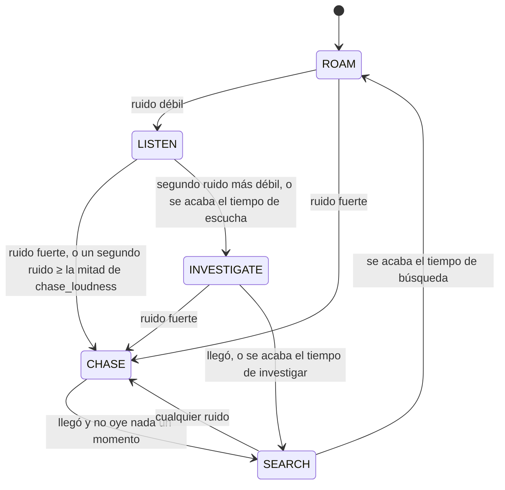

# El ruido y el Pale man

*[English version](../en/noise-and-pale-man.md) · [Todas las páginas](README.md)*

El bucle central del Nivel 2: todo lo que hace el jugador hace ruido; el Pale man es ciego
y solo sabe de dónde vinieron los ruidos.

## El sistema de ruido

`systems.NoiseSystem` (Kotlin puro, con tests) guarda cada ruido de los últimos
**5 segundos** (100 ticks) como un `NoiseEvent`:

| Campo | Significado |
|---|---|
| `source` | Qué lo hizo (`NoiseSource`: sneak, walk, sprint, jump, land, interact, equipment, breathing, drink) |
| `dimension`, `x`, `y`, `z` | Dónde |
| `radius` | Hasta dónde llega, en bloques |
| `tick` | Cuándo, en ticks del servidor |
| `playerId` | Quién lo hizo, o null para ruidos del mundo |

Quien escucha puede preguntar en cualquier momento qué se oye desde una posición
(`audibleAt(dimension, x, y, z, now, hearing, maxAgeTicks)`) o registrar un
`NoiseSystem.Listener` para reaccionar en cuanto se emite un ruido. Un ruido de radio 0 se
descarta.

### De dónde salen los ruidos

`platform.NoiseHooks` alimenta el sistema cada tick del servidor, para jugadores en
Supervivencia y Aventura en mundos con niveles (Creativo y Espectador son silenciosos, y
también un jugador escondido en una taquilla, `HidingHooks`):

| Ruido | Radio (por defecto) | Cómo se detecta |
|---|---|---|
| Paso, agachado | 2 | Uno por bloque andado en el suelo (`StepCounter`) |
| Paso, andando | 6 | Igual |
| Paso, esprintando | 14 | Igual. Moverse más de 2 bloques en un tick es un teletransporte, no un paso |
| Salto | 8 | La estadística de saltos de vanilla (`JumpCounter`); no hay evento de salto |
| Aterrizaje | 10 × caída/2, limitado a 5–20 | Las caídas de menos de 0,6 bloques (una losa) son silenciosas |
| Puertas, trampillas, vallas, palancas, botones, cofres, bloques musicales | 8 | Game events de vanilla ("vibraciones") capturados por `ServerWorldMixin` |
| Clic de la linterna, cambio de batería | 4 | Los informa `FlashlightHooks` |
| Jadeo agotado | 5 | Una vez por segundo |
| Beber | 4 | Una vez por trago completo |

Todos los radios están en la sección `noise` de la configuración
([Sistemas del jugador](player.md#el-archivo-de-configuración)).
`/everytunnel noise watch` muestra cada ruido tuyo en la barra de acción.

## El cerebro

`entities.PaleManBrain` son las decisiones del Pale man en Kotlin puro: sin tipos de
Minecraft, con tests completos (`PaleManBrainTest`). Cada tick recibe unos `Senses`
(tiempo, su posición, lo que oyó, el jugador más cercano y si su navegación está parada) y
devuelve una `Decision` (estado, objetivo, velocidad, a quién golpear, de quién fue el
ruido que lo alertó).

### Volumen

```
alcance = radio × hearing × wall_muffle ^ muros
volumen = 1 − distancia / alcance      (0 si distancia ≥ alcance)
```

1 en el origen, 0 en el borde de lo que puede oír. Con los valores por defecto
(`wall_muffle` 0,6), un muro reduce los 14 bloques de un sprint a 8,4 y dos muros a 5. Los
muros los cuenta `PaleManEntity.wallsBetween`: bloques opacos completos en la línea del
ruido a sus orejas, hasta 4.

### Estados



| Estado | Velocidad | Qué hace |
|---|---|---|
| `ROAM` | `roam_speed` 0.6 | Vaga dentro de su territorio |
| `LISTEN` | 0 | Se queda quieto `listen_seconds` (2), con la cabeza hacia el ruido, aguantando la respiración |
| `INVESTIGATE` | `investigate_speed` 0.8 | Anda hacia el último ruido; los ruidos nuevos mueven el objetivo. Se rinde tras `investigate_seconds` (20) |
| `CHASE` | `chase_speed` 1.6 | Corre hacia el último ruido; cada ruido nuevo mueve el objetivo y reinicia el tiempo |
| `SEARCH` | 0 | Se queda alerta `search_seconds` (4), aguantando la respiración |

"Fuerte" significa volumen ≥ `chase_loudness` (0,5): esprintar a unos 7 bloques sin muro
en medio. Un segundo ruido mientras escucha solo necesita la mitad para empezar una
persecución.

**Golpes:** golpea a un jugador a `attack_range` (2) o menos mientras persigue o busca, y a
cualquiera a `touch_range` (1) o menos en cualquier momento. Un golpe hace `attack_damage`
(20, un golpe mata) y tiene un tiempo de espera de `attack_cooldown_seconds` (1).

Cada ruido se usa una vez, el tick siguiente a producirse, para no perder ninguno hecho más
tarde en el mismo tick.

## La entidad

`platform.PaleManEntity` (`every_tunnel:pale_man`, una `HostileEntity` de GeckoLib, caja de
0,6 × 1,9 bloques) es el lado de Minecraft:

- **El jugador no puede matarlo**: solo `/kill` y el vacío lo quitan. Nunca desaparece.
- **Territorio:** si su punto de aparición nombra una `zone`, solo vaga dentro de ella e
  ignora todo ruido y jugador fuera. Se consulta en vivo, así que un `/reload` se aplica al
  momento.
- **Cada tick:** oye los ruidos de los últimos 2 ticks dentro de su territorio, calcula su
  volumen con los muros, busca al jugador más cercano (entre -2 y +3 bloques de su altura),
  ejecuta el cerebro y aplica la decisión: ir al objetivo, pararse y mirar, o golpear.
- **Navegación:** la navegación de mobs de vanilla. Su caja mide 1,9 bloques de alto, así
  que, como el jugador, necesita dos bloques libres de altura (el modelo erguido mide 2,75;
  ver *Su modelo*). Las rutas que se quedan cortas quedan en el `PlaytestLog` con los
  bloques que estorban.
- **Partida nueva:** nota que empezó una partida nueva (un contador en `PaleManSpawner`) y
  vuelve a su punto de aparición.
- **Sincronización:** el estado de su cerebro es un dato sincronizado de la entidad
  (`brainState`), que los clientes usan para animaciones y música.

### Aparición

`platform.PaleManSpawner`: la primera vez que un jugador entra en un nivel, cada punto con
la etiqueta `pale_man` recibe uno. El mundo lo recuerda (`every_tunnel_pale_men.dat`), así
que salir y volver o reabrir el mundo nunca añade un segundo, ni siquiera mientras está en
un chunk sin cargar. Si lo matan o lo quitan, su punto se olvida y lo vuelve a generar en la
siguiente entrada. El huevo de aparición (pestaña creativa Every Tunnel) es para pruebas.

### Su modelo

`tools/entity/pale_man.py` escribe la geometría, las animaciones (idle, listen, walk, run,
attack), la textura y una máscara de brillo para sus ojos lechosos.
`client.render.PaleManRenderer` lo dibuja; la animación sigue su modo (listen, chase = run,
roam = walk o idle).

**La postura encorvada:** donde hay un bloque en el espacio de su modelo erguido (encima de
la caja, donde está o un bloque más adelante), el cliente lo encorva en 8 ticks: la espalda
se inclina al menos 75°, los brazos siguen colgando, la cabeza se levanta y las rodillas se
doblan. Entonces mide unos 1,9 bloques, y se endereza otra vez al salir. La comprobación va
en el cliente, en `PaleManEntity.tick` (`stoopAt`); `client.render.PaleManModel` dobla los
huesos encima de la animación que suene. La postura son los `STOOP_*` de `pale_man.py`
(dibujada en su vista previa) y los mismos números en `PaleManModel`.

## Lo que oye el jugador

| Sonido | Dónde | Código |
|---|---|---|
| Sus pasos descalzos | Al ritmo de su animación; andando se oyen hasta 16 bloques, corriendo hasta 24 | `PaleManEntity.footsteps` |
| Su respiración | Una tras otra, a unos 8 bloques; la aguanta al escuchar o buscar | `PaleManEntity.breathe` |
| Golpe musical "te ha oído" | Cuando tu ruido empieza una persecución, como mucho una vez cada 30 s | `PaleManEntity.sting` |
| Tu latido | A 24 bloques o menos: de 60 ppm en el borde a 140 a su lado, nunca menos de 120 mientras persigue | `client.effects.HeartbeatEffect` |
| Acúfeno | Tras su golpe. `DeathHooks` mantiene vivo a un jugador que muere, así que también suena con el golpe mortal (pregunta abierta: dejarlo o no) | `PaleManEntity.hit` |
| Música | Según lo que hacen los Pale men cercanos (abajo) | `client.effects.TensionMusic` |

### Música de tensión

`TensionMusic` elige una capa según los Pale men alrededor del jugador. Gana la más fuerte:

| Capa | Evento de sonido | Cuándo |
|---|---|---|
| ninguna | | Ningún Pale man a 48 bloques o menos |
| Pulso | `music.tension.pulse` | Uno a 48 bloques o menos, vagando |
| Ascendente | `music.tension.rising` | Uno andando hacia un ruido |
| Cuerdas | `music.tension.strings` | Uno a 12 bloques o menos, sin ir hacia un ruido |
| Persecución | `music.chase` | Uno persiguiendo, a 64 bloques o menos |

Las capas más fuertes empiezan al momento; una más débil solo toma el relevo cuando lleva
un rato siendo la correcta, y las distancias tienen un margen, para que la música no
oscile. Las capas hacen fundido cruzado. La persecución se apaga despacio sin ninguna señal
de "te ha perdido", así que el jugador nunca está seguro.

## Ajuste

Todos sus números están en la sección `pale_man` de la configuración. El registro
`[playtest]` apunta cuándo te oye, por qué termina cada persecución y dónde se quedan cortas
las rutas (ver [Depuración](debugging.md)). `/everytunnel paleman` muestra los Pale men
cercanos, su estado y su objetivo.
